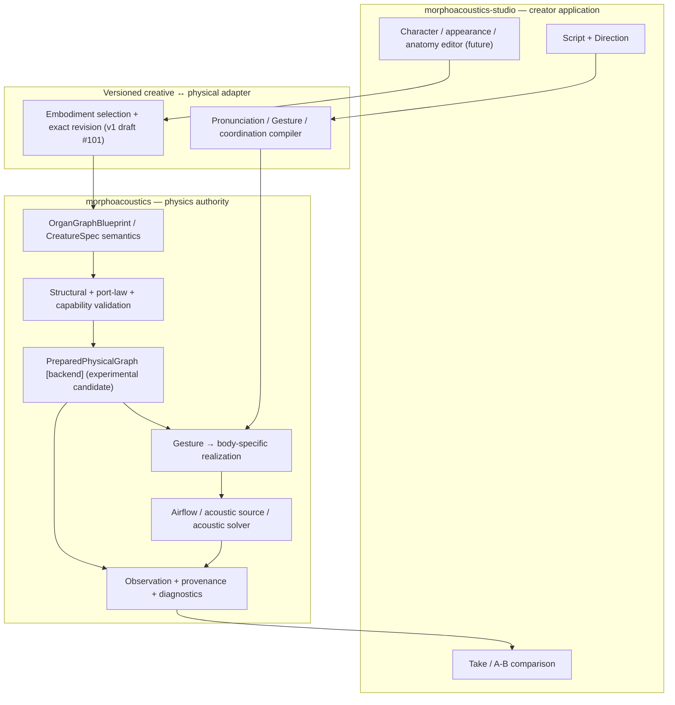
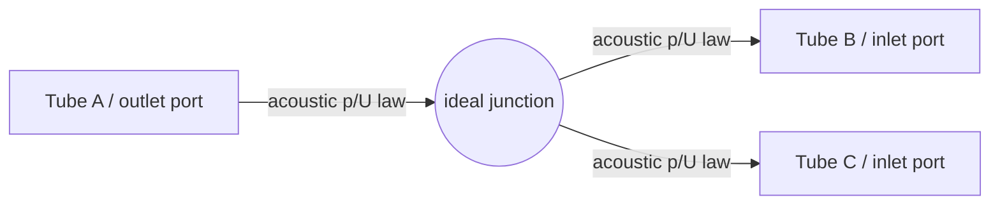
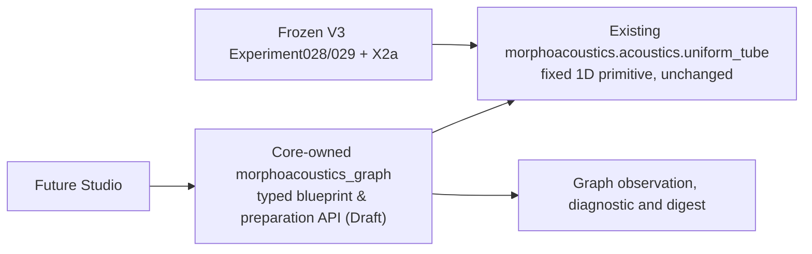

# Organ Graph Program — living architecture (proposal, 2026-10-14 JST)

**Current status (2026-10-16): OG-3 fixed2 passive Core API ADOPTED LIMITED**, [PR #104 merged](https://github.com/ryonakayama234/morphoacoustics/pull/104), [Gate C receipt](./og3-gate-c-limited-adoption.md). The original proposal/NOT ADOPTED status below is historical for broader organ graphs/Studio, which remain **unimplemented / NOT ADOPTED**. Keep Core physical authority, Studio creative workflow and research evidence separate.

**Status: LIVING ARCHITECTURE PROPOSAL. OG-2 RESEARCH ADOPTED LIMITED; public graph and creator UI NOT ADOPTED.** This document does not promote any experiment-local type or authorize public API/Studio changes. Related: [Core OG-2 #96](https://github.com/ryonakayama234/morphoacoustics/issues/96), [OG-2 audit #98](https://github.com/ryonakayama234/morphoacoustics/issues/98), [Studio Character Creator #12](https://github.com/ryonakayama234/morphoacoustics-studio/issues/12).

## Product boundary and causal diagram

The **Core decides physically valid dynamics**; the **Studio assembles and performs a body**. Creative identity, presentation mesh, physical body, performance intent, simulation state and observation are distinct.

**Current vs future:** Studio's current Performance Contract is v0 without creator-selected embodiment. `Body Binding v0` supports immutable prepared preset lookup, but creator selection requires a versioned contract revision (Core [CC-A1 #72](https://github.com/ryonakayama234/morphoacoustics/issues/72) → Studio [CC-A2 #14](https://github.com/ryonakayama234/morphoacoustics-studio/issues/14)). Current research OG-0/OG-1/OG-2 does *not* provide a public generic graph solver. A separate [v1 draft contract PR #101](https://github.com/ryonakayama234/morphoacoustics/pull/101) now prototypes exact body binding but does not make the Studio feature available.

## Node/edge diagram — one physical example

- **Node:** stable named organ/module, revision, geometry/material/actuator references and explicit **typed ports**. No requirement that all nodes are 3D.
- **Edge:** a connection between typed ports with orientation, unit semantics, boundary/coupling law ID, and version/provenance. A line in a visual editor does **not** guarantee a legal physical connection.
- **Physics:** for an ideal *zero-volume* junction of fixed rigid 1D small-signal acoustic ducts, perturbation pressure is continuous and signed **volume velocities** satisfy \(\sum U_\text{outward}=0\). Conjugate port power is \(pU\) (mean peak-phasor acoustic power: \(\tfrac12\operatorname{Re}(pU^*)\)). This is not a universal nonlinear-flow/FSI law.
- Later port families (not validated by OG-2) may include mechanical force/velocity, tissue contact, airflow/pressure, and actuation. Each family requires its *own* laws and cross-domain coupling; reject a connection that lacks a model.
- Keep **semantic topology**, **numerical prepared topology**, **physical state**, and **UI graph layout** separate. Never store computed pressure/flow as persistent anatomy.

## Delivery order — dependencies, not a single mega-feature

1. **WP-01 COMPLETE (2026-10-15 JST):** OG-0 [#93](https://github.com/ryonakayama234/morphoacoustics/issues/93), OG-1 [#94](https://github.com/ryonakayama234/morphoacoustics/issues/94) and OG-2 [#98 decision](https://github.com/ryonakayama234/morphoacoustics/issues/98#issuecomment-6182585021) each have distinct limited research decisions. [OG-2 PR #97](https://github.com/ryonakayama234/morphoacoustics/pull/97) was independently checked at integrated head `5711a3a` with [science CI](https://github.com/ryonakayama234/morphoacoustics/actions/runs/38667264999), [tests](https://github.com/ryonakayama234/morphoacoustics/actions/runs/38667265000), Wolfram and artifact hash, then **merged research-only** to main `2f325956a98b527f295821522ef844540e734cd8`. Post-merge push CI is tracked separately. Its public preparation API is **not** adopted.
2. **Next production-facing Gate:** if OG-2 research is accepted, propose a *minimal versioned graph preparation contract*, for fixed passive tubes and typed acoustic p/U connections only. Map to existing `CreatureSpec`, `PreparedMorphology[T]`, `BodyPresetRegistry` without breaking them. Separately review compatibility, deterministic canonical digest, failure types and no-hidden-fallback rules.
3. **First creator-visible Gate is independent:** Core [CC-A1 #72](https://github.com/ryonakayama234/morphoacoustics/issues/72) versioned exact body-preset request/result → Studio [CC-A2 #14](https://github.com/ryonakayama234/morphoacoustics-studio/issues/14) identical task across two validated body revisions and immutable Takes. Do not block Stage A on speculative general graphs.
4. **Following science slices:** validated passive branch→speech-relevant coupling, deformable articulator/material→geometry, source ↔ acoustic load, time-varying shared-state gestures, finally broader anatomy/Studio modular graph editor. Each new phenomenon requires its own falsification gate. Never label the existing fixed-1D research results as validated 3D physiology/FSI/phonation.

## Repository ownership

| Concern | Source of truth |
| --- | --- |
| Physical law / port interpretation / SI / capability / feasibility | Core |
| Graph preparation / backend numerical rest state / physical provenance | Core |
| Creative identity / script / direction / graph editing UX / undo | Studio |
| Versioned creative-to-physical exchange | Core contract, Studio version-pinned consumer |
| Scientific experiment and immutable evidence | Core experiment + scientific tests |
| Creator Take and comparison | Studio, carrying Core evidence references |

## Docs-as-tests workflow (required for each future capability change)

The **same PR** should update (1) architecture diagram + capability boundary, (2) candidate/adopted data model with backward compatibility and units, and (3) experiment ledger + raw reproducible evidence link. If a PR modifies a subsystem, these three views must be reviewed *together*; pure research PRs mark types as experiment-local.

- **Hypothesis first:** record H0/H1, supported fixture, frozen controls, predicted observables, explicit rejection and numerical floor **before implementation**. Amend errors transparently and never describe amended results as untouched preregistration.
- **Implement one falsifiable capability:** emit typed diagnostics `INVALID`, `UNSUPPORTED`, `INFEASIBLE` (only for supported task/body failure) and `NUMERICALLY_UNRESOLVED` when appropriate; keep execution `FAILED` separate.
- **Evaluate against distinct evidence paths:** independently derived Wolfram/analytic oracle, wrong-law mutation tests, local experiment tests, regression/typecheck, same exact-head multi-Python CI, artifact hashes and provenance. Disclose correlated AI reviews; they are not independent human signatures.
- **Decision:** `SUPPORTED_LIMITED` / `INCONCLUSIVE` / `REJECT` with precisely bounded scientific claim. Passing code/CI alone does not grant physical validity or public API adoption.
- **Archive:** link exact commit SHA, issue/PR, inputs, backend/version, preparation/graph digest, raw outputs, diagnostics, evaluation metrics, known limitations, amendment, decision, and any listening comparison. Existing historical Takes remain immutable.

See companion [data-model candidate](./organ-graph-data-candidate.md) and [experiment ledger](./organ-graph-experiment-ledger.md).

## Execution work orders

The concrete delegated implementation tasks, expected source/test paths, independent Wolfram criteria, acceptance gates and failure decisions are in [the four-work-package implementation plan](./organ-graph-execution-plan.md). Production graph API design is separately tracked as [Core OG-3 #100](https://github.com/ryonakayama234/morphoacoustics/issues/100) and may not start without OG-2 limited adoption. Creator-facing presets remain [Core CC-A1 #72](https://github.com/ryonakayama234/morphoacoustics/issues/72) → [Studio CC-A2 #14](https://github.com/ryonakayama234/morphoacoustics-studio/issues/14).

## 2026-10-15 OG-3 Gate A design handoff (proposal, not adopted)

[OG-3 RFC](./og3-public-preparation-rfc.md) supplies the two-rigid-tube preparation boundary. New production code belongs only in Core sibling `src/morphoacoustics_graph/`; the entire frozen `src/morphoacoustics/` and X2a manifest remain byte-identical. Audit sibling sources/imports separately and run original Experiment028/029 plus X2a smoke on exact Gate B HEAD. Extending X2a pins alone failed and is not an operative option. Gate A adds no public implementation; see RFC §5/§6/§10 and the protocol.

### OG-3 Gate A self-audit follow-up (2026-10-15, PROPOSED)

The [RFC §8](./og3-public-preparation-rfc.md) distinguishes unloaded transfer from terminal-loaded observables. Same tubes give identical T under matched vs pressure-release metadata. Its earlier pin-extension proposal is superseded by sibling isolation (§10); original source/pins stay unchanged. This is not independent adoption.

### Gate A reviewer amendment (2026-10-15, proposed)

GitHub review requirements are synchronized in RFC §9 and the protocol: ordered 1D `1<=N<=4096`, `0<=f<=4000` Hz, one `(2,2)` complex matrix per input including repeats; oversize or out-of-band valid grids `UNSUPPORTED` with no observation; malformed/type/nonfinite/negative `INVALID`; ±0 normalize to exact `0000000000000000` frequency hex before evaluation/hash. Only seven original frequencies carry frozen oracle evidence. The Wolfram source exports the dimensionless J_flux defect and explicit thresholds; Gate B remains separate from adoption.

### Gate A compatibility decision supported by first Gate B experiment (2026-10-15)

The audited downstream packaging is a **sibling Core package**, `morphoacoustics_graph`, not a new module inserted into frozen `morphoacoustics`. Trial #104 initially falsified the add-pins-in-frozen-tree approach with Exp028/029/X2a identity failures; corrected build reused frozen UniformTube and passed Exp028/029 original decisions + X2a fresh two Take gate and graph oracle on [run #38731394921](https://github.com/ryonakayama234/morphoacoustics/actions/runs/38731394921). This supersedes older draft architecture paths, preserves the five-layer causal model, and remains nonadopted until independent Gate A review and Gate C release approval.

### Geometry-domain correction and Gate B handoff (2026-10-15)

[RFC §11](./og3-public-preparation-rfc.md) restricts every 0..4000 Hz support claim to the two frozen **ordered** fixtures (first 0.08 m/3e-4 m², second 0.09 m/{3e-4,6e-4} m²; rho 1.21, c 343). All other valid geometry/medium is UNSUPPORTED before preparation; malformed input is INVALID. No arbitrary-geometry 4 kHz claim. Caller IDs/revision labels and collection reorder remain independent of physical path. Backend candidate v2 must refuse old candidate snapshots and forged prepared values rather than bypass capability. New code stays in the sibling package; old Core tree/oracles/pins stay unchanged. The [reconciliation work order](./og3-gate-b-reconciliation.md) records #104 blockers and acceptance before its next exact-head run. Design-only merge does not release or scientifically adopt Gate B.

## Historical Gate B trial receipt retained during design reconciliation

### OG-3 Gate B implementation candidate — 2026-10-15 (Draft; NOT ADOPTED)

[Gate B implementation notes](./og3-gate-b-implementation.md) add a proposed production-only import path through explicit new graph and preparation submodules, with **no change** to old Core initializers or uniform-tube law. Physical graph → validation → fixed2 backend preparation → unloaded complex observation; typed unsupported branch and error status; X2a manifest pins separately audited under #103. This does not change the overall Morphology→Gesture→physical state→acoustics→observation causal model, nor confer waveform or general graph capability. Actual CI and independent adoption remain gates.

#### Gate B corrective architecture: protected legacy kernel vs Core-owned sibling graph API

First Gate B CI caught Experiment028/029 full source identity invalidation despite pinning new package files in X2a's own manifest. Consequently the **new graph package must live outside frozen `src/morphoacoustics/`**, as `src/morphoacoustics_graph/`; all existing Core source paths/blobs and X2a manifest restored, but physical primitive still reused (Core authority not forked). This is an implementation amendment *after an explicitly failed pilot*, not a retrospectively clean first attempt. See [Gate B notes](./og3-gate-b-implementation.md) for actual CI failure details. Scientific acceptance not yet determined.

#### Gate B evidence orchestration (proposed)

A new [dedicated exact-head CI](../../.github/workflows/og3-gate-b.yml) owns new graph scientific evidence and regenerates V3b/V3c/X2a **actual** compatibility proof on edits to the sibling `morphoacoustics_graph` package (legacy path-filtered jobs would otherwise not fire). The associated [runner](../../checks/check_og3_gate_b.py) only emits *provisional machine results* with SHA/complex oracle/error and fresh output rejection; it never grants physics/human signoff. Architecture remains one authoritative Core physics domain with a protected experimental source subtree.

### Gate B reconciled implementation trial (2026-10-15; verification pending)

PR #104 incorporates merged Gate A main `6d38d8b`. Sibling backend v2 enforces RFC §11's two exact geometry/medium fixtures and reconstructs prepared binding before evaluation. Old v1 candidate snapshots are refused, never rebound. Observation validation preserves original scalar types, checks all malformed values before resource/frequency capability, returns UNSUPPORTED for valid 4097-point grids, preserves N matrices/order/duplicates and hashes exact positive-zero bytes. Supplementary per-point flux threshold <=1e-12, wrong defect 0.5 and separate reverse-order controls are explicit. Tests and evidence runner match the [reconciliation work order](./og3-gate-b-reconciliation.md); current exact-head CI/artifact receipt will be attached to [#104](https://github.com/ryonakayama234/morphoacoustics/pull/104). No legacy package, source pins or experiment/oracle changes; no release/adoption. Old trial receipts above are historical and do not attest this new implementation.

### Gate C correction after external P1 review (2026-10-16)

[PR #104](https://github.com/ryonakayama234/morphoacoustics/pull/104) received two P1 Codex findings: recursive traversal on legal long-but-unsupported graphs can raise RecursionError, and old OG-3 CI path filters miss changes to the inherited acoustic solver/oracles. Gate B switches to iterative cycle/connectivity validation and adds a 1205-node refusal regression; broad source/experiments/tests/checks/research-docs dependency triggers now enforce fresh exact-HEAD evidence. No physical law or frozen legacy source mutation; previous green run is historical only. See [implementation and audit corrections](./og3-gate-b-implementation.md).
