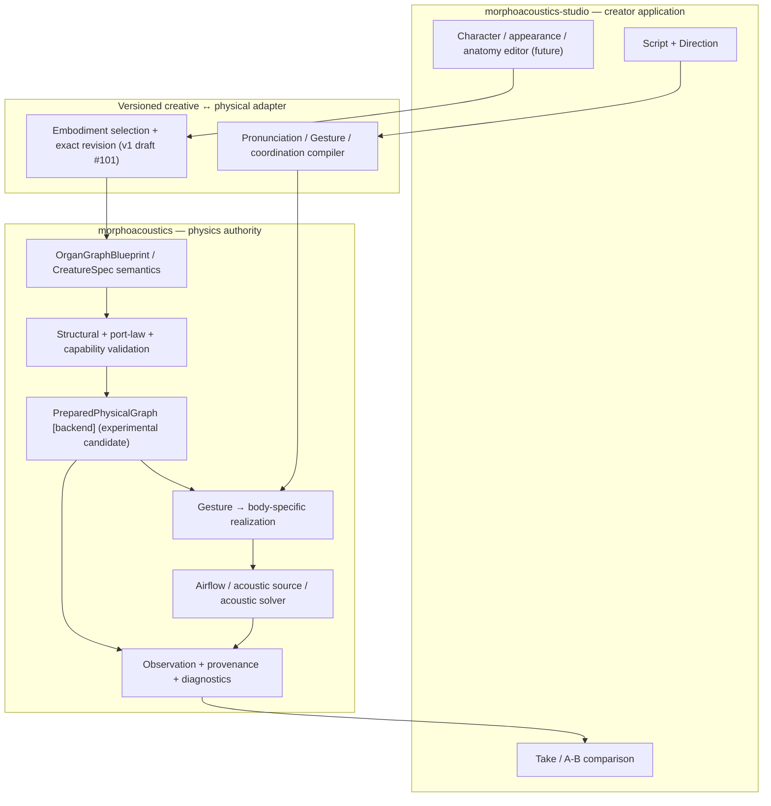
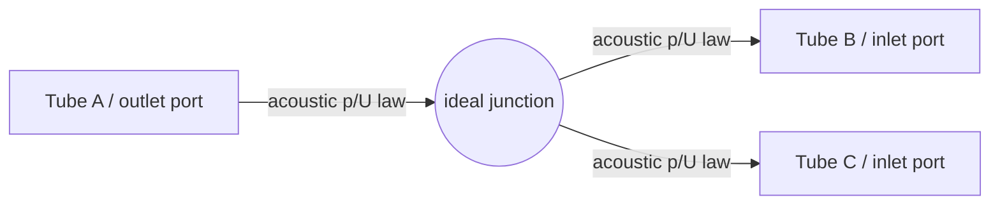
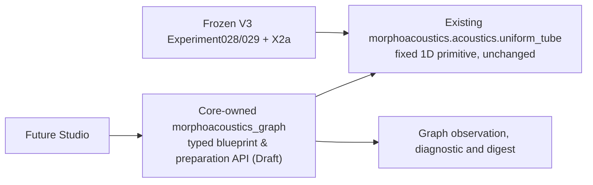
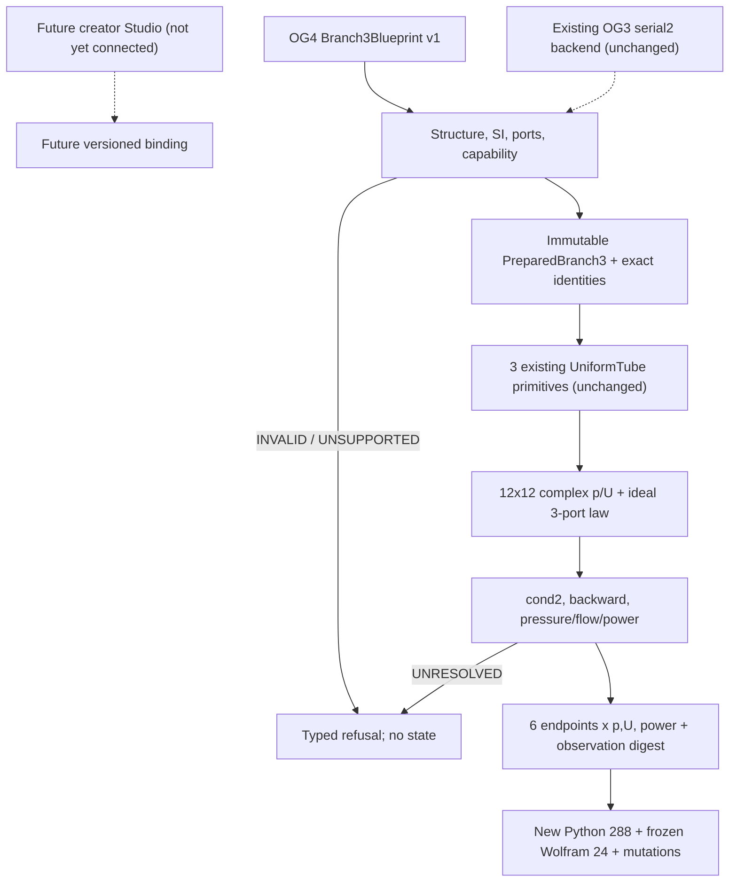
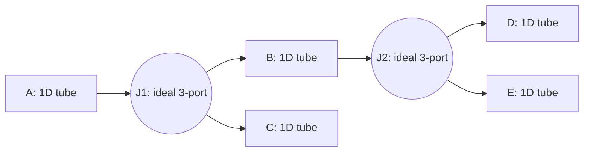

# Organ Graph Program — living architecture (proposal, 2026-10-14 JST)

> **OG-5 Gate B3 active, not adopted (2026-10-16):** [B3 experiment+architecture/data diagrams](./og5-gate-b3-trial.md) | [separate Wolfram oracle](./og5-gate-b3-independent-oracle.wl) | [Core-vs-reference scorer](../../checks/check_og5_gate_b3.py) | [Draft PR #112](https://github.com/ryonakayama234/morphoacoustics/pull/112). Eight case shards × 18, 144 full 10-port p/U records from independent global and recursive solvers archived. **Reference-only** check succeeded; Core exact-HEAD score/twin artifacts, eight mutants, regressions and separate Gate C still require completed receipts. Frozen Gate A/A1 remains controlling.

**Current status (2026-10-16): OG-3 fixed2 passive Core API ADOPTED LIMITED**, [PR #104 merged](https://github.com/ryonakayama234/morphoacoustics/pull/104), [Gate C receipt](./og3-gate-c-limited-adoption.md). The original proposal/NOT ADOPTED status below is historical for broader organ graphs/Studio, which remain **unimplemented / NOT ADOPTED**. Keep Core physical authority, Studio creative workflow and research evidence separate.

**Status: LIVING ARCHITECTURE PROPOSAL. OG-2 RESEARCH ADOPTED LIMITED; public graph and creator UI NOT ADOPTED.** This document does not promote any experiment-local type or authorize public API/Studio changes. Related: [Core OG-2 #96](https://github.com/ryonakayama234/morphoacoustics/issues/96), [OG-2 audit #98](https://github.com/ryonakayama234/morphoacoustics/issues/98), [Studio Character Creator #12](https://github.com/ryonakayama234/morphoacoustics-studio/issues/12).

## Product boundary and causal diagram

The **Core decides physically valid dynamics**; the **Studio assembles and performs a body**. Creative identity, presentation mesh, physical body, performance intent, simulation state and observation are distinct.

**Current vs future:** Studio's current Performance Contract is v0 without creator-selected embodiment. `Body Binding v0` supports immutable prepared preset lookup, but creator selection requires a versioned contract revision (Core [CC-A1 #72](https://github.com/ryonakayama234/morphoacoustics/issues/72) → Studio [CC-A2 #14](https://github.com/ryonakayama234/morphoacoustics-studio/issues/14)). Current research OG-0/OG-1/OG-2 does *not* provide a public generic graph solver. A separate [v1 draft contract PR #101](https://github.com/ryonakayama234/morphoacoustics/pull/101) now prototypes exact body binding but does not make the Studio feature available.

## Node/edge diagram — one physical example

- **Node:** stable named organ/module, revision, geometry/material/actuator references and explicit **typed ports**. No requirement that all nodes are 3D.
- **Edge:** a connection between typed ports with orientation, unit semantics, boundary/coupling law ID, and version/provenance. A line in a visual editor does **not** guarantee a legal physical connection.
- **Physics:** for an ideal *zero-volume* junction of fixed rigid 1D small-signal acoustic ducts, perturbation pressure is continuous and signed **volume velocities** satisfy \(\sum U_\text{outward}=0\). Conjugate port power is \(pU\) (mean peak-phasor acoustic power: \(\tfrac12\operatorname{Re}(pU^*)\)). This is not a universal nonlinear-flow/FSI law.
- Later port families (not validated by OG-2) may include mechanical force/velocity, tissue contact, airflow/pressure, and actuation. Each family requires its *own* laws and cross-domain coupling; reject a connection that lacks a model.
- Keep **semantic topology**, **numerical prepared topology**, **physical state**, and **UI graph layout** separate. Never store computed pressure/flow as persistent anatomy.

## Delivery order — dependencies, not a single mega-feature

1. **WP-01 COMPLETE (2026-10-15 JST):** OG-0 [#93](https://github.com/ryonakayama234/morphoacoustics/issues/93), OG-1 [#94](https://github.com/ryonakayama234/morphoacoustics/issues/94) and OG-2 [#98 decision](https://github.com/ryonakayama234/morphoacoustics/issues/98#issuecomment-6182585021) each have distinct limited research decisions. [OG-2 PR #97](https://github.com/ryonakayama234/morphoacoustics/pull/97) was independently checked at integrated head `5711a3a` with [science CI](https://github.com/ryonakayama234/morphoacoustics/actions/runs/38667264999), [tests](https://github.com/ryonakayama234/morphoacoustics/actions/runs/38667265000), Wolfram and artifact hash, then **merged research-only** to main `2f325956a98b527f295821522ef844540e734cd8`. Post-merge push CI is tracked separately. Its public preparation API is **not** adopted.
2. **Next production-facing Gate:** if OG-2 research is accepted, propose a *minimal versioned graph preparation contract*, for fixed passive tubes and typed acoustic p/U connections only. Map to existing `CreatureSpec`, `PreparedMorphology[T]`, `BodyPresetRegistry` without breaking them. Separately review compatibility, deterministic canonical digest, failure types and no-hidden-fallback rules.
3. **First creator-visible Gate is independent:** Core [CC-A1 #72](https://github.com/ryonakayama234/morphoacoustics/issues/72) versioned exact body-preset request/result → Studio [CC-A2 #14](https://github.com/ryonakayama234/morphoacoustics-studio/issues/14) identical task across two validated body revisions and immutable Takes. Do not block Stage A on speculative general graphs.
4. **Following science slices:** validated passive branch→speech-relevant coupling, deformable articulator/material→geometry, source ↔ acoustic load, time-varying shared-state gestures, finally broader anatomy/Studio modular graph editor. Each new phenomenon requires its own falsification gate. Never label the existing fixed-1D research results as validated 3D physiology/FSI/phonation.

## Repository ownership

| Concern | Source of truth |
| --- | --- |
| Physical law / port interpretation / SI / capability / feasibility | Core |
| Graph preparation / backend numerical rest state / physical provenance | Core |
| Creative identity / script / direction / graph editing UX / undo | Studio |
| Versioned creative-to-physical exchange | Core contract, Studio version-pinned consumer |
| Scientific experiment and immutable evidence | Core experiment + scientific tests |
| Creator Take and comparison | Studio, carrying Core evidence references |

## Docs-as-tests workflow (required for each future capability change)

The **same PR** should update (1) architecture diagram + capability boundary, (2) candidate/adopted data model with backward compatibility and units, and (3) experiment ledger + raw reproducible evidence link. If a PR modifies a subsystem, these three views must be reviewed *together*; pure research PRs mark types as experiment-local.

- **Hypothesis first:** record H0/H1, supported fixture, frozen controls, predicted observables, explicit rejection and numerical floor **before implementation**. Amend errors transparently and never describe amended results as untouched preregistration.
- **Implement one falsifiable capability:** emit typed diagnostics `INVALID`, `UNSUPPORTED`, `INFEASIBLE` (only for supported task/body failure) and `NUMERICALLY_UNRESOLVED` when appropriate; keep execution `FAILED` separate.
- **Evaluate against distinct evidence paths:** independently derived Wolfram/analytic oracle, wrong-law mutation tests, local experiment tests, regression/typecheck, same exact-head multi-Python CI, artifact hashes and provenance. Disclose correlated AI reviews; they are not independent human signatures.
- **Decision:** `SUPPORTED_LIMITED` / `INCONCLUSIVE` / `REJECT` with precisely bounded scientific claim. Passing code/CI alone does not grant physical validity or public API adoption.
- **Archive:** link exact commit SHA, issue/PR, inputs, backend/version, preparation/graph digest, raw outputs, diagnostics, evaluation metrics, known limitations, amendment, decision, and any listening comparison. Existing historical Takes remain immutable.

See companion [data-model candidate](./organ-graph-data-candidate.md) and [experiment ledger](./organ-graph-experiment-ledger.md).

## Execution work orders

The concrete delegated implementation tasks, expected source/test paths, independent Wolfram criteria, acceptance gates and failure decisions are in [the four-work-package implementation plan](./organ-graph-execution-plan.md). Production graph API design is separately tracked as [Core OG-3 #100](https://github.com/ryonakayama234/morphoacoustics/issues/100) and may not start without OG-2 limited adoption. Creator-facing presets remain [Core CC-A1 #72](https://github.com/ryonakayama234/morphoacoustics/issues/72) → [Studio CC-A2 #14](https://github.com/ryonakayama234/morphoacoustics-studio/issues/14).

## 2026-10-15 OG-3 Gate A design handoff (proposal, not adopted)

[OG-3 RFC](./og3-public-preparation-rfc.md) supplies the two-rigid-tube preparation boundary. New production code belongs only in Core sibling `src/morphoacoustics_graph/`; the entire frozen `src/morphoacoustics/` and X2a manifest remain byte-identical. Audit sibling sources/imports separately and run original Experiment028/029 plus X2a smoke on exact Gate B HEAD. Extending X2a pins alone failed and is not an operative option. Gate A adds no public implementation; see RFC §5/§6/§10 and the protocol.

### OG-3 Gate A self-audit follow-up (2026-10-15, PROPOSED)

The [RFC §8](./og3-public-preparation-rfc.md) distinguishes unloaded transfer from terminal-loaded observables. Same tubes give identical T under matched vs pressure-release metadata. Its earlier pin-extension proposal is superseded by sibling isolation (§10); original source/pins stay unchanged. This is not independent adoption.

### Gate A reviewer amendment (2026-10-15, proposed)

GitHub review requirements are synchronized in RFC §9 and the protocol: ordered 1D `1<=N<=4096`, `0<=f<=4000` Hz, one `(2,2)` complex matrix per input including repeats; oversize or out-of-band valid grids `UNSUPPORTED` with no observation; malformed/type/nonfinite/negative `INVALID`; ±0 normalize to exact `0000000000000000` frequency hex before evaluation/hash. Only seven original frequencies carry frozen oracle evidence. The Wolfram source exports the dimensionless J_flux defect and explicit thresholds; Gate B remains separate from adoption.

### Gate A compatibility decision supported by first Gate B experiment (2026-10-15)

The audited downstream packaging is a **sibling Core package**, `morphoacoustics_graph`, not a new module inserted into frozen `morphoacoustics`. Trial #104 initially falsified the add-pins-in-frozen-tree approach with Exp028/029/X2a identity failures; corrected build reused frozen UniformTube and passed Exp028/029 original decisions + X2a fresh two Take gate and graph oracle on [run #38731394921](https://github.com/ryonakayama234/morphoacoustics/actions/runs/38731394921). This supersedes older draft architecture paths, preserves the five-layer causal model, and remains nonadopted until independent Gate A review and Gate C release approval.

### Geometry-domain correction and Gate B handoff (2026-10-15)

[RFC §11](./og3-public-preparation-rfc.md) restricts every 0..4000 Hz support claim to the two frozen **ordered** fixtures (first 0.08 m/3e-4 m², second 0.09 m/{3e-4,6e-4} m²; rho 1.21, c 343). All other valid geometry/medium is UNSUPPORTED before preparation; malformed input is INVALID. No arbitrary-geometry 4 kHz claim. Caller IDs/revision labels and collection reorder remain independent of physical path. Backend candidate v2 must refuse old candidate snapshots and forged prepared values rather than bypass capability. New code stays in the sibling package; old Core tree/oracles/pins stay unchanged. The [reconciliation work order](./og3-gate-b-reconciliation.md) records #104 blockers and acceptance before its next exact-head run. Design-only merge does not release or scientifically adopt Gate B.

## Historical Gate B trial receipt retained during design reconciliation

### OG-3 Gate B implementation candidate — 2026-10-15 (Draft; NOT ADOPTED)

[Gate B implementation notes](./og3-gate-b-implementation.md) add a proposed production-only import path through explicit new graph and preparation submodules, with **no change** to old Core initializers or uniform-tube law. Physical graph → validation → fixed2 backend preparation → unloaded complex observation; typed unsupported branch and error status; X2a manifest pins separately audited under #103. This does not change the overall Morphology→Gesture→physical state→acoustics→observation causal model, nor confer waveform or general graph capability. Actual CI and independent adoption remain gates.

#### Gate B corrective architecture: protected legacy kernel vs Core-owned sibling graph API

First Gate B CI caught Experiment028/029 full source identity invalidation despite pinning new package files in X2a's own manifest. Consequently the **new graph package must live outside frozen `src/morphoacoustics/`**, as `src/morphoacoustics_graph/`; all existing Core source paths/blobs and X2a manifest restored, but physical primitive still reused (Core authority not forked). This is an implementation amendment *after an explicitly failed pilot*, not a retrospectively clean first attempt. See [Gate B notes](./og3-gate-b-implementation.md) for actual CI failure details. Scientific acceptance not yet determined.

#### Gate B evidence orchestration (proposed)

A new [dedicated exact-head CI](../../.github/workflows/og3-gate-b.yml) owns new graph scientific evidence and regenerates V3b/V3c/X2a **actual** compatibility proof on edits to the sibling `morphoacoustics_graph` package (legacy path-filtered jobs would otherwise not fire). The associated [runner](../../checks/check_og3_gate_b.py) only emits *provisional machine results* with SHA/complex oracle/error and fresh output rejection; it never grants physics/human signoff. Architecture remains one authoritative Core physics domain with a protected experimental source subtree.

### Gate B reconciled implementation trial (2026-10-15; verification pending)

PR #104 incorporates merged Gate A main `6d38d8b`. Sibling backend v2 enforces RFC §11's two exact geometry/medium fixtures and reconstructs prepared binding before evaluation. Old v1 candidate snapshots are refused, never rebound. Observation validation preserves original scalar types, checks all malformed values before resource/frequency capability, returns UNSUPPORTED for valid 4097-point grids, preserves N matrices/order/duplicates and hashes exact positive-zero bytes. Supplementary per-point flux threshold <=1e-12, wrong defect 0.5 and separate reverse-order controls are explicit. Tests and evidence runner match the [reconciliation work order](./og3-gate-b-reconciliation.md); current exact-head CI/artifact receipt will be attached to [#104](https://github.com/ryonakayama234/morphoacoustics/pull/104). No legacy package, source pins or experiment/oracle changes; no release/adoption. Old trial receipts above are historical and do not attest this new implementation.

### Gate C correction after external P1 review (2026-10-16)

[PR #104](https://github.com/ryonakayama234/morphoacoustics/pull/104) received two P1 Codex findings: recursive traversal on legal long-but-unsupported graphs can raise RecursionError, and old OG-3 CI path filters miss changes to the inherited acoustic solver/oracles. Gate B switches to iterative cycle/connectivity validation and adds a 1205-node refusal regression; broad source/experiments/tests/checks/research-docs dependency triggers now enforce fresh exact-HEAD evidence. No physical law or frozen legacy source mutation; previous green run is historical only. See [implementation and audit corrections](./og3-gate-b-implementation.md).

### OG-4 Gate A — proposed limited three-port Core branch (2026-10-16; NOT ADOPTED)

A new [issue #106](https://github.com/ryonakayama234/morphoacoustics/issues/106) opens **design-only** work to promote frozen limited-research OG-1/Experiment038's one ideal passive 3-port branching law into a Core-owned **versioned branch3 backend**. [System, p/U path + typed data diagrams](./og4-three-port-public-preparation-rfc.md) show A.out→J→(B.in,C.in); admissible energy law requires equal J pressure and **signed volume-flow conservation**, not equal particle velocities. Keep adopted OG-3 fixed2 backend and `src/morphoacoustics/` source freezes byte-identical, do not import Experiment038 code at runtime. Core is the sole physical-law authority; Studio remains a future creative layer, and a two-branch network is not a human mouth/nose model. Dedicated [pre-implementation protocol](./og4-gate-a-protocol.md) and Wolfram source/results are separate from inherited research oracle. No new 3-port API adopted or merged by this entry.

### OG-4 Gate A Amendment A1 — PR #107 review corrections (2026-10-16)

The [Amendment A1 API contract](./og4-branch3-api-v1.md) now fixes complete source/load/observation fields, an isolated branch3 module and explicit fixed2 refusal, independent prepared reconstruction, and the 1..256-point response path. The system/data diagrams in the RFC remain the architecture; no backend or Studio integration is added.

State remains **DESIGN PROPOSED / NOT ADOPTED / no branch3 runtime**. Existing physical sources, frozen experiments and adopted OG-3 behavior remain unchanged.

## OG-4 Gate B isolated branch3 candidate (2026-10-16; NOT ADOPTED)

Gate A specification was accepted at [PR #107](https://github.com/ryonakayama234/morphoacoustics/pull/107) reviewed design SHA `37d15e2dac2fbfcc72d43efe681c3042a521ac4a`. Gate B runs on a separate Draft PR; no Core/studio release is implied.

Core owns all conservation laws and physical port typing; Studio may eventually compose validated bodies, but OG-4 does not introduce a graph editor, phonation, mouth/nose model or WAV. Acoustic `p,U` ports are not illustration edges. Keep `src/morphoacoustics/**`, OG-3 schema/digests, experiment references/oracles, existing Studio contracts and X2a frozen source untouched. OG-4 branch3 resides solely in `src/morphoacoustics_graph/branch3.py`. The acceptance boundaries and numerical thresholds are normative in [og4-branch3-api-v1.md](./og4-branch3-api-v1.md) and [og4-gate-a-protocol.md](./og4-gate-a-protocol.md), not redefined here.

### Gate B implementation status (2026-10-16 JST)

Versioned branch3 implementation and its bounded physical data flow are now present in [Draft PR #108](https://github.com/ryonakayama234/morphoacoustics/pull/108). The physical change is limited to three existing UniformTube primitives and the independently typed 3-Port junction, not a new vocal instrument. **Gate B automated numerical acceptance has passed on prior exact HEAD a5d0b4c**, as recorded in the experiment ledger; external critical code review and Gate C adoption are outstanding. No change to existing OG-3/X2a public/experimental behavior is intended.

### OG-4 PR #108 critical review corrections — 2026-10-16 JST

The corrected PR #108 is reviewed against the accepted API in two critical scopes: physics/numerics and code/API/evidence. The [Gate C review](./og4-gate-c-review.md) records findings, repairs and the exact limited decision boundary. Validation now gathers independent structural failures before capability; every snapshot envelope is validated before unknown-version refusal. The existing diagram above remains the physical architecture. Corrections add no physical degree of freedom, change no numerical threshold and preserve the legacy source tree. Final readiness requires the corrected-HEAD receipt on PR #108; no merge is performed by this entry.

## OG-5 Gate A design started — 2026-10-16 JST (DRAFT, NOT ADOPTED)

[Issue #109](https://github.com/ryonakayama234/morphoacoustics/issues/109), [physics/falsification protocol](./og5-gate-a-protocol.md) and [API candidate](./og5-tree5-api-v1.md) extend adopted OG-3 two-tube [#104](https://github.com/ryonakayama234/morphoacoustics/pull/104) and adopted limited OG-4 three-tube [#108](https://github.com/ryonakayama234/morphoacoustics/pull/108) **only as a NEW proposal**. Diagram, explicitly scoped:

Typed organ endpoint ports are semantic nodes/port identities; each J is a **multiport physical constraint** connecting exactly three endpoints. The composed pressure/volume-flow state is solved together. Persistent Blueprint -> structural/capability validation -> immutable PreparedGraph -> harmonic coupled solve -> full-endpoint observation and immutable evidence. No inference from Creator canvas wires to physical validity. Wolfram scaled global 20x20 vs scalar impedance recursion produced 8 exploratory full-port records, not public backend support. Creator CC-A1→CC-A2 separate; no UI graph editor or WAV in OG5. Architecture, schema, execution and scientific evidence were changed together in this Gate A PR.

## OG-5 Gate A Amendment A1 — 2026-10-16 JST, candidate review pending

Addresses [PR #110 R1–R4](https://github.com/ryonakayama234/morphoacoustics/pull/110#pullrequestreview-5546195786). The [normative complete handoff](./og5-gate-a-amendment-a1.md) and [complete fixtures](./og5-contract-goldens.json) define Snapshot and N×10 Observation fields/identity bytes, stable refusal codes and escaped-pointer precedence, revisions scoped per organ, and lawful vs malformed topology. The split-only connected v1 language admits trees; cycles are INVALID and a complete 7-organ/3-junction tree is the UNSUPPORTED control.

State/digest flow is Blueprint -> complete structural validation -> fixed capability -> recomputed immutable Snapshot -> rank-safe coupled solve -> atomic full Observation. Snapshot digests bind normalized anatomy/source/load; Observation digests bind exact ordered numeric outputs/diagnostics. Neither includes UI layout, timestamps or Git/CI metadata. Full SVD retains zeros; condition2<=1e4 and scaled equation residual<=1e-12 precede success. All 144 positive samples must succeed and pass independent full-state comparators; no refusal reduces the denominator. Child-slot permutation has a distinct bounded mapping identity but identical ideal junction physics; actual output identity swaps and signed/particle-velocity row mutants test numerical mistakes.

Standalone Python regeneration and an independent JavaScript encoder confirm full golden bytes/hashes; they do not implement Core validation. [A1 Wolfram receipt](./og5-wolfram-gate-a-a1-result.json) contains 144-case supplementary design maxima, eight mutant margins and numerical rank/condition/nonfinite refusals. Original 8-case exploration is preserved. No new production module, Studio support, new Core run, scientific adoption or merge is implied. Exact amended HEAD review must precede a separate Gate B Draft.

## OG-5 Gate A specification accepted — 2026-10-16 JST

Decision **ACCEPTED_FOR_GATE_B / SPECIFICATION_FROZEN**. [Acceptance and scope](./og5-gate-a-acceptance.md) supersedes the earlier pending status. Technical specification reviewed at `b7fb56c66236b0cbdb532fec8c75d46709c95bd0`; A1's schemas/bytes/refusal rules, fixed five-organ/two-junction fixture, 144/144 positive requirements and explicit numerical controls are frozen for a separate implementation trial. This accepts the design handoff only. Runtime tree5 support and scientific implementation adoption require Gate B execution and Gate C decision; #109 remains open. Original candidate receipts retain their historical status and hashes.

## OG-5 Gate B1 internal solver Draft — 2026-10-16 (NOT ADOPTED)

The frozen [Gate A acceptance](./og5-gate-a-acceptance.md) authorized an isolated physical solver candidate, described in [B1 trial report](./og5-gate-b1-trial.md). Five fixed passive tube nodes are coupled through two three-port physical junction laws in a scaled global 20-state system. This is **internal Core numerics only**; it does not expose a new public or Studio graph/voice capability. Live architecture and future Blueprint-to-Prepared-to-Observation flow retain the Gate A A1 contract, separate from unchanged OG3/OG4.

**OG-5 B1 numerical PR CI correction:** First trial HEAD's physics pytest succeeded but new NumPy solve type annotation failed mypy. Static typing repair changes no acoustic equations; see [dated trial report](./og5-gate-b1-trial.md). No new Core public capability claimed.

## Gate B2 contract checkpoint (2026-10-16; DRAFT)

OG-5 Gate B2 introduces a separate strictly typed frozen v1 Blueprint→PreparedTree5→Observation adapter around the unchanged B1 global acoustic equations; the two 3-port junctions remain physical laws rather than graphic wires. [B2 design/implementation record](./og5-gate-b2-contract.md). No Studio/FSI or voice claim.

**OG-5 B2 correction:** Original test harness misread frozen response fixture envelope; a duplicate identity generated ambiguous secondary binding error, now prioritized as primary duplicate before references. A1 expected semantics unchanged; [red-run receipt](./og5-gate-b2-contract.md).

**B2 numerical architecture evidence:** Six registered A1 solver-seam mutants are now exercised against the actual 20×20 matrix and NumPy linear-solve operations, with exact typed refusal and late-sample atomicity. Physical dynamics and junction equations remain unchanged. [Trial record](./og5-gate-b2-contract.md).
