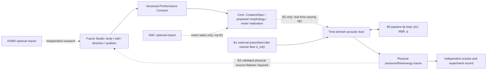

# SYSTEM — causal and creative architecture

B1 experiment-local, fixed-area linear acoustic finite-volume/port-Hamiltonian approximation. No after-the-fact WAV equalization. No GUI controls for abstract loudness or 'brightness'. Only anatomy-derived SI acoustic ports.

N uniform cells: cell-centered acoustic pressure p_i (Pa), internal face volume flows U_j (m^3/s), fixed inlet U_in prescribed externally, and *for B0 termination only* inertial flow q (m^3/s). Cell compliance C = A Δx/(rho c^2) (m^3/Pa); face inertance Lf = rho Δx/A (Pa s^2/m^3). For i=0..N-1:
 C d p_i/dt = U_left - U_right;
 Lf d U_j/dt = p_j - p_(j+1).
At the right terminal, choose closed U_right=0, matched U_right=p_last/Zc, or exactly the B0 circuit U_right=q+p_last/R, M dq/dt=p_last. Zc=rho*c/A, and all R,M are provided by unmodified B0 parameters_from_area().

Use *implicit midpoint* over each exact h=1/fs, with U_in evaluated at the midpoint. This yields the exact **discrete** identity (for fixed A and linear positive physical parameters):
 E_tube(next)-E_tube(now) + E_B0(next)-E_B0(now) = h*p_0_mid*U_in_mid - h*p_last_mid^2/R (B0),
or -h*p_last_mid^2/Zc (matched), or no terminal dissipation (closed).
E_tube = 0.5 Σ_i C*p_i^2 + 0.5 Σ_j Lf*U_j^2; E_B0=0.5*M*q^2.
No energy should appear from a passive element. Negative signed inlet work is allowed and measured. The B0 one-port outgoing/incoming pressure waves are *derived* at every midpoint: a=(p_last+Zc U_right)/2, b=(p_last-Zc U_right)/2. Compare the B0 one-port's original causal step(a) at identical q_previous against the whole-system boundary update, not against a post-EQ reflection.

At 48k, genuine M0 section width 0.010 m has travel time 1.3994169096 samples; solver retains exact physical Δx rather than rounding delays. Implicit midpoint remains energy passive even when Courant c*h/Δx exceeds one, but that does not imply good phase accuracy: record Courant and measured grid/clock dispersion. B1 only uses a uniform 0.16 m tube; it does not claim authentic sectionwise M0 area/length.

Future physical connection: B2 replaces the uniform calibration with actual fixed M0 section areas and junctions; B3 adds source load and independently justified observation. VF-1 finally couples glottal tissue/airflow and source-filter feedback. Voice Atlas in Studio separately evaluates distinction, voice-likeness and artifacts: numeric wave-propagation pass does NOT prove human voice quality.