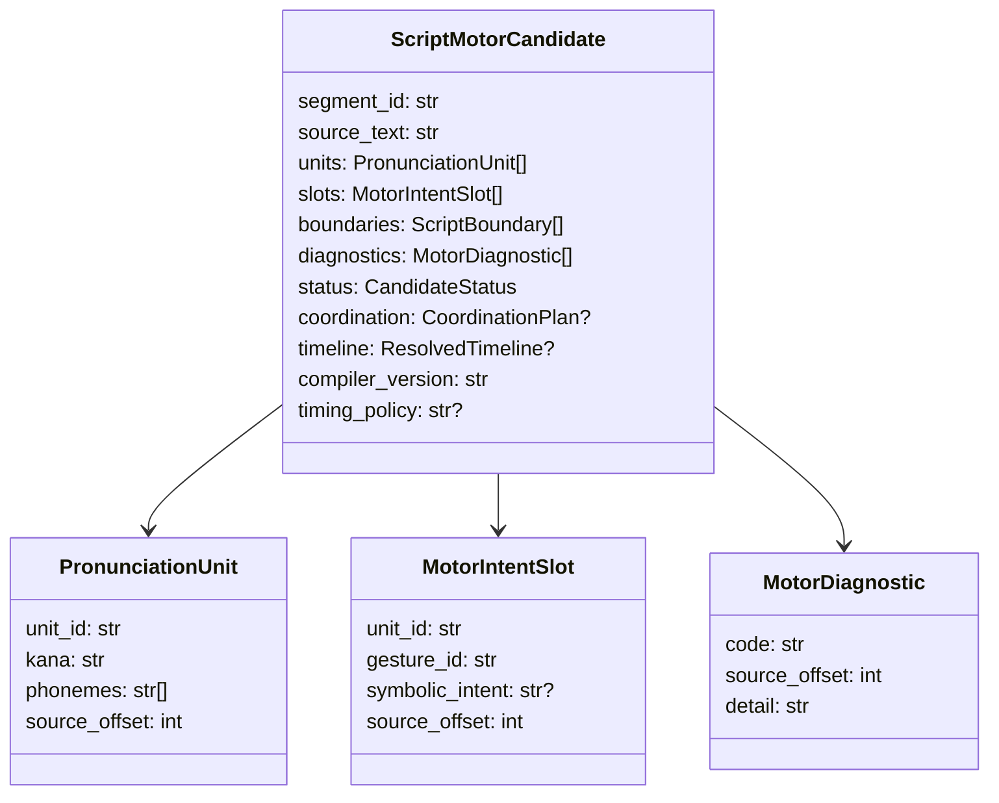

# SMC-1 — DATA model, source mapping and refusal meanings

Candidate version `smc1-kana-motor-candidate/v0`, timing policy `experiment011-derived-synthetic-overlap/v0`.

All records are Python frozen/slot dataclasses; no claim of an adopted JSON Schema. `source_offset` counts Unicode Python code points in `source_text` (not UTF-8 bytes or grapheme clusters). `segment_id` is a stable creative reference provided by caller; derived IDs follow `{segment_id}.unitN` and `{unit_id}.motor`. Version, original text and source offsets must be retained in future serialized results; edits create new candidates, not mutate an immutable Take.

### Explicit tiny orthographic lexicon

| Kana | Provisional phoneme symbols | Motor-intent candidate |
|---|---|---|
| あ | a | A_LIKE_INTENT |
| い | i | I_LIKE_INTENT |
| お | o | unresolved |
| は | h,a | unresolved |
| よ | j,o | unresolved |
| う | u | unresolved |
| り | ɾ,i | unresolved |
| が | g,a | unresolved |
| と | t,o | unresolved |

**Not a Japanese dictionary**. `よう` and `とう` generate CONTEXTUAL_PHONOLOGY_UNRESOLVED; orthographic symbols are not certified surface pronunciations or long-vowel decisions. Kanji, katakana, whitespace and all outside lexicon are explicit `UNSUPPORTED_CHARACTER`; neither autocorrection nor silent substitutions. Punctuation `、。` is stored in `boundaries` but pause/prosody remains `BOUNDARY_TIMING_UNRESOLVED`.

### Status and output policy
- `COORDINATION_RESEARCH_READY`: all recognized units are A/I-like symbolic candidates with no unresolved diagnostics; a synthetic CoordinationPlan and start anchor are available for **research only**.
- `PARTIAL_MOTOR_PLAN`: parsed units and all unresolved motor/context/boundary diagnostics returned; `coordination=None`, `timeline=None`.
- `INVALID_INPUT`: empty segment or unknown character(s), with any recognized partial data preserved for analysis; no executable or coordination plan.
- No `GestureScore` field exists in SMC-1; converting symbolic intents to actual physical gestures is an independent, unadopted adapter obligation.
- `UNSUPPORTED` versus `INFEASIBLE` are only meaningful downstream after a backend capability and body-specific feasibility check. SMC-1 must not fabricate those outcomes.

### Timing representation
For a complete A/I-only symbolic candidate, first onset = segment.start + 0.08 s; each symbolic window = 0.18 s; next onset = previous offset - 0.06 s. Relations are emitted as `CoordinationPlan(TimingConstraint...)` and one `ResolvedTimeline` start anchor. These numbers reproduce *two distinct experimental CONSTRICT events* from Experiment011; **not normative Japanese timing**. Never treat final rendered waveform concatenation as a Gesture plan.
