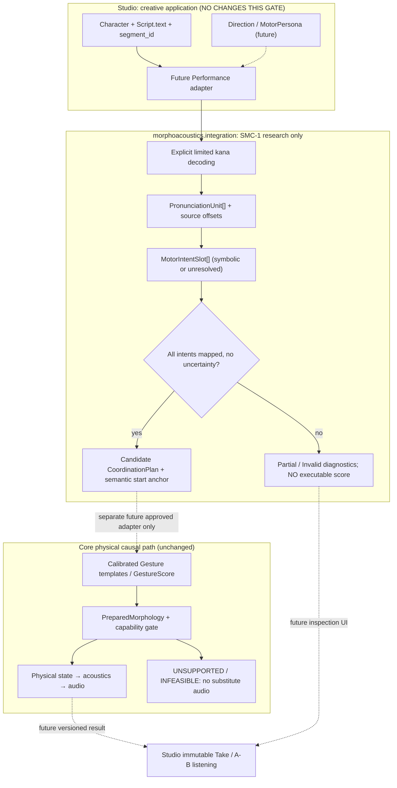

# SMC-1 — SYSTEM architecture and creator consequences

**Hypothesis:** Script intent can be represented independently of a body's current motor/solver capability. A string must never be quietly converted into plausible sound through another path.

## Current vs future
Current SMC-1 owns *only* pure kana analysis, symbolic A/I-like intents, and a demonstration event-relation plan. It does **not** create `GestureScore`, access body presets or call waveform generation. Import it explicitly from `morphoacoustics.integration.speech_motor_candidate`; it is deliberately absent from `integration.__all__`.

Existing `shared_timeline.compile_shared_timeline` accepts **actual** GestureTemplate instances and a CoordinationPlan. Tests use a **synthetic two-CONSTRICT adapter** solely to compare event arithmetic to Experiment011. This test adapter is not a phonetic mapping for 「あい」; never expose the resulting synthetic score to Studio as speech.

## Creator-facing semantics
The future Studio experience can show an intact typed Script plus unresolved movements. An existing adopted physical adapter may generate a real new Take only when every requested task is validated and feasible. Unimplemented `/h/`, `/g/`, `/ɾ/`, `/t/` and the uncalibrated mapping of whole syllables cannot become audible just because a phoneme string exists.

**Organ graph separation:** no organ nodes, ports, edges, materials, acoustic topology or physical numerical state are modified. Body-specific realization and capabilities remain Core responsibility; Studio owns creative editing, Takes and comparisons.

## Next gates
Gate A independent prospective protocol; Gate B bounded planning semantics and test evidence; Gate C separate physical adapter and real audio; Gate D independent scoped adoption; Gate E Studio product journey. Do not broaden Performance Contract v0/v1 silently.
