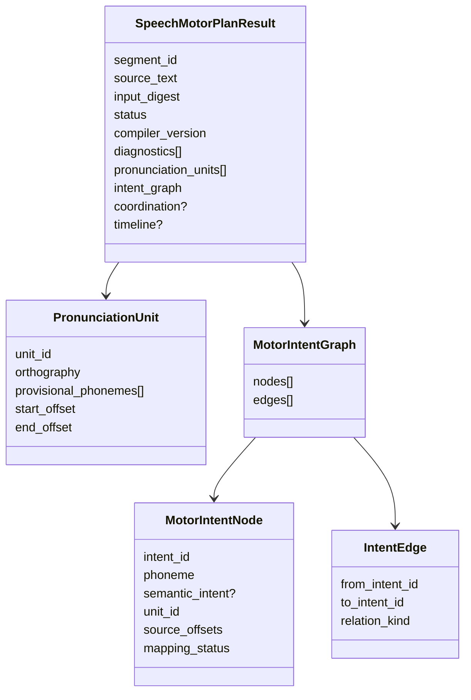

# SMC-2 DATA — provisional exact representation

**Schema candidate:** `smc2-motor-plan/v0` (research-only Python frozen dataclasses; deterministic canonical JSON output, **not** an adopted Performance Contract or Core domain schema).

## Representation invariants
- `source_text` is byte-for-byte unchanged as Unicode text. Offsets are Python code-point half-open spans `[start,end)` (not UTF-8 byte offsets and not grapheme clusters). No silent NFC normalization, kanji transcription or dropped characters. Caller supplies a nonblank `segment_id`.
- IDs from stable segment ID + ordinal unit and phoneme index. They identify a candidate revision; edits to a segment can change derived IDs. `input_digest` from canonical UTF-8 JSON using sorted keys and tight separators, including compiler version and timing policy, source, pace and segment ID.
- Graph nodes are **phoneme-level proposals**, not one node per text glyph and not proven articulator gestures. Multi-phoneme kana such as `は` make separate unresolved and /a/-like nodes. `あ`/`い` are symbolic only. Orthographic `よう`/`とう` are explicitly contextual-phonology unresolved.
- Edge kind `PRECEDES` represents lexical/plan ordering only, **not** a fixed physical actuation timeline, which is in CoordinationPlan. This keeps body/motor inventory distinct from word segmentation.
- Explicit tiny kana pronunciation inventory initially: あ(a), い(i), お(o), は(h,a), よ(j,o), う(u), り(ɾ,i), が(g,a), と(t,o). Only phonemes a/i have symbolic intent labels `A_LIKE_INTENT`/`I_LIKE_INTENT`. This does not assert true surface pronunciation nor bodily support.
- Punctuation `、。` is retained as `ScriptBoundary` with `BOUNDARY_TIMING_UNRESOLVED`; unknown characters (including kanji, katakana, whitespace in v0) are `UNSUPPORTED_CHARACTER`; empty input `EMPTY_SCRIPT`. No fallback.
- `SYMBOLIC_READY` requires at least one unit and zero unresolved diagnostics. `PARTIAL_MOTOR_PLAN` preserves known nodes but emits no executable / coordinated schedule. `INVALID_INPUT` includes empty or unknown chars. No `GestureScore`, body, section, area, F0, pressure, audio, or solver state field may exist.

## Synthetic timing policy (NOT Japanese normative timing)
- Start anchor `{segment_id}.start=0`; first ONSET = anchor+0.08/pace seconds.
- Every mapped motor intent window = 0.18/pace seconds. Next ONSET = previous OFFSET-0.06/pace seconds (overlap of 0.06/pace seconds). `pace` is dimensionless finite in [0.5,2]. For first Gate no freeform Direction-to-pressure or F0 mapping.
- Generate constraints as existing `morphoacoustics.integration.shared_timeline.CoordinationPlan` over provisional node IDs only; don't invoke runtime `compile_shared_timeline`, because it materializes GestureScore. Synthetic conversion is permitted **only inside designated tests** and must not claim physical/phonetic identity.
- Return raw graph and diagnostics even on `PARTIAL`, but `coordination=None` and `timeline=None` if anything unresolved. Contradictory external constraints are tested with the inherited solver only, not silently solved by the planner.

## Provenance and status
`compiler_version=smc2-motor-plan/v0`, `timing_policy=experiment011-derived-synthetic-overlap/v0`, explicit `representation_kind=SYMBOLIC_RESEARCH_ONLY`; caller-specific timestamp intentionally absent from deterministic result. `job_status` and `realization_outcome` belong to downstream request execution, not to the planner's symbolic status.

## Gate B serialization and IDs
Research result uses frozen dataclasses; deterministic `dataclasses.asdict` sorted JSON with UTF-8 and no nonfinite numbers. `input_digest` SHA-256 includes version, policy, segment ID, exact source text and numeric pace. Node ID `{segment_id}.unitN.phonemeM.motor`. A `PRECEDES` edge cannot cross an unsupported character or punctuation, although a multi-phoneme kana remains ordered. No coordination for partial/invalid plans.
