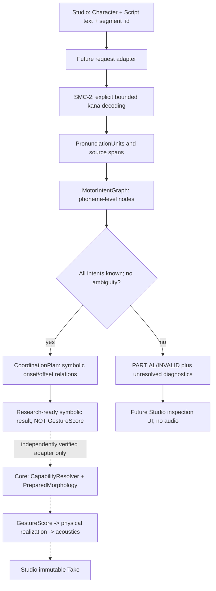

# SMC-2 SYSTEM — body-independent motor intent planning

## Creator objective and separation
Creators write any Script.text, including unsupported text. Research planner preserves source and offers proposals / exact unresolved diagnostics, never a fake audible Take. Future Core realizer binds a validated task/gesture mapping to a versioned PreparedMorphology; Studio then records immutable physically generated Takes. This work does **not** implement that future link.

## Strict ownership
- Core `src/morphoacoustics/` physical and existing `integration.shared_timeline`: **unchanged**.
- Research `src/smc2_research/`: provisional immutable plans, no public re-export, no physical solver imports except reuse of `shared_timeline` symbolic constraint types.
- Existing `compile_shared_timeline` emits physical GestureScore and therefore is NOT invoked by runtime SMC-2. A synthetic test fixture may explicitly use it to verify *event arithmetic only* (Exp011), never as evidence of Japanese phonetic mapping.
- Organ graph node/edge (physical acoustics) is NOT the same graph as motor-intent node/time-edge. Intent expresses desired capabilities, not body-specific organ IDs, locations, tissue properties, or numerical state.
- Studio remains untouched in initial Gate B. Its adopted CC-A2 body preset and immutable Take contract are an integration destination, not part of this research result.

## Claim limits
No Japanese general phonology, no physical consonants, no morphology-conditioned actuation, no self-oscillating source, no real-time speech, no neural fallback, no recorded speech/audio input, no wav output, no naturalness claim. Recognition is not execution, and `SYMBOLIC_READY` is explicitly not `FEASIBLE`.
