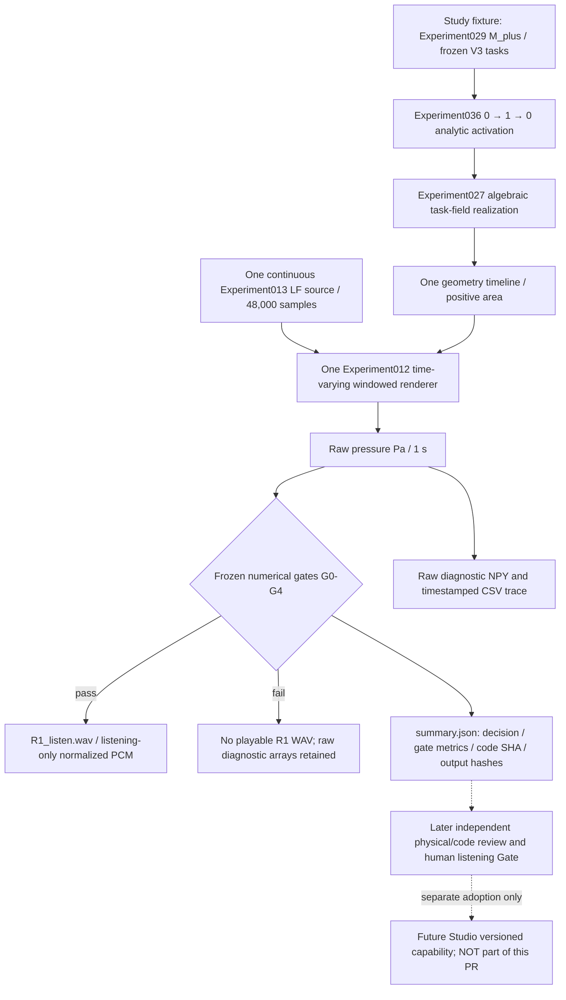

# V4-A 2026-10-19 implementation, numerical receipt, and review handoff

**Status: DRAFT / NUMERIC_GATE_PASS_CANDIDATE / NOT SCIENTIFICALLY ADOPTED / NOT IN CORE MAIN / NOT IN STUDIO.**  
Tracking: [Core #74](https://github.com/ryonakayama234/morphoacoustics/issues/74), preregistration [Draft PR #77](https://github.com/ryonakayama234/morphoacoustics/pull/77), stacked experiment [Draft PR #88](https://github.com/ryonakayama234/morphoacoustics/pull/88).

## Creator-relevant goal and present boundary

The experimental fixture renders one uninterrupted **1.0 s /a/-like → /i/-like → /a/-like** movement using the frozen Experiment027 three-task field on Experiment029 M_plus. The same LF Rd=1.0 / 100 Hz source phase, one time-indexed geometry and one Experiment012 windowed renderer produce freshly computed pressure and a provisional listening WAV. The already adopted Studio CC-A2 two-body 0.5 s A/B audition remains unchanged. No 1.0 s Studio backend/Take authoring exists yet.

**Do not infer:** tissue inertia, finite-force articulation, full acoustic PDE state, physical source/tract feedback, gesture competition/coarticulation, intelligible Japanese, or general anatomy authoring. Distinct conditioned output / sound quality / user preference are independent propositions.

## System and data

Evidence `summary.json` is produced after calculated arrays and (only when numerical gates pass) listening WAV. Its `adoption_status=NOT_ADOPTED_REVIEW_AND_HUMAN_GATE_PENDING` is intentionally distinct from the historical machine decision `SUPPORT_ONE_RUN_ROUNDTRIP`, which currently means **frozen engineering gates passed, not independent scientific adoption**. `preview_available=false` and `wav_sha256=null` on numeric failure. The code refuses any pre-existing output path, including an empty directory and a directory symlink. An interrupted calculation can leave an incomplete new research directory: absence of complete `summary.json` means no result acceptance. It is not an atomic production Take store.

`executed_sources` records Git HEAD and SHA-256 of the actual Python/JSON files used by the narrow research chain. In addition, the historical frozen B0 acoustic-pressure quantized hash and current R1 raw-pressure and WAV byte hashes are distinct fields. Playback WAV gain is **not** calibrated sound pressure; use the raw Pa NPY for physics.

## Immutable prior evidence versus new execution

- First experiment implementation and **exploratory** machine pass: [PR #88 at 9d8695c](https://github.com/ryonakayama234/morphoacoustics/commit/9d8695ccba6a3f83345b0bf2abb45811e595035e), [V4-A 2026-10-12 CI run 38186537225](https://github.com/ryonakayama234/morphoacoustics/actions/runs/38186537225). PR #77's preregistration draft was **not independently approved before execution**. Thus even if its numerical thresholds were frozen in the documentation, retrospective confirmation is not a prospective independent confirmatory scientific trial. Preserve that distinction permanently.
- Hardening commits: [76aeea0](https://github.com/ryonakayama234/morphoacoustics/commit/76aeea037f750be56bb080dba9e6b2574ce25478) and [0c475d4](https://github.com/ryonakayama234/morphoacoustics/commit/0c475d4896f25152506a572596cf96c017945086). New negative tests guard failed-gate playable WAV, reused and symlinked outputs; source SHA receipt enables per-run code identity.
- New machine check on exact **0c475d4896f25152506a572596cf96c017945086**:
  - [Actual Experiment036 physics and repeat, CI 39272465612](https://github.com/ryonakayama234/morphoacoustics/actions/runs/39272465612) — SUCCESS, all nine `checks` true, distinct fresh 1 s executions identical in the same pinned environment.
  - [Generic tests, CI 39272465379](https://github.com/ryonakayama234/morphoacoustics/actions/runs/39272465379) — SUCCESS.
  - [Raw provisional audit artifact 12195623269](https://github.com/ryonakayama234/morphoacoustics/actions/runs/39272465612/artifacts/12195623269): includes source, raw pressure, 1-second listening WAV, diagnostic concat and trace. Artifacts have finite retention; this document preserves URLs and digests but cannot substitute for permanent archival of raw data if later required.
  - Numerical metrics: midpoint target error `0.18682836448690684 < 0.20`, max 10 ms trajectory step `0.06621354015393985 < 0.20`, fine-hop pressure normalized RMS difference `0.008624933237146724 < 0.20`, cycle jump `9.731644676297197e-8 < 0.01`, boundary ratios at 0.15/0.35/0.65/0.85 s `1.0013976161, 0.5642579202, 0.5637924758, 0.9988691944` (each < 3).
  - Frozen B0 quantized pressure SHA-256: `dc14c78bcc6d4a19c11fe2a01ba84b1394802b66626f4dfa27cc582c741e714e`.
  - R1 f64 raw-pressure SHA-256: `d7a33bf723a7d97fbf3d23e4550ce1c8bcfa7cbda61fe8216af7f0ce7048a122`.
  - R1 WAV SHA-256: `2ef790dbd51eb84d516c493a14998edb1193b56abe190e03aacb437faf8b9d0d`.
  - 196 accepted transfer calls, 391 reference, 102 baseline; synthetic diagnostic C0 has two independent 102-call renders **and must not be published as accepted physics**.
- Separate Wolfram Language exact calculation on 2026-10-19 reverified `s(0)=0, s(1/2)=1/2, s(1)=1`; rise duration 1/5 s gives maximum absolute velocity `15/2 s^-1`, second derivative `[-150,150] s^-2`, boundary rise slopes both zero and one-sided accelerations +150 / -150. This only checks command algebra, not acoustic or biological physics. Wolfram evaluator returned `{0,1/2,1,15/2,150,-150,0,0,150,-150}`.

## Outstanding gates and next owner actions

1. **Reconcile base history before adoption**: PR #77 is >100 commits behind Core main as of the 2026-10-19 inspection, including the now adopted CC-A1/A2 and X2a integrations. Do not auto-merge or force-push the reviewed/stacked evidence. First review the exact main-compatible diff and verify existing unrelated production contracts/hashes.
2. **Independent physics/numerics assessment**: analyze prereg timing and endpoint/oracle validity, source-phase and overlap-add interpretation, negative-control design, thresholds, and claims. New reviewers must explicitly distinguish this 2026-10-19 *post-implementation* CI from a pre-reviewed prospective protocol. A separate confirmatory run is only meaningful after an independently accepted future protocol; never relabel earlier execution.
3. **Independent code/data/security assessment**: inspect output path handling including parent symlinks/races, provenance completeness, failure results, frozen scientific source inventory and upstream ABI preservation. This new research output is not a transaction-safe service or adversarial sandbox.
4. **Creator hearing**: request an unprompted Japanese transcription first, then perceived change order, discontinuity, buzziness/voice-likeness and optional enjoyment on anonymized level-controlled clips. Freeze order, prompts and answers before opening the blind key. N=1 is a pilot, not population phonetic validation. The researcher/assistant cannot certify that the user listened merely because CI produced a WAV.
5. **Decision and release**: mark independently reviewed numerical limited adoption, human perceptual evidence and technical integration authorization separately. Keep Draft PR #77/#88 and Core #74 open until required gates conclude. No Studio edit, production contract widening or merge follows automatically.

### Local creator-oriented audition (after downloading the CI artifact)

From [experiment run 39272465612](https://github.com/ryonakayama234/morphoacoustics/actions/runs/39272465612), open the `v4a-036-research-audit` artifact, listen to `v4a-run1/R1_listen.wav` as a **provisional research preview**, then inspect `activation_and_resonance_trace.csv` and `summary.json`. To compare against a 0.5-second adopted baseline, create/obtain the independently pinned Core X2a WAV; *do not confuse the diagnostic C0 concatenation with a supported output*. Normalized listening WAV is not a sound-pressure measurement.

This is a research-preview artifact, not an executable Studio feature.
