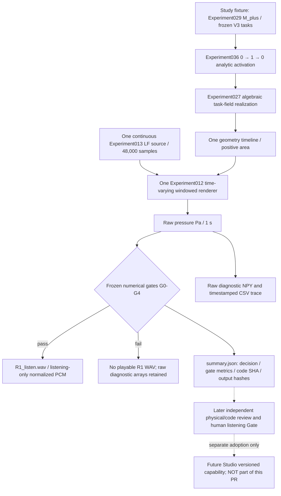

# V4-A 2026-10-19 implementation, numerical receipt, and review handoff

**Status: DRAFT / NUMERIC_GATE_PASS_CANDIDATE / NOT SCIENTIFICALLY ADOPTED / NOT IN CORE MAIN / NOT IN STUDIO.**  
Tracking: [Core #74](https://github.com/ryonakayama234/morphoacoustics/issues/74), preregistration [Draft PR #77](https://github.com/ryonakayama234/morphoacoustics/pull/77), stacked experiment [Draft PR #88](https://github.com/ryonakayama234/morphoacoustics/pull/88).

## Creator-relevant goal and present boundary

The experimental fixture renders one uninterrupted **1.0 s /a/-like → /i/-like → /a/-like** movement using the frozen Experiment027 three-task field on Experiment029 M_plus. The same LF Rd=1.0 / 100 Hz source phase, one time-indexed geometry and one Experiment012 windowed renderer produce freshly computed pressure and a provisional listening WAV. The already adopted Studio CC-A2 two-body 0.5 s A/B audition remains unchanged. No 1.0 s Studio backend/Take authoring exists yet.

**Do not infer:** tissue inertia, finite-force articulation, full acoustic PDE state, physical source/tract feedback, gesture competition/coarticulation, intelligible Japanese, or general anatomy authoring. Distinct conditioned output / sound quality / user preference are independent propositions.

## System and data

Evidence `summary.json` is produced after calculated arrays and (only when numerical gates pass) listening WAV. Its `adoption_status=NOT_ADOPTED_REVIEW_AND_HUMAN_GATE_PENDING` is intentionally distinct from the historical machine decision `SUPPORT_ONE_RUN_ROUNDTRIP`, which currently means **frozen engineering gates passed, not independent scientific adoption**. `preview_available=false` and `wav_sha256=null` on numeric failure. The code refuses any pre-existing output path, including an empty directory and a directory symlink. An interrupted calculation can leave an incomplete new research directory: absence of complete `summary.json` means no result acceptance. It is not an atomic production Take store.

`executed_sources` records Git HEAD and SHA-256 of the actual Python/JSON files used by the narrow research chain. In addition, the historical frozen B0 acoustic-pressure quantized hash and current R1 raw-pressure and WAV byte hashes are distinct fields. Playback WAV gain is **not** calibrated sound pressure; use the raw Pa NPY for physics.

## Immutable prior evidence versus new execution

- First experiment implementation and **exploratory** machine pass: [PR #88 at 9d8695c](https://github.com/ryonakayama234/morphoacoustics/commit/9d8695ccba6a3f83345b0bf2abb45811e595035e), [V4-A 2026-10-12 CI run 38186537225](https://github.com/ryonakayama234/morphoacoustics/actions/runs/38186537225). PR #77's preregistration draft was **not independently approved before execution**. Thus even if its numerical thresholds were frozen in the documentation, retrospective confirmation is not a prospective independent confirmatory scientific trial. Preserve that distinction permanently.
- Hardening commits: [76aeea0](https://github.com/ryonakayama234/morphoacoustics/commit/76aeea037f750be56bb080dba9e6b2574ce25478) and [0c475d4](https://github.com/ryonakayama234/morphoacoustics/commit/0c475d4896f25152506a572596cf96c017945086). New negative tests guard failed-gate playable WAV, reused and symlinked outputs; source SHA receipt enables per-run code identity.
- New machine check on exact **0c475d4896f25152506a572596cf96c017945086**:
  - [Actual Experiment036 physics and repeat, CI 39272465612](https://github.com/ryonakayama234/morphoacoustics/actions/runs/39272465612) — SUCCESS, all nine `checks` true, distinct fresh 1 s executions identical in the same pinned environment.
  - [Generic tests, CI 39272465379](https://github.com/ryonakayama234/morphoacoustics/actions/runs/39272465379) — SUCCESS.
  - [Raw provisional audit artifact 12195623269](https://github.com/ryonakayama234/morphoacoustics/actions/runs/39272465612/artifacts/12195623269): includes source, raw pressure, 1-second listening WAV, diagnostic concat and trace. Artifacts have finite retention; this document preserves URLs and digests but cannot substitute for permanent archival of raw data if later required.
  - Numerical metrics: midpoint target error `0.18682836448690684 < 0.20`, max 10 ms trajectory step `0.06621354015393985 < 0.20`, fine-hop pressure normalized RMS difference `0.008624933237146724 < 0.20`, cycle jump `9.731644676297197e-8 < 0.01`, boundary ratios at 0.15/0.35/0.65/0.85 s `1.0013976161, 0.5642579202, 0.5637924758, 0.9988691944` (each < 3).
  - Frozen B0 quantized pressure SHA-256: `dc14c78bcc6d4a19c11fe2a01ba84b1394802b66626f4dfa27cc582c741e714e`.
  - R1 f64 raw-pressure SHA-256: `d7a33bf723a7d97fbf3d23e4550ce1c8bcfa7cbda61fe8216af7f0ce7048a122`.
  - R1 WAV SHA-256: `2ef790dbd51eb84d516c493a14998edb1193b56abe190e03aacb437faf8b9d0d`.
  - 196 accepted transfer calls, 391 reference, 102 baseline; synthetic diagnostic C0 has two independent 102-call renders **and must not be published as accepted physics**.
- Separate Wolfram Language exact calculation on 2026-10-19 reverified `s(0)=0, s(1/2)=1/2, s(1)=1`; rise duration 1/5 s gives maximum absolute velocity `15/2 s^-1`, second derivative `[-150,150] s^-2`, boundary rise slopes both zero and one-sided accelerations +150 / -150. This only checks command algebra, not acoustic or biological physics. Wolfram evaluator returned `{0,1/2,1,15/2,150,-150,0,0,150,-150}`.

## Outstanding gates and next owner actions

1. **Reconcile base history before adoption**: PR #77 is >100 commits behind Core main as of the 2026-10-19 inspection, including the now adopted CC-A1/A2 and X2a integrations. Do not auto-merge or force-push the reviewed/stacked evidence. First review the exact main-compatible diff and verify existing unrelated production contracts/hashes.
2. **Independent physics/numerics assessment**: analyze prereg timing and endpoint/oracle validity, source-phase and overlap-add interpretation, negative-control design, thresholds, and claims. New reviewers must explicitly distinguish this 2026-10-19 *post-implementation* CI from a pre-reviewed prospective protocol. A separate confirmatory run is only meaningful after an independently accepted future protocol; never relabel earlier execution.
3. **Independent code/data/security assessment**: inspect output path handling including parent symlinks/races, provenance completeness, failure results, frozen scientific source inventory and upstream ABI preservation. This new research output is not a transaction-safe service or adversarial sandbox.
4. **Creator hearing**: request an unprompted Japanese transcription first, then perceived change order, discontinuity, buzziness/voice-likeness and optional enjoyment on anonymized level-controlled clips. Freeze order, prompts and answers before opening the blind key. N=1 is a pilot, not population phonetic validation. The researcher/assistant cannot certify that the user listened merely because CI produced a WAV.
5. **Decision and release**: mark independently reviewed numerical limited adoption, human perceptual evidence and technical integration authorization separately. Keep Draft PR #77/#88 and Core #74 open until required gates conclude. No Studio edit, production contract widening or merge follows automatically.

### Local creator-oriented audition (after downloading the CI artifact)

From [experiment run 39272465612](https://github.com/ryonakayama234/morphoacoustics/actions/runs/39272465612), open the `v4a-036-research-audit` artifact, listen to `v4a-run1/R1_listen.wav` as a **provisional research preview**, then inspect `activation_and_resonance_trace.csv` and `summary.json`. To compare against a 0.5-second adopted baseline, create/obtain the independently pinned Core X2a WAV; *do not confuse the diagnostic C0 concatenation with a supported output*. Normalized listening WAV is not a sound-pressure measurement.

This is a research-preview artifact, not an executable Studio feature.

## Acceptance pass — 2026-10-20 (latest evidence, supersedes earlier HEAD-only pointers)

**Scope and completion definition fixed, no new task selection.** Core Issue #74 / Draft #77 and stacked Draft #88 are the only task. Completion requires (i) this one-source one-timeline one-render limited science pilot with frozen numeric G0-G4 and faithful claim G5, (ii) current exact-HEAD CI/reproducibility with no reference drift, (iii) independent scientific and code review and resolution of material P1/P2 defects, (iv) separately recorded creator listening/exploratory transcription, and (v) a recorded scoped adoption decision and non-destructive main integration after review authorization. Studio integration, general vocal persona editing, authentic inertia/FSI and natural Japanese speech are **not** added acceptance requirements.

### Additional implementation repair discovered during acceptance audit

The earlier Experiment036 G0 only verified B0 output hash, FEASIBLE and acoustic-call count; the preregistered G0 additionally required preserving inherited Experiment027/029 frozen checks and negative no-fallback semantics. The acceptance pass now:
- verifies the exact Git blob contents of Experiment028 frozen reference, its oracle, Experiment029 oracle and V3c Wolfram generator, and calls the **existing adopted** V3b `frozen_preflight` and V3c `local_oracle_preflight`, plus exact Experiment027 task/oracle equality. Abort *before rendering* on preflight failure.
- independently calls Experiment029 negative `M_minus` body with oral reach 0.70 and checks `INFEASIBLE`, zero transfer calls, no waveform, no endpoint; this is incorporated into the existing `frozen_B0` G0 check without changing original numerical thresholds.
- tracks the upstream scientific oracle/reference files via SHA-256 in the execution receipt; adds two regression tests validating the inherited preflight and zero-render negative.

Latest tested scientific/code HEAD **`c69c08816a9c28ea28595c6c01afa440c473cd7c`**:
- [Real 1s physics twice, tests and independent byte integrity action 39275191454 — SUCCESS](https://github.com/ryonakayama234/morphoacoustics/actions/runs/39275191454), including new inherited preflight and no-fallback negative.
- [Research evidence including `R1_listen.wav`, run-1/run-2 raw pressure, source, CSV and summary — artifact 12197027447](https://github.com/ryonakayama234/morphoacoustics/actions/runs/39275191454/artifacts/12197027447); retention until **2027-01-17 15:07 UTC** according to GitHub. This artifact supersedes the older examples above.
- Original exact B0 waveform quantized hash and R1 scientifically emitted waveform/PCM hashes remained as before. New `summary.json` also includes `upstream_scientific_preflight` and `unreachable_body_no_fallback`. WAV normalization is 0.90 full-scale by inherited Experiment009, not real-world loudness.
- The original independent-ish byte-verification CI step is a **separate script in the same PR**; it checks honest byte and source equivalence but is not an external peer review.

### Independent review requests and disclosure
- [Codex review request on protocol PR #77](https://github.com/ryonakayama234/morphoacoustics/pull/77#issuecomment-6270502723) (explicitly **post hoc**, cannot erase lack of pre-execution protocol approval).
- [Codex code/science/security review request on implementation PR #88](https://github.com/ryonakayama234/morphoacoustics/pull/88#issuecomment-6270503765), pinned to HEAD `c69c08816a9c28ea28595c6c01afa440c473cd7c`.
- Existing Codex automated reviewer was demonstrably used in adopted CC-A2 PR #122; a formal GitHub review-request attempt targeting its bot identity was rejected (not a collaborator). The `@codex review` PR comment is the repository's established trigger. **Request sent does not equal review completed or accepted.** Check exact-HEAD review state before any further action.
- Merge compatibility is NOT established. [GitHub main-versus-PR comparison](https://github.com/ryonakayama234/morphoacoustics/compare/main...research/v4a-roundtrip-execution-20261012) shows the stacked research branch currently **103 main commits behind**, with 11 branch commits ahead. Resolve the integration gap after required scientific/creator gates, without force-updating original evidence.

### Creator listening protocol — first action only
Use only the unambiguous accepted-experimental-run `v4a-run1/R1_listen.wav` under the above exact-HEAD artifact. Creator opens it via Windows media player (or browser audio app), preferably at a comfortable volume; do not listen to the `C0_naive_concat_DIAGNOSTIC_ONLY.npy` research negative as an accepted recording. **First unprompted response:** freely write what the sound seems to say (kana/vowel sequence, or `聞き取れない`), without comparing against target text. **Second-stage questions, after free response:** perceivable direction/order of change; discontinuity/buzz/roughness; voice-likeness; creative potential / interest in replaying; whether listening and saving were straightforward. Record their literal feedback with context, not invent impressions. The creator already saw the task name /a/-like → /i/-like → /a/-like, so this single hearing **is not blinded** and should be marked expectation-biased exploratory evidence. No subjective aesthetic dislike alone invalidates a passing physics gate.

### Gate status for next session
- Implementation: **DONE, Draft research branch only**.
- Frozen automatic engineering/science G0–G4: **PASS at c69c088**; accepted physical scope is only quasi-static one-run waveform, not time-domain PDE.
- Independent peer code/science review: **REQUESTED / PENDING** at time of this record.
- Creator machine listening and expressive feedback: **PENDING**.
- Formal adoption, Core main merge, Studio integration: **NOT DONE**, and must not be stated otherwise.
- Blocking vs future-only: outstanding review, creator pilot and main-base reconciliation **block formal completion**; physical articulator inertia, new phonemes, Studio editing and broader aesthetic quality improvements are future scope and **do not block this narrow research pilot's scientific validity**.

### Independent reviewer blocker confirmed after requesting review (2026-10-20)

The documented `@codex review` requests **did reach** the GitHub Codex integration, but both PRs reported **FAILED: Codex code-review usage limit exceeded**. Codex did **not** submit an actual code review, a line-specific scientific finding, or an approval. GitHub's bot summary internally sets `has_any_findings=true` in the failed state; this is **not** evidence of a verified P1/P2 software defect because the reviewer did not execute. Treat both as `INDEPENDENT_REVIEW_BLOCKED_BY_USAGE_LIMIT` and do not merge. Exact source records: [PR #77 review request](https://github.com/ryonakayama234/morphoacoustics/pull/77#issuecomment-6270502723), [PR #88 review request](https://github.com/ryonakayama234/morphoacoustics/pull/88#issuecomment-6270503765) and the subsequent bot comments on each PR. A normal reviewer request to `chatgpt-codex-connector` was rejected by GitHub because this automation identity is not a regular repository collaborator. Any new independent review must be acquired through an authorized reviewer or a future available Codex review slot; it is a **separate actor**, not the implementer marking their own code APPROVED.

**No user action required for technical review administration.** A creator audition can independently proceed from artifact 12197027447 and be recorded as creator evidence, without pretending to settle the blocked scientific review.

Latest code/physics CI: `c69c08816a9c28ea28595c6c01afa440c473cd7c`, science run [39275191454](https://github.com/ryonakayama234/morphoacoustics/actions/runs/39275191454) **SUCCESS**, 9 dedicated unit tests and physical+evidence checks. Later documentation-only commits change Git HEAD recorded in a fresh run; use a matching artifact and manifest when citing exact code+data hashes.

## Creator actual hearing / perceptual evidence (2026-10-20 JST)

**One user, first hearing, target already disclosed (NON-BLIND); do not make claims of population intelligibility or verified Japanese phonemes.** The creator played the run-1 WAV and reported:

> 「ああいーあ」みたいな感じかな？  
> 最初の「あ」音に関しては一音が滑らかに、ではなく「あ」(この間にちょっと詰まった感じアリ)「あ」と2音並んで、「いー」(こっちはまぁ良さそう)って感じ  
> 連続発声というより、音を3つ並べておいた感

**Assessment (creator experience, not a scientific physics rejection):** transition is perceptible, middle `いー` comparatively promising, but the initial `あ` has a reported catch/re-articulation and the total feels like three separated sounds, not one continuous utterance. Therefore *perceptual smoothness as creative experience is NOT ACCEPTED in this pilot*. This does **not** erase numeric G0–G4 success; nor does numeric PASS override the creator's report. No user claims about usability, enjoyment or performance authoring have been received.

The implementer independently downloaded the [2026-10-19 exact-PR-head workflow artifact 12196309449](https://github.com/ryonakayama234/morphoacoustics/actions/runs/39275807586/artifacts/12196309449) and inspected the waveform and actual receipt:
- `R1_listen.wav`: mono 16-bit PCM, 48kHz × exactly 48,000 samples; `<f8` SHA-256 of full raw pressure/source and byte SHA-256 of WAV agree with `summary.json`; two runs regenerate matching values.
- In the opening `0.01–0.15s`, ratios of minimum to maximum 10ms RMS pressure windows `0.98335`; during the `0.15–0.35s` ramp `0.83666`. No 10ms-scale silent interruption observed. This **cannot rule out perceptual articulation or spectral segmentation**.
- R1 generated using one full `frame_render` call; C0 is a separately labeled two-render diagnostic, not accepted audio. R1 and C0 pressure differ (normalized whole-file RMS `0.03349`). The creator's "three sounds side by side" is perceptual evidence **not proof that the implementation concatenated WAVs**.
- GitHub PR SHA `8a74855e89ee6ccb8f0fb3e8eec9a4aab071ec8b` and `summary.json` **executed Git checkout** `51d652538966f717f6ad28dece316bbfc87019a6` are distinct (pull_request checkout's merge SHA). Record both; only file SHA and physical output digest bind exact execution. This distinction should be verified for subsequent acceptance receipts.
- Existing gesture command has a stable `/a/-like` plateau through 0.15s before a smooth 0.15–0.35s ramp; this is a possible perceptual separation cue but **not established as the cause**. Do not alter protocol after hearing evidence or claim a material/solver bug based on a single pilot.

Full verbatim testimony, wave checks, and gate classification were posted to [PR #88 creator-evidence receipt](https://github.com/ryonakayama234/morphoacoustics/pull/88#issuecomment-6279797641).

**Adoption status remains HOLD.** Existing independent code/science review is blocked by Codex usage quota. Any scoped adoption/merge needs the accepted independent review and integration check. Natural uninterrupted vocal performance and Studio editing are NOT claims for Experiment036 and need a separate development/creator integration gate; do not quietly expand this pilot. Record this limitation for later work, without selecting or implementing another task here.

## Acceptance integration on current main — 2026-10-20 (latest handoff)

**Decision: CONDITIONAL LIMITED TECHNICAL/SCIENTIFIC ACCEPTANCE, NOT FORMAL ADOPTION; MERGE ON HOLD PENDING EXTERNAL REVIEW.** This is *the same* Core #74 V4-A task. No new research or product scope has been opened.

- Historical evidence remains immutable in [stacked Draft #77](https://github.com/ryonakayama234/morphoacoustics/pull/77) and [Draft #88](https://github.com/ryonakayama234/morphoacoustics/pull/88). Both were based on an old branch 103 main commits behind. They are preserved as posthoc exploratory evidence; do not reclassify the preregistration as reviewed before original implementation.
- [New main-compatible Draft PR #123](https://github.com/ryonakayama234/morphoacoustics/pull/123), initial commit `623638dcbc5a4624396a61e37d48409ffbcfb040`, starts at exact main `12973d0ef8f82ab2e60533a3ec9344e3c628ad68`. It copies exactly six research-only files (the original prereg record, this handoff, the Exp036 runner/tests/schedule oracle, and experiment CI). No old branch commits were replayed, no Core/Studio runtime API was changed. CI on this branch demonstrates contemporaneous compatibility, rather than assuming 103-commit old base compatibility.
- [Real physics one-second CI on current main, run 39350385956 — SUCCESS](https://github.com/ryonakayama234/morphoacoustics/actions/runs/39350385956), including 9 experiment tests, frozen B0 and V3b/V3c oracle/no-fallback, two independently executed 1-second examples, input/pressure/PCM provenance, reproducibility and no-audio-on-failed-Gate rules. [General tests 39350386040](https://github.com/ryonakayama234/morphoacoustics/actions/runs/39350386040), [OG-3 39350386121](https://github.com/ryonakayama234/morphoacoustics/actions/runs/39350386121), [OG-4 39350386128](https://github.com/ryonakayama234/morphoacoustics/actions/runs/39350386128) — all SUCCESS.
- [Integration audit artifact 12232343693](https://github.com/ryonakayama234/morphoacoustics/actions/runs/39350385956/artifacts/12232343693), retained until 2027-01-18 UTC. Accepted listening PCM WAV SHA-256 remains `2ef790dbd51eb84d516c493a14998edb1193b56abe190e03aacb437faf8b9d0d`, identical to the creator-audition WAV. Raw f64 R1 pressure SHA differs from prior branch (`5839b67661b13fde5d16d93022810f74a8d716e6f2d2df48489f476376cfbad2` here versus `d7a33bf723a7d97fbf3d23e4550ce1c8bcfa7cbda61fe8216af7f0ce7048a122` in the old environment); this is **unquantized floating-point byte sensitivity** and must not be misreported as byte-identical across environments. Same-checkout repeated executions and the frozen quantized B0 digest still match. Exact source and receipt hashes must be compared within each executed checkout.
- The creator's real hearing described /a-a-i:-a/-like and a catch between the first two /a/-like perceptions, with middle /i:/ comparatively promising, and a perceptual impression of three placed sounds. This is **not continuous-sounding voice performance accepted by the user**. However current code has exactly one 48,000-sample source oscillator phase, algebraically continuous 0→1→0 task geometry and a single 1-second Experiment012 windowed renderer call for **R1**; the independently constructed two-half-render **C0** is diagnostic only. Earlier artifact analysis found no 10-ms-scale silent break at onset, although **spectral/temporal articulatory segmentation remains possible**. Hence the hearing does not establish a code-level three-WAV splice, nor does the numerically continuous waveform disprove the user's auditory impression.
- The limited task **passes its declared machine semantics** and yields a listener-auditable research preview; it does not pass a proposed claim of *natural perceptually seamless utterance*. That latter claim, true dynamic bodily inertia, realistic oral/nasal multi-network, gesture competitions, flexible user scripting, Studio editing/saving and individualized voices are outside V4-A and do not retroactively block the narrow pilot. They remain future design inputs, not hidden success claims.

### Remaining *blocking* work for a main merge

1. **Actual independent external code/scientific review**, at exact integration head: PR #77/#88 Codex requests failed for review usage quota. This was not a code fault but does not satisfy independent approval. Self-verification, independent CI script and Wolfram analytic command checks cannot substitute for a separate reviewing actor. No self-approved GitHub review is to be forged.
2. **Formal scoped GO_LIMITED decision and merge authorization** after recording the review and resolving material findings, with exact main-compatibility CI at the reviewed HEAD. If PR #123 gets another documentation-only commit, rerun tests on that checkout before final merge. Preserve the historical stacked PRs and avoid double-merging.
3. **End-user report recorded** (creator Gate evidence completed, but perceptual seamlessness is *not* accepted); do **not** repeat listening merely to obtain a favorable score.

### Handoff when independent review remains unavailable

This chat/task is **not finished** and must not be called adopted or merged. Continue with the *same* Core #74 in a subsequent session if reviewer access or other external dependency cannot be fulfilled. Review the exact PR #123 six-file diff, CI and inherited oracle applicability; add an independent reviewer conclusion to PR #123 and the issue, then choose scoped adoption or documented rejection. The creator has delegated technically justified GO_LIMITED merge subject to core required Gates, but that delegation alone does not certify absent independent review.
