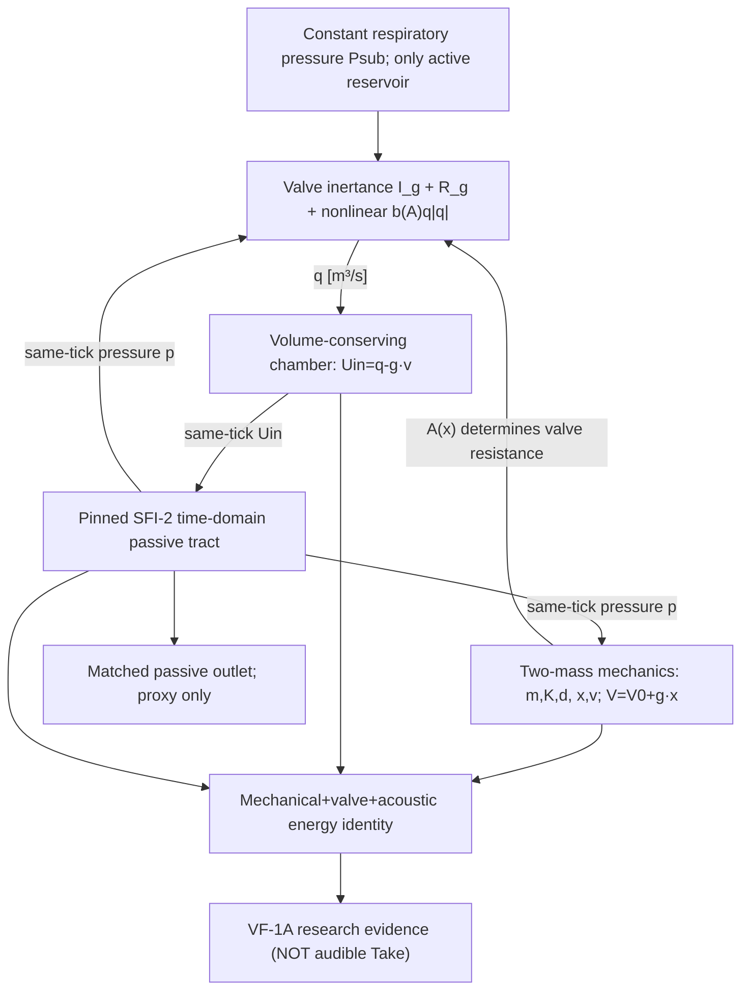

# VF-1A SYSTEM — causal model, not Studio feature

There is **no imposed F0, area schedule or prebuilt voice flow**. The implicit coupling solves simultaneously for `q_mid,v1_mid,v2_mid,p_mid,Uin_mid`; acoustics advances **once**, after a converged power-port solution, without a previous-tick p feedback shortcut. All state persists over duration; no resets to fake repeated oscillations.

**Dependency:** base exact SFI-3 Draft #84 commit `7ab18f25f53bc5f81bcdf5e7697fd11981abe6dd` includes original SFI-2 PassiveTract. Draft #84 is itself stacked on Draft #81, so this research PR is stacked on #84 and **MUST NOT** be merged straight to main; future integration would require an independent dependency audit and rebasing.

**Studio contract read-only:** `character.canvas` (future body model, geometry/material), `motion.canvas` (future task-level respiratory/phonatory effort), `scene.canvas` (future named receiver), `take.transport` (future only; no generated Take), `research.drawer` (proof receipts). No panel changed. No `src/morphoacoustics/`, `src/morphoacoustics_graph/`, Performance Contract, SMC, ASMR or Studio source touched.
