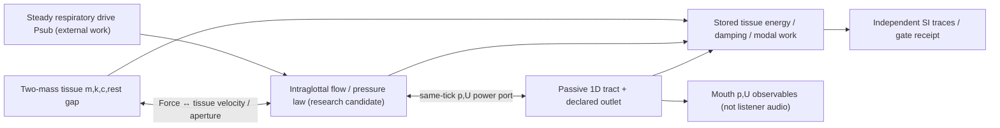

# VF-1B SYSTEM — phase-resolved physical energy audit (design only)
**Status:** PROPOSAL; no code or approved self-oscillator. Parent [VF-1B design #212](https://github.com/ryonakayama234/morphoacoustics/issues/212), [VF-1A #208](https://github.com/ryonakayama234/morphoacoustics/issues/208), [Foundation #199](https://github.com/ryonakayama234/morphoacoustics/issues/199). Baseline candidate is stacked, **not on main**: VF-1A PR #209 head `2b33bc69835170639fb9127c01dab7b523eff4f3` on SFI-3 #84 on SFI-2 #81.

## Causal physical system, not studio UI

## Studio panel mapping (exact draft registry, READ ONLY)
`character.canvas`: future organ/module graph only, not modified. `selection.inspector`: properties only if separately adopted. `motion.canvas`: planned respiratory/phonatory intention (SMC optional; unused). `scene.canvas`: future actor/listener positioning; no receiver solution in VF-1B. `take.transport`: no preview/Take adoption. `research.drawer`: where reproducible traces/receipts could be displayed later, **without adding a new panel**. Source: Studio Draft PR #33 `docs/product/workspace-v2/PANEL_REGISTRY.json`.

## Research boundaries
Keep numerical model and sign/units physically conjugate. No prescribed F0/glottal waveform, arbitrary negative damping, post-EQ, gain alignment as physics, learned beautifier, new published graph ABI, changes to main, or Studio UI. Existing fixed2 `src/morphoacoustics_graph/` is not yet a generalized self-exciting graph. Work only in experiment-local modules after approval. A visual edge without a conjugate physical law is not a working coupling.

## References
I. R. Titze, JASA 1988 DOI 10.1121/1.395910; Titze, JASA Express Lett 2022 DOI 10.1121/10.0014359; Zhang 2016, Mechanics of human voice production and control (PMCID PMC5412481). The literature suggests phase-related aerodynamic energy input and acoustic inertance; it does not validate this specific toy model or guarantee a pass.

## Implementation authorization amendment (2026-10-26)
Creator delegated technical experiments and research PR management. This is the **VF-1B1** independent modal-work audit only; underlying VF-1A equations remain byte-for-byte unchanged. The first comparison is the exact symmetric tissue parameters and equal pressure areas of VF-1A; symmetric and antisymmetric modal coordinates use orthonormal unit vectors. Discrete per-step modal work and damping are compared to stored mechanical energy, plus the exact damped midpoint recurrence for the antisymmetric homogeneous mode. Later intraglottal pressure laws remain **outside scope** pending this evidence. New numeric tests/measurements follow this pre-source amendment. Source parent: VF-1A candidate 2b33bc69835170639fb9127c01dab7b523eff4f3; scientific results not yet run.
