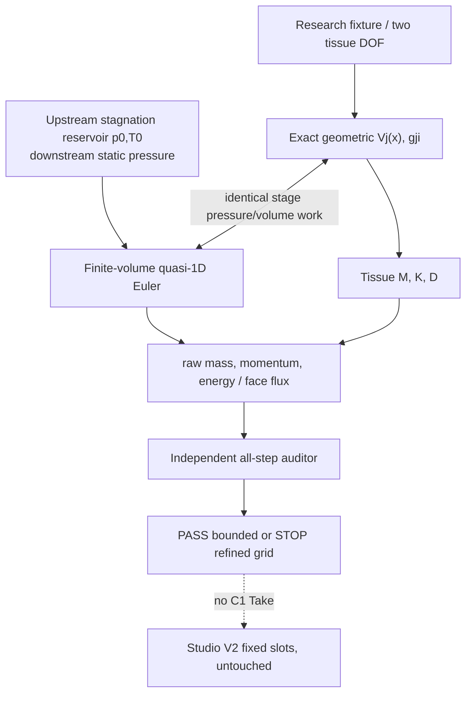

# C1-Open SYSTEM — actual research architecture

**Actual tested code** is experiment-local; no `src/morphoacoustics*` change or new OrganGraph executor. `solver.py` has per-cell geometry (V_j=V^0_j+\sum_i g_{ji}x_i); `g_{ji}\) is used for **both** (F_i=\sum_j(p_j-P_{ext})g_{ji}\) and fluid work (-\sum_j p_j g_{ji}v_i\). Tissue damping is positive, two DOF. Perfect gas with absolute pressure, total-energy FV conservative state; axial momentum includes (p\partial_z A\), energy includes (-p\partial_t A\). Face flux Rusanov; explicit simultaneous RK4 stages bounded by CFL; no delayed source-to-wall feedback.
Upstream gas reservoir (stagnation p0,T0 plus outgoing characteristic) and downstream (static pressure plus outgoing characteristic + entropy continuation). Code explicitly refuses reverse/choked/high Mach, nonpositive pressure/mass and contact. Crucial **outlet microreverse** with a mobile wall is a real detected domain refusal, not silently clipped. Diagnostic identifies first threshold crossing at N32/N64 around 14 microseconds. Because it is resolved differently across meshes, no claim of globally stable/converged numerical solution.

Continuum relative-energy ledger (H=E_{fluid}+E_{tissue}+P_{ext}(V-V_0)) obeys (dH/dt=\Phi_{E,in}-\Phi_{E,out}-v^TDv), where `Phi_E = mdot*(e+p/rho+u²/2)`. Historical C1-R0 sealed model is not equated with Euler simply by closing ends. C2 mean-flow/acoustic bridge/tract is **unconnected**. Studio V2: Character and Inspector future organ edits, Motion future respiratory/task commands, Take only **verified sound**, Research Drawer scientific receipts, Scene future listener; **NO UI changes in this PR**.
