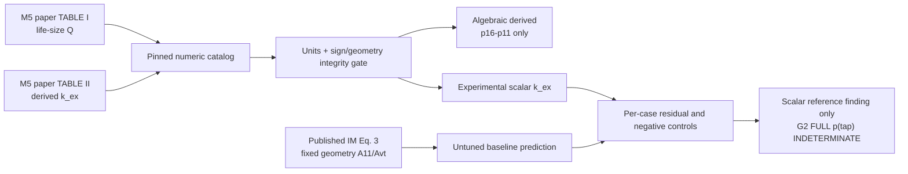

# VF-1B2 / M5 published scalar recovery experiment — SYSTEM
Date: 2026-10-27. Status: preregistered before experiment code. Core main base `e05e3274ad69bfb9202816049f6661a18ba39ec0`. Parent [Issue #215](https://github.com/ryonakayama234/morphoacoustics/issues/215). Prior [pressure-tap source inventory #218](https://github.com/ryonakayama234/morphoacoustics/pull/218) is separate, unmerged and not imported.

## Physical question and scope
The first published M5 reference is not limited to visually rendered per-tap curves. Fulcher, Scherer & Powell (2011), DOI [10.1121/1.3514424](https://doi.org/10.1121/1.3514424), publishes directly numeric *experiment-derived exit coefficients* in **Table II** and matched *measured volume flows* in **Table I**. This bounded experiment evaluates a **SCALAR pressure-recovery reference** and the explicitly quoted Ishizaka–Matsudaira (IM) abrupt-exit formula; it does NOT reconstruct the complete measured `p(tap)` profile and does not fit any glottal solver.

Measured tap 11 and tap 16 pressures enter the published coefficient:
`k_ex = 2 A11^2 (p16-p11)/(rho Q^2)`.
With `A11 = 1.2 cm * d`, `A_vt=2.4 cm^2`, `rho=0.00121 g/cm^3` and paper life-size values, the pressure difference *implied by those two published summary tables* is
`Delta_p_11to16 = k_ex rho Q^2/(2 A11^2)` [Pa].
**This is algebraically reconstructed from a published derived coefficient** and Q, not an independently transcribed raw pressure measurement, an entire pressure distribution, or an uncertainty-verified measurement of an individual tap.

Predeclared alternative is the published, untuned IM sudden-expansion estimate:
`k_ex_IM = 2r(1-r); r=A11/A_vt`. It has no dependence on transglottal pressure at fixed d, whereas Table II's values can differ by pressure. M5's rounded exit differs from IM abrupt-expansion boundary conditions, so a mismatch diagnoses **non-transferability** to this test geometry, NOT a universal invalidation of momentum conservation or of other geometries.

All research logic remains under `experiments/049_vf1b2_m5_exit_scalar/`. No production Core solver/organ graph/WAV/Studio/SMC/ASMR changes; no moving-wall force/energy law. Approved Studio V2 panel/layout freeze unchanged. Nonphysical gain or hand-parameter adjustments to make a voice are prohibited.
