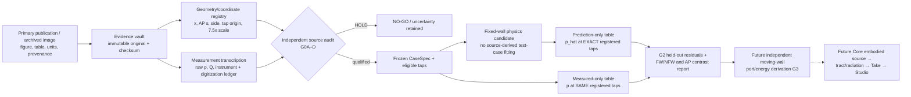

# VF-1B2 Pressure Atlas — Pre-Acquisition Design Refinement v2

**Date:** 2026-10-27. **Status:** research design amendment / no acquired tap numbers / no pressure model validated / no moving-wall implementation. **Parent:** [#215](https://github.com/ryonakayama234/morphoacoustics/issues/215), [Draft #218](https://github.com/ryonakayama234/morphoacoustics/pull/218).

This document corrects a **scientifically consequential geometry error** in the original Gate-0 inventory: **M6 has THREE 14-tap AXIAL upstream–downstream rows at separate anterior–posterior (AP) positions**, not 14 transverse taps at each of three axial stations. The source-derived distinction is supported by [Scherer et al. 2010, Methods and Fig. 3](https://pmc.ncbi.nlm.nih.gov/articles/PMC2933258/) and [PubMed 20707452](https://pubmed.ncbi.nlm.nih.gov/20707452/). Historical commits retain the previous mistaken assertions as an auditable erratum, not as valid preregistration. The prior 13/13 green CI checked an incorrect catalog invariant and does not certify source semantics.

## 1. Question and causal target

**Primary scientific question:** for a *rigid*, geometry-matched glottal model, can a preregistered pressure–flow closure predict **signed wall-gauge pressures at registered surface taps**, across held-out pressure/geometry cases, with errors reported against source uncertainty? This question must be answered independently of generating audio or self-oscillation.

**Measurement target:** wall static pressure over the fixed fold surfaces, observed as discrete taps. Not air-jet centerline pressure, not oscillating-tissue pressure, not glottal flow Q, not a source waveform. A 1D surrogate that reproduces Q alone is NOT proof it reproduces p(x,s), separation, surface loading or wall work.

### Geometry and coordinate contract

- `x` [m]: **local flow/axial direction**, increasing subglottal → supraglottal; each paper's entrance offset is explicitly recorded. Normalize for comparison only as `xi=(x-x_entrance)/(x_exit-x_entrance)` if both locations have actually been verified.
- `s` [m]: **anterior–posterior** coordinate along membranous fold length; `eta=s/L_AP` if length/orientation audited. `side` is wall identity (left/right; FW/NFW is **jet attachment state**, not a permanent wall name).
- `n(x,s)` [dimensionless] is the actual outward surface-normal convention; a 1D pressure sample alone does not provide a full surface normal or area element.
- `p_raw` [Pa] retains the source instrument sign and reference. `p_gauge=p_raw-p_ref` [Pa] is derived **only** when the reference and sign are explicitly verified. `Delta p_T=p_sub-p_sup>0` [Pa] is reservoir pressure difference, **not automatically tap 0**.
- `Q` [m^3/s] is measured flow; `p(x,s)` and `Q` have different independent error ledgers. Preserve physical model vs life-size equivalents. For the 7.5× models, published dynamic similarity corresponds to model pressures `1/56.25` of life-size pressure and model flow `7.5×` life-size; record which scale each literal belongs to.

| Dataset | Pressure observation layout | Boundary/reference trap | Role |
| --- | --- | --- | --- |
| **M5 uniform** (Fulcher, Scherer, Powell 2011; DOI 10.1121/1.3514424) | One model fold's numbered tap path across inferior surface, straight intraglottis and exit; entrance tap 6 at life-size x=0.211 cm; exit tap 13 at x=0.511 cm | **Tap 0 is upstream tracheal reference**; downstream tap 16 distinct. d=0.005–0.32 cm; published Fig. 2 measurements and quoted <1% upper uncertainty **only for taps 6–14**, not universal one-sigma | **Primary**: axial pressure shape, loss/recovery, FW/NFW when resolved |
| **M6 nonrectangular** (Scherer et al. 2010; DOI 10.1121/1.3455838) | **Three parallel axial rows** of 14 tap IDs (#1–14), `eta=1/4, 1/2, 3/4` (anterior/middle/posterior); axial positions identical across rows; tap 6 is entrance (`x=0` in paper) | **Tap 0 is downstream pressure-setting/monitor point**, not M5's upstream tap 0. Sinusoidal AP gap; 10° convergent, uniform, 10° divergent; midsection width 0.16 cm vs quarter-section 0.113 cm. Published Table 2 `Q` and ±6 cm^3/s flow-meter accuracy are **not** tap-pressure uncertainty | **Secondary generalization**: variation between axial rows; requires 3D shape and per-row coordinates |
| **M5 hemilarynx** (Fulcher et al., J Voice 2010, DOI 10.1016/j.jvoice.2008.02.005) | M5 pressure taps in asymmetrically angled configurations; experimental FW/NFW labels depend on *which wall the jet attaches to*; physical one-sided taps can yield opposite-state measurements, NOT simultaneous sensor readings on both opposing walls | 0.04-cm minimal gap, 3/5/10/20/40 cm H2O, asymmetric wall angle. Fig. 3 **triangles** measured; FLUENT **curves** predictions. Jet states must remain separate | **Tertiary stress test**: jet-attachment branch, asymmetry and pressure bistability |

**Measurement/source facts:** [M5 uniform paper](https://pmc.ncbi.nlm.nih.gov/articles/PMC3078031/); [M6 paper](https://pmc.ncbi.nlm.nih.gov/articles/PMC2933258/); [M5 hemilarynx paper](https://pmc.ncbi.nlm.nih.gov/articles/PMC4804921/). Figure-only plots do NOT constitute digitized numeric observations. The M6 paper's stated ~4% of transglottal pressure between mid- and quarter-position for convergent geometry and ~2% for divergent is a *reported effect*, not a source-qualified numerical benchmark yet.

## 2. Measurement plan, defined before extraction

### The first locked source/case family

**Primary acquisition target:** M5 uniform **Fig. 2B, d=0.02 cm**, because the published plot shows straight-section viscous pressure decrease and exit pressure recovery; distinguish FW/NFW whenever the legend/symbols separate them. For this figure, choose and record one **exact published transglottal pressure curve from its legend**, instrument/reference, and complete available tap sequence *before digitizing pixel values*. Do not invent an unverified curve pressure or assign coordinates by uniform index spacing. Independent paper Fig. 1 geometry and its supplementary definitions must establish all tap x-coordinates needed for interpolation/comparison; two anchor taps alone are insufficient.

**Controls:** M5 Fig. 2A d=0.005 cm tests the reported absence of exit pressure recovery; Fig. 2C d=0.16 cm probes stronger FW/NFW skew. Do not pool these geometries or call them replications of the d=0.02 condition.

**Hold-out:** a distinct M5 pressure condition (same audited geometry) selected and frozen before any coefficient fitting; M6 cross-row comparisons and M5 hemilarynx are **separate, geometry-specific challenge sets**, not interchangeable points in one error distribution.

### Atomic immutable evidence schema (future proposal, NOT runtime API)

```text
PaperRevision { DOI, title, figure_table, version_date, access_url,
                fetched_at, original_bytes_sha256, license_or_use_note }
GeometryCase  { model_id, glottal_shape, wall_surface_id, jet_state,
                native_scale, life_size_mapping, local_frame, L_AP_m,
                entrance_exit_x_m, aperture_profile_or_mesh_ref, normal_provenance }
RunCondition  { run_id, geometry_case_id, Delta_p_T_Pa,
                upstream_reference_id, downstream_reference_id,
                Q_measured_m3_s, source_units, pressure_tap0_role,
                acquisition_run_or_curve_id, experimental_vs_simulated }
TapPosition   { tap_id, wall_surface_id, axial_x_m, AP_s_m_or_NULL_for_M5,
                tap_group_id, coordinate_origin, original_source_ref }
PressureDatum { run_id, tap_position_id, raw_pressure_value,
                raw_unit, instrument_reference, sign_convention,
                derived_pressure_Pa, uncertainty_components, digitization_ref }
Comparison    { run_id, fixed_geometry_hash, solver_version, frozen_parameters,
                per_tap_prediction_Pa, residuals, train_holdout_split,
                domain_eligibility, independent_audit_receipt }
```

Require `(run, wall_surface, jet_state, tap_group, tap_id)` identity, not a bare `tap_id`; M6 repeats tap IDs 1–14 three times. Reject samples with absent AP section, side/jet ambiguity, sign/reference ambiguity, non-matching experiment-vs-CFD provenance, false 1σ inference or missing geometry. Allow `AP_s_m` to be null **only when the dataset is intrinsically an axial M5 profile**, not because an M6 coordinate was omitted.

**Uncertainty ledger:** report independently (i) instrument upper-limit/precision, (ii) repeat statistics, (iii) plotted-point size and axis digitization, (iv) tap-placement and geometric scaling, (v) model/solver discretization. A published percent upper bound is **not** a Gaussian SD; do not combine incomparable uncertainties in quadrature by default. Interpolated values are predictions, never measured taps.

## 3. Preregistered hypotheses and refutation logic

**H-DATA (qualifiability; immediate Gate-0):** no complete, independently audited case of raw/digitized wall `p`, full tap positions, pressure reference, geometry and uncertainty currently exists in PR #218. **Falsification:** submit a source-traceable, independently audited eligible case with actual numeric samples and all audit fields; synthetic fixtures or measured `Q` alone never qualify. **Current outcome:** supported as repository-audit observation only; pressure physics remains indeterminate.

**H-AXIAL (rigid M5; future G2):** one preregistered fixed-wall pressure closure predicts the *held-out* M5 intra-glottal gradient and exit recovery over tap x, not just total Q. **Falsification:** held-out pressure residuals exceed the predeclared experimental+numerical comparison tolerance or the predicted recovery/gradient sign disagrees with observations. **Guard:** do not use `k_ent`/`k_ex` estimated from that very test case to call it an independent prediction.

**H-SIDE (jet-attachment; future G2):** for resolved FW/NFW states, any accepted surrogate must either predict state-conditional wall pressures and the observed branch difference or explicitly report out-of-domain. **Falsification:** branch reversal/averaging conceals pressure difference beyond audited uncertainties. Static branch-conditioned data do not establish switching dynamics.

**H-AP (3D M6; future G2 challenge):** pressure profiles measured along axial x at AP `eta=1/4,1/2,3/4` differ by a resolved amount in at least some geometry/flow conditions; a strictly AP-invariant 1D prediction cannot explain those contrasts as spatial predictions. **Falsification:** measured contrasts are not distinguishable from combined measurement/digitization uncertainty or geometry is mismatched. Literature reports approximate mid-vs-outer differences of 4% and 2% of `Delta p_T` for some configurations, not preregistered point-by-point data. Symmetry may be tested but not imposed as a measurement identity.

**H-WORK (future G3; not tested here):** a moving-wall FSI law can close its total energy and port signs, i.e. air-to-solid work `W_fs=int dt sum_i F_i v_i` equals the opposite transfer in fluid bookkeeping, once reservoir work, fluid/tissue storage and **nonnegative physical loss** are included. **Falsification:** algebraic double counting or nonconvergent residual. Static pressure data **cannot** establish this hypothesis, energy transfer or sustained self-oscillation.

**H-VOICE (future G4; out of scope):** embodied body+gesture→sound improves voice clarity, voice identity and quality. Requires separate acoustics and listening evidence, not pressure-fit CI.

## 3.1 Explicit decision observables and provisional engineering thresholds

These thresholds are **our research design targets**, not numbers quoted from the papers, not probabilistic confidence intervals and not claims that any solver has passed. They must be frozen in the case-specific acquisition preregistration **before looking at transcribed numeric tap values**; revision after seeing failures requires a new separately versioned study and cannot rewrite the first result.

For an independently audited matched held-out case of `N` measured taps and measured `Delta p_T>0`:

- `e_j=(p_hat_j-p_meas_j)/Delta_p_T`; `E_MAE=mean(|e_j|)`, `E_MAX=max(|e_j|)`. The initial **engineering acceptance proposal** is `E_MAE <= 0.05` **and** `E_MAX <= 0.15` across *all eligible held-out tap IDs*, with no opportunistic deletion. A result with missing full tap mapping, reference, or digitization budget remains **INDETERMINATE**, regardless of E.
- Separately report `E_RMS=sqrt(mean(e_j^2))` and a per-tap table containing predicted p, observed p, instrument uncertainty bound, digitization bound, numerical discretization error and residual sign. Experimental uncertainty is not the same as tolerated model discrepancy. Reconcile instrument+digitization/coordinate ambiguity; do not falsely declare every residual a statistical outlier from a quoted 1% upper bound.
- **Physical features:** preregister the axial tap interval for straight-channel pressure drop and exit pressure recovery from source geometry **before running the model**. Record predicted/observed slope and recovery **sign** and amplitude in units of `Delta p_T`. A model cannot pass on global MAE if it reverses a resolved feature's sign. The d=0.005 cm control must not acquire artificial positive recovery merely because a correction was tuned on d=0.02 cm.
- **State-conditioned prediction:** never average FW and NFW *before* the primary comparison. If the source only distinguishes them qualitatively or cannot resolve both, label branch conclusion `INDETERMINATE`.
- **M6 AP contrast:** at the same audited axial `x_j`, define `C_j=(p_mid,j - (p_ant,j+p_post,j)/2)/Delta p_T`. The conservatively bounded contrast uncertainty `U_C,j=(U_mid,j+(U_ant,j+U_post,j)/2)/Delta p_T` assumes no unwarranted cancellation of correlated errors. Only call an observed AP contrast **resolved** when `|C_j|>2*U_C,j`; otherwise **INDETERMINATE**, never "1D confirmed." Contrast is separate from averaged profile agreement and from the paper's reported approximate 4%/2% effects.
- **Numerical floor:** show at least two spatial/time-step refinements appropriate to the fixed-wall candidate and ensure their estimated pressure differences are smaller than its observed-versus-predicted discrepancy. No model convergence evidence = `G2_NUMERICALLY_UNRESOLVED`. Repeated pressure measurements, digitization and model discretization use separate provenance.
- **Scope of claim:** even success under these research thresholds can only support `G2_RIGID_WALL_PRESSURE_MATCH_FOR_TESTED_CASES`, not a universal fluid solver, a valid moving-wall power law, sustained voice or a creator-ready Take.

## 4. Architecture ownership, discriminability and interfaces



- **Evidence vault/registration** owns observed scientific facts; *model* cannot rewrite provenance or select convenient pressure branches after seeing residuals.
- **CaseSpec/comparability gate** owns eligibility; matching checks exact glottal wall shape, d, angle, inlet/outlet, pressure reference, coordinate frame, scaling, flow/pressure run and experimental state. M6 sinusoidal AP contour can never be claimed identical to M5 rectangular geometry by matching only `A_min` or `Q`.
- **Predictor** owns fluid assumptions, separation/viscous closures and solver convergence; outputs `p_hat(x,s,wall,case)`. The pressure reference is explicit. A reduced 1D model can be *tested* as a negative/limited baseline, but not rebranded as full M6.
- **Evaluator** owns per-tap normalized residual `e_j=(p_hat_j-p_meas_j)/Delta_p_T`, mean absolute and maximum absolute error, sign of gradient/recovery, pressure-branch differences, M6 AP contrast and error bars. Numerical acceptance limits must be frozen **before** opening the numeric curves; comparison claims require an independent held-out case and a separately reasoned tolerance. Literature paper's own fitted equations do not constitute independent solver validation.
- **Future tissue/fluid ports** (not created here): wall pressure `p` [Pa] and normal wall velocity `v_n` [m/s] form a conjugate power density `p v_n` [W/m²]; generalized coordinates `q_i` [m] couple via `F_i = integral_surface traction · (partial r/partial q_i) dS` [N]. The sign depends on declared normal/traction convention. Must ledger `W_tissue+W_fluid_interface=0` once, not add a force term to unchanged legacy `Q`/Bernoulli expressions. Unmeasured pressure between taps does not license force integration over arbitrary anatomy.
- **Product ownership:** Core research-only `experiments/048...` and `docs/research/...` only. No production `src/morphoacoustics`, OG3 ABI, source Take, sound-processing shortcuts, SMC/ASMR coupling, or Studio UI/layout. Frozen Studio ADR's `research.drawer` could someday display qualified research receipts only with separate approval.

## 5. Rejection matrix and ordered decisions

| Gate | Accept evidence | Stop / reject cause | Current |
| --- | --- | --- | --- |
| G0-SOURCE | correct article, **M6 axial-row** topology, versioned immutable source, native units/reference | M6 falsely typed transverse; M5 tap0 mistaken for M6 tap0 | inventory only / correction required |
| G0-DATA | real tap-by-tap p; complete x/side/AP IDs; recorded digitization uncertainty | Q-only, Fig-only, two x anchors, duplicate tap index across M6 rows improperly flattened | HOLD |
| G0-CASE | geometry, wall/jet state, pressure boundaries, scale matched by independent reviewer | M5-for-M6 substitution, plot line actually CFD, uncertain reference | HOLD |
| G2-PRESSURE | held-out and source-qualified pressure prediction with frozen method/threshold, negative cases retained | in-sample fitted coefficients, pressure branch averaging hiding errors, no uncertainty reconciliation | INDETERMINATE |
| G3-FSI | separately proven coupled power and convergence, then intervention/onset/offset | pressure field simply multiplied by area, missing swept-volume continuity/double-counting | HOLD, NOT AUTHORIZED |
| G4-CREATOR | independently evaluated embodied audio and character perceptibility | green CI / pressure fit alone | NO-GO |

**Adversarial tests required for the corrected Gate-0 catalog** (identity tests only, not new solver): reject M6 `transverse`, reject loss of AP group, reject duplicate IDs only *within the same row* while permitting repeated #6 at different AP rows, reject false M5/M6 tap0-role equivalence, pressure sign inversion, 7.5× scale confusion, conflated FW/NFW, flow-meter error mislabeled pressure error, incomplete original-image hash. These are proposals unless implemented and verified. Existing 13 tests do not demonstrate all these properties.

### Immediate decision

**This turn permits a scientific-specification/erratum and source-identity metadata correction only.** No paper-plot digitization, no fitted pressure law, no moving tissue FSI, no synthesized voice, no PR merge. First physical acquisition is allowed only under a separate exact-case acquisition protocol and independent source audit, with a new frozen preregistration and its own receipt.
