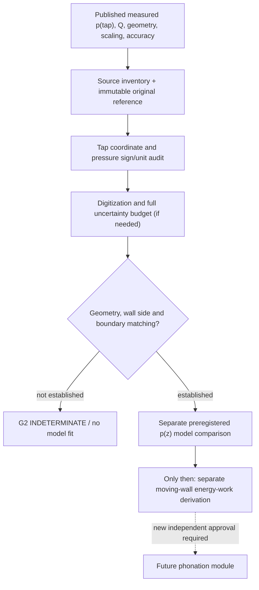

# VF-1B2 Pressure Atlas / SYSTEM — Gate 0 source qualification
Status: RESEARCH DESIGN / NOT A PHYSICAL MODEL / NOT A CREATOR SOUND RELEASE
Date: 2026-10-27. Base: Core main `e05e3274ad69bfb9202816049f6661a18ba39ec0`.
Parent: [Issue #215](https://github.com/ryonakayama234/morphoacoustics/issues/215).
Previous measured-flow reference: [Draft #217](https://github.com/ryonakayama234/morphoacoustics/pull/217) at `d50f0f2` (unmerged; no code imported).

## Goal
Before permitting rigid-flow pressure predictions to drive a moving vocal-fold wall, qualify a published **spatially registered measured wall-pressure profile**, its actual 3D/2D geometry, boundary conditions, scaling, and uncertainty. First audit the M5 uniform-glottis axial tap reference; track M6's THREE AXIAL pressure-tap rows at distinct anterior-posterior positions separately. No hand-tuned separation factor, no fitted Cd, no extrapolated force, no constructed voice. **Geometry erratum (2026-10-27):** original M6 'cross-width' wording was incorrect; original paper specifies 14 upstream-downstream taps at each of three AP positions. See [Design Refinement v2](DESIGN_REFINEMENT_V2.md).

This research **does not** complete the p(z) comparison or the wall-energy derivation.

## Software and product boundaries
- Research-local inventory/assessor: `experiments/048_vf1b2_pressure_tap_reference/`. No imports from Draft #217 or #216. Neither changes Core `src/morphoacoustics/` nor experimental `src/morphoacoustics_graph/`.
- Core remains authoritative for eventual organ node/typed-port physical legality. The currently staged organ graph is not a validated general-purpose human larynx, and this work creates no public OrganGraph schema or solver API.
- Studio accepted ADR: [STUDIO_WORKSPACE_V2_DECISION.md](https://github.com/ryonakayama234/morphoacoustics-studio/blob/main/docs/product/STUDIO_WORKSPACE_V2_DECISION.md). The approved `character.canvas` owns organ design; `motion.canvas` gestures; `scene.canvas` speaker/listener; `take.transport` immutable actual audio; `research.drawer` future scientific receipts. **No UI edit, panel extension, Take generation or contract change.**
- SMC and ASMR remain optional, independently gated producers; no coupling to this pressure reference.

## Explicit stop boundary
G0 (traceable source inventory) is not G2 (external pressure-model validity), G3 (non-double-counted moving wall), or G4 (creator-audible voice quality). Even after measured static p(z), G3 requires an independently derived coupled air/solid power law, not inserting `pA` into arbitrary oscillator dynamics.
