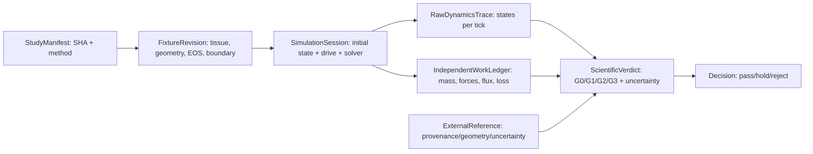

# VF-1B2a DATA v2 — records, units and ownership
**Prospective research-local serialization only; not a Core public ABI, Studio Character schema, Performance Contract or immutable creator Take.**

## Entity/data graph

Not connected to Studio runtime during B2a/C1/C2; prospective Studio Character and Motion references are distinct authored entities, never aliases for research fixtures.

| Entity | Owner | Strict fields / units and semantics |
|---|---|---|
| StudyManifest | Core research | exact repository and ancestor SHA, dirty-state flag, git tree, code/fixture hashes, language/dependency versions, prereg version, CI run IDs, source rights and oracle lineage |
| TissueFixture | Core research | masses kg, stiffness N/m, damping N s/m, x/v initial m/m s^-1, coupling N/m, external pressure Pa abs, wall shape functions |
| FluidFixture | Core research | Lg, ell, h0(z), A_floor in SI, rho kg/m³, sound speed m/s, P_atm Pa abs, EOS/gamma, loss/separation model IDs, validity limits |
| ReservoirBoundary | Core research | upstream/downstream absolute pressure, density, thermodynamic state, flow direction, boundary characteristic prescription, drive time course |
| TractFixture C2 only | Core research | pinned 10-section geometry, perturbation p'/u' ports, sign, inlet/outlet time clock and state, bridge law and truncation domain |
| SimulationSession | Core research | IDs/hashes of all frozen fixtures, numerical method, N cells, dt s, t horizon s, initial mass/momentum/tissue/acoustic states |
| RawDynamicsTrace | Core research | t s; x/v m,m/s; rho kg/m³; A m²; u m/s; U m³/s; wall p_abs Pa; endface mass kg/s; finite-volume momentum flux N; temperature/entropy assumption |
| WorkLedger | **independent** Core observer | tissue ΔE J, fluid ΔE J, possible acoustic ΔE J, pwall × volume-rate W, F_i v_i W, total-enthalpy flux W, reservoir/external ambient work J, modeled dissipations J, signed per subsystem/global residual J |
| ReferenceComparison | Core metrology | reference ID/source page, geometry mapping, physical state, conditions, measurand, SI units, uncertainty/CI, withheld conditions and model discrepancy |
| ScientificVerdict | Core research | G0 provenance, G1 numerics, G2 independent validity, G3 source mechanism, G4 not-evaluated; explicit NO_GO/INDETERMINATE/HOLD and artifact SHA |
| CreativeTake | Studio | **NONE** at B2a/C1/C2; future immutable audio observation is separately authorized |

## Compulsory observation and uncertainty protocol
- Every field: reference frame, sign convention, sampling time (midpoint/end), sensor location, native units, provenance and exact model assumptions.
- Distinguish **computed numerical p(z), U(z)** from externally **measured** pressure/flow; distinguish fixed-wall virtual force from actual F_i v_i on moving tissue.
- Distinguish glottal wall pressure, tract inlet acoustic p', mouth port pressure and later receiver pressure; NEVER relabel mouth-port as ear measurement.
- Track gauge and absolute pressures separately. Pressure differences may be stored as Pa gauge only together with explicit P_atm/P_ext and a declared reference map; no hidden 101325-Pa subtraction.
- Conservation residual is meaningful only when the boundary energy flux and counted stored energy use the same reference; record absolute J errors and dimensionless residual with declared denominator **and** a separately derived near-zero energy floor.
- Force/mass/flux spatial controls: computed from raw primary state, not accepted solely from model-emitted receipt. Independent observer cannot call the code-under-test's energy-balance helper.
- Preserve raw failing traces and negative controls. No retries that replace failure artifacts with favorable results; append-only decision amendments.

## Status taxonomy
INVALID_INPUT; UNSUPPORTED_CONTACT; UNSUPPORTED_FLOW_REGIME; UNSUPPORTED_COUPLING_DOMAIN; REFERENCE_UNAVAILABLE; NUMERICALLY_UNRESOLVED; G1_PASS_MATH_ONLY; G2_INDETERMINATE; G3_NO_SELF_OSCILLATION_FOUND; G4_CREATOR_NOT_EVALUATED. These statuses classify independent things; no automatic promotion of G1 to G2–G4.

## Future Studio mapping (fixed UI contract; NO UI changes)
- Character canvas: authored physical body/organ revision (not raw session x/v).
- Inspector: selected organ's existing authorized parameters/status only, no speculative sliders.
- Motion canvas: effort/gesture intent, not an imposed periodic pressure waveform stored as a creature characteristic.
- Scene canvas: Speaker/Listener reference only when receiver physics validated.
- Take transport: verified immutable **audio** from a qualified body, not numeric reference data.
- Research drawer: optional evidence/provenance if separately approved.
- Project library: asset/revision references, not duplicate physical state.
