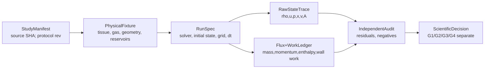

# VF-1B2 / C1-Open — DATA v3

**Design-only research-local schemas; NOT published Core/Studio ABI.** Immutable signed units and version identity; no duplicate BodyRevision registry. The experimental geometry is a *TissueFixture* rather than a new approved editable Studio organ.

### Canonical records
| Record | Required fields (all exact versioned, SI unless stated) |
| --- | --- |
| StudyManifest | repository/main SHA, research branch+exact-head SHA, parent PR refs #259/#278, code-tree SHA, Python/NumPy versions, prereg status, external source and rights/case reference |
| TissueFixture | `mL,mU` kg, `kL,kU,kc` N/m, `dL,dU` N s/m, `x0,v0`, `P_ext` Pa absolute, `ell,L_g,h0(z)`, shape basis ID |
| GasFixture | `gamma,R,rho0,T0,p0`, ideal-gas EOS version, inviscid/adiabatic qualification; energy-reference definition |
| ReservoirBoundary | upstream stagnation `p0_abs,T0`, downstream static `p_static_abs`, characteristic formulation ID, accepted flow orientation/domain; boundary source work |
| RunSpec | snapshot digests, `N`, `dt`, time window, `state0`, integrator+flux+spatial geometry scheme versions, positivity/contact/Mach gates |
| RawStateTrace | per-step time, cell mass/momentum/total E, `rho,u,p_abs,A,V`, two tissue positions/velocities and forces, face fluxes, residual/iterations; float64 native |
| IndependentLedger | full cellwise mass balances, axial momentum incl. `p dA/dz`, fluid/tissue/global energy in J, boundary total enthalpy in/out W, wall work J, tissue damping J, external pressure J, convergence errors |
| ScientificDecision | source SHA, immutable raw artifact byte digests, success/refusal scope, hypotheses, measured numerical residual and uncertainty, per-gate verdict, independent review, known gaps |
| Studio Take | **NONE in C1**; no synthesized audio evidence or UI edits |

### Measurands and provenance discipline
Primary numerical measurands: `mdot_left/right` [kg/s], `rho_j` [kg/m³], `u_j` [m/s], `p_abs,j` [Pa], `A_j` [m²], `V_j` [m³], `F_L,F_U` [N], `F_L-F_U` [N], signed wall power [W], integrated mass and energy residual [kg,J], mode/velocity projections, Mach, physical-domain refusal. Sensor/reference plane for each value MUST be named (inlet/outlet/cell center/tissue). Gauge `p_g` derived from declared `P_ext`, never silently substituted for absolute thermodynamic p. Acoustic p', glottal bulk flow and future ear pressure are three different quantities.

Derived independent observer calculates signed work from raw states/fluxes, **not by importing the solver's ledger routine**. Trace records solver step states and half-step/face quadrature to prevent endpoint-only fraud. Each fail and tamper test preserves its own raw trace and refusal receipt. SHA is provenance/integrity within trusted code/CI, not cryptographic attestation against a hostile owner.

Distinct verdicts: `INVALID_INPUT`, `UNSUPPORTED_CONTACT`, `UNSUPPORTED_REVERSE_OR_CHOKED`, `UNSUPPORTED_MODEL_DOMAIN`, `NUMERICALLY_UNRESOLVED`, `INDEPENDENT_REFERENCE_UNAVAILABLE`, `G1_PASS_MATH_ONLY`, `G2_NOT_QUALIFIED`, `G3_NOT_TESTED`, `G4_NOT_TESTED`.
Without physical C1 output no playable Take or fake fallback.

### UI ownership, no change
Studio V2 `character.canvas` + right Inspector future exact organ/shape edits; `motion.canvas` future respiratory/task intent; `scene.canvas` future Speaker/Listener only; `take.transport` verified future immutable audio and A/B; `research.drawer` provenance/diagnostics hidden; `project.library` references only. This scientific record does NOT create or modify that UI contract.
