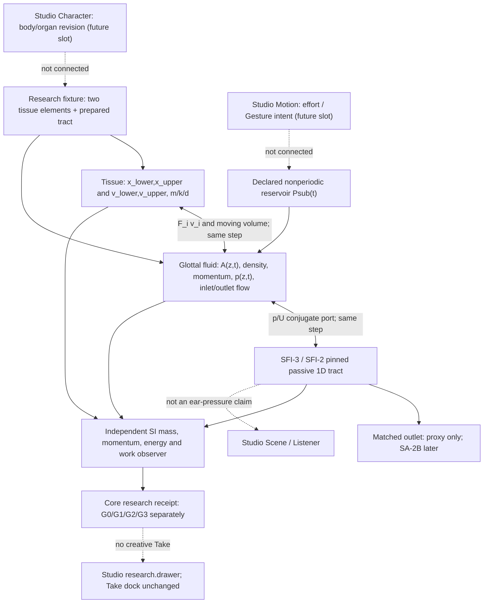

# VF-1B2 SYSTEM — proposed causal architecture and minimal physical equations
**Design-only, not yet accepted or implemented; no universal OrganGraph ABI.**

## Causal dataflow

## Sign and coordinate convention — freeze precisely at B2a
- x_L, x_U [m] = **outward** displacement of lower and upper symmetrical wall pairs, away from the glottal midline; positive x increases opening.
- z [m] = axial distance from subglottal lower boundary to supraglottal upper boundary, 0 <= z <= L_g; transverse length/depth ell [m].
- Two shape functions: phi_L(z)=1-z/L_g; phi_U(z)=z/L_g. Proposed half-gap h(z,t) = h0(z) + phi_L(z)x_L(t) + phi_U(z)x_U(t).
- Moving airway A(z,t)=2 ell h(z,t) [m^2]; V_g(t)=integral_0^Lg A(z,t) dz [m^3]; no-contact A>A_floor everywhere, otherwise UNSUPPORTED_CONTACT.
- Pressure p(z,t), Psub(t), p_tract(t) in Pa **gauge relative to declared external tissue pressure**; pressure difference and momentum use a consistent absolute-pressure density reference. U(z,t) [m^3/s] positive towards mouth; both subsystem ports use opposing outward-normal orientations.
- Proposed tissue elastic/kinetic energy, no contact: E_t = sum_i (m_i v_i^2/2 + k_i x_i^2/2) + k_c(x_L-x_U)^2/2. All m,k,d nonnegative with positive masses and stiffness; damping power D_t = sum_i d_i v_i^2 >= 0 [W].
- Local generalized aerodynamic force on tissue, F_i(t) = integral_0^Lg [p(z,t)-p_ext] (partial A/partial x_i)(z,t) dz [N]. Mechanical power sum_i F_i v_i [W]. In the **fluid** balance the same interface power must appear with the opposite sign; do not also insert legacy g dot v pressure work a second time.
- Distinguish pressure at the *glottal wall*, pressure at the *tract inlet* and pressure at *the mouth port*. They are not interchangeable. Do not call mouth-port p an ear measurement.

## Fluid and mathematical solver choice
**Proposed primary reference:** at least two control volumes, moving-area compressible/weakly compressible barotropic conservation of mass and axial momentum, with time-evolving density and momentum states and pressure derived from a stated equation of state. Initial reference EOS: barotropic isentropic small-compression air closure around a declared atmospheric reference; dissipative viscosity/separation is explicitly exported as a nonnegative heat/loss sink, not discarded. The specific EOS, face interpolation, momentum flux and thermal assumption must be **derived and registered in B2a** before numerical code.

Mass in cell j: m_j = rho_j V_j and d m_j/dt = rho_in U_in - rho_out U_out [kg/s]; V_j is geometry dependent. A moving wall changes V_j and thus density/pressure. A naive Uin=Uout or the old Uin=q-g dot v cannot be used as an independent imposed law.

**Reference flow alternatives, not substituted ad hoc:** (a) fixed-wall Bernoulli + measured viscous/separation corrections to check p(z), U, pressure losses; (b) independent momentum-based reduced flow formulation; (c) higher-fidelity measured/CFD results for discrepancy investigation. The moving-wall model cannot inherit an arbitrary separation location or coefficient tuned until sound appears. Reverse-flow outside the calibrated law must be UNSUPPORTED, not silently mirrored.

Use the existing passive tract as an independently testable acoustic subsystem. For each timestep solve the coupled nonlinear unknowns **tissue, cell mass/momentum, wall force, p/U tract inlet**, then advance all subsystem states once. Use an implicit midpoint/discrete-gradient energy-consistent approach where applicable, with declared nonlinear residuals and backtracking; fail NUMERICALLY_UNRESOLVED instead of clipping/concealing an unstable solve. Continuous states must persist between timesteps.

## Global signed power ledger
With all subsystem port orientations explicitly cancelled, the *target* balance is:

  Delta(E_tissue + E_glottal_fluid + E_tract + E_outlet_storage)
  = integral[Psub(t) Uin(t) - P_external(t) Uexit(t)]dt
    - (D_tissue + D_viscous + D_separation + D_tract + D_outlet)

All E and integrated D in joules. If the matched outlet is modeled as an ideal dissipative termination, E_outlet_storage=0 and D_outlet is nonnegative. Fluid internal/kinetic storage and moving control-volume work must be included; avoid treating Psub Uin and acoustic port pU as *two independent* energy sources. For any boundary model, state exactly which power is counted. This is a **required derivation**, not a proven identity of a yet-unwritten solver.

At every step compute separately:
- Tissue: Delta E_tissue - integral sum(F_i v_i)dt + D_tissue.
- Fluid: Delta E_fluid + integral sum(F_i v_i)dt - reservoir work + tract port work + D_fluid.
- Tract/outlet: Delta E_tract - incoming port work + D_tract+outlet.
The interface terms must cancel algebraically in total and in an independent, separately implemented numeric observer.

## Boundary cases
- Baseline pinned research tract: VF-1A's **10-section** frozen uniform and constricted variants, not Exp043's 16-section M0/M1; do not mix fixtures.
- First physical test strictly noncontact and no imposed periodic A, F0, wave source, negative material damping, per-case EQ or neural signal overwrite.
- Source reservoir has prescribed **constant pressure**, but actual flow is solved dynamically; a steady pressure is an external energy boundary, not a preset periodic excitation.
- SA-2B dynamic passive radiation remains a later dependency. Neither this matched outlet nor SA-2A's frequency-only piston gives a valid listener pressure.
- Projected Studio owner mapping unchanged: character.canvas = morphology/organ ref; motion.canvas = task/effort ref; scene.canvas = speaker/listener ref only; selection.inspector = selected domain entity; take.transport = qualified immutable Take; research.drawer = traces and receipts. No new slot.
