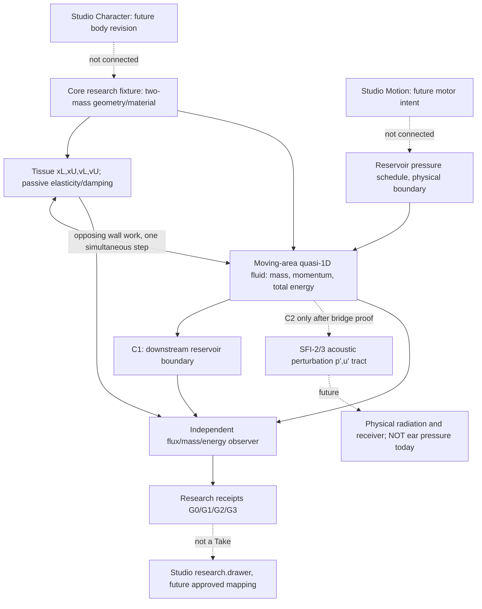

# VF-1B2a SYSTEM v2 — causal/physical architecture
**Prospective design and derivation checklist; not a proven discrete implementation.**

## Architecture / dependency (not an adopted runtime graph)

The C1 reservoir is **not** an acoustic tract, does not reproduce standing-wave feedback, and must never be presented as a finished phonation model. C2 cannot use the existing SFI-3 whole-flow scalar port unmodified without deriving a compatible mean/fluctuation bridge.

## Chosen reduced geometry and mechanics
- Coordinate z from lung side (0) to tract side (Lg), both end planes axial and fixed. Depth ell; half-gap h(z,t)=h0(z)+phiL(z)xL(t)+phiU(z)xU(t), phiL=1-z/Lg, phiU=z/Lg.
- A(z,t)=2 ell h(z,t)>A_floor; fluid volume V(t)=integral A dz; dV/dt=ell Lg(vL+vU) for constant ell and linear shape functions. This identity is a test oracle, **not a separate valve flow equation**.
- x_i positive away from midline; v_i=dx_i/dt. Tissue m_i>0, k_i>0, d_i>=0, kc>=0, coupling: m_i dv_i/dt=F_air_i - (Kx)_i - d_i v_i; dx_i/dt=v_i, with K=[[kL+kc,-kc],[-kc,kU+kc]]. Stored tissue E_t=.5 v^T M v + .5 x^T K x.
- p_abs(z,t) in Pa. External tissue pressure P_ext absolute and explicitly logged. F_air_i=integral [p_abs(z,t)-P_ext] (partial A/partial x_i) dz [N]; P_wall=sum F_air_i v_i [W]. Signed fluid wall work is the opposite. Any ambient-pressure boundary term produced by the chosen relative-energy reference must be retained; do not both subtract external pressure and silently drop the absolute flow flux.

## Independent analytical check: spatial load distinguishes the modes
For p_g(z)=p_abs-P_ext=p0+a z/Lg, the exact continuum generalized forces are:
F_L=ell Lg (p0+a/3), F_U=ell Lg (p0+2a/3), F_minus=(F_L-F_U)/sqrt(2)= -ell Lg a/(3sqrt(2)).
For uniform p_g, a=0 and F_minus=0 exactly (VF-1B1 symmetric negative control). For a !=0, direct modal work *can* be nonzero if the antisymmetric tissue velocity is nonzero; no assumption of positive net cycle work or self-oscillation follows. Compare integrated cell forces to this oracle at spatial refinements.

## Full compressible-fluid energy — non-negotiable
Use rho>0, u axial speed, U=A u, mcell=integral rho A dz. Declare an absolute thermodynamic closure e(rho), p_abs(rho), de/d(rho)=p_abs/rho^2 for a barotropic isentropic reversible model. An ideal-gas isentropic closure p_abs=P_atm(rho/rho_atm)^gamma with gamma>1 is the **first analytic candidate**, not measured glottal physics; any numerical shift to relative-energy variables must be derived and independently tested rather than asserting raw absolute-reference cancellation.

Candidate smooth quasi-1D inviscid moving-channel equations before separately qualified loss closure:
```text
mass:      ∂t(rho A) + ∂z(rho u A) = 0
momentum:  ∂t(rho u A) + ∂z[(rho u² + p_abs) A] = p_abs ∂z A + S_drag
energy:    ∂t[rho A(u²/2+e)] + ∂z[U(rho u²/2+rho e+p_abs)]
             = -p_abs ∂t A + S_energy
```
Mass flux kg/s; momentum flux N; energy flux W. Area variation geometric term is essential. For a declared drag force S_drag per length, its mechanical removal and any thermal/closure sink S_energy must be internally compatible and cannot silently be interpreted as loss-free total thermodynamic energy. The reduced barotropic model's sink may represent untracked heat; document scope. Viscous and separation coefficients are NOT selected by this mathematical skeleton.

At each timestep the independent ledger accounts for **both** endface total-enthalpy fluxes, external ambient boundary work, fluid/tissue storage and nonnegative modeled sinks; uses signed opposing wall work exactly once. Absolute and relative formulations must be proven equivalent for all test ports. A pressure-only Psub*Uin - Pout*Uout global identity is invalid for generic compressible mean flow.

## Acoustic port incompatibility / ordered resolution
SFI-2 computes the *linear acoustic* energy E_ac=.5 Σ(C p'²+L u'²), with inlet fluctuation work p' u'. SFI-3 couples a scalar prescribed positive glottal valve to this port. VF-1B2 has nonzero mean flow and total energy flux U(ρu²/2+ρe+p_abs). Simply setting U_total=u'_in and p_abs=p'_in, or subtracting baseline flux without accounting for cross terms/advection, is physically unsupported.

**C1 (first moving-wall research)**: two-mass + conservative glottal fluid + declared downstream finite-pressure reservoir; upstream reservoir likewise specifies thermodynamic/mass inflow consistently. No SFI runtime import or claim of tract feedback.
**C2 (later, conditional)**: derive p_abs=pbar+p', U_total=Ubar+u', and a mean-flow reservoir/mass-throughflow + perturbation acoustic interface; explicitly attribute mean pressure work, first-order cross terms, advected energy and acoustic second-order port power. Compare full energy and perturbation residual vs a linearized reference, state an expansion parameter/truncation bound and fail outside the declared regime. A compatible finite-mean-flow duct or bridge is allowed; if unproved, HOLD. The SFI-2 outlet remains a matched proxy, not human radiation.

## Discrete implementation obligations (not code approval)
Use moving-volume conservative finite volume cells; store rho/mass and momentum (and a thermodynamically consistent energy variable if not derivable) plus two tissue coordinates. Use face-consistent mass/momentum/enthalpy transport and a geometric conservation law for moving A; use simultaneous implicit residual, enforce positivity without power-creating clips, preserve state and refuse late failures atomically. Store source and observer on separate computational paths.

Stop on UNSUPPORTED_CONTACT, UNSUPPORTED_FLOW_REGIME, NUMERICALLY_UNRESOLVED, REFERENCE_UNAVAILABLE. No prescribed vibration, F0, negative physical damping, arbitrary net-work tuning, playback EQ, source wavetable or neural beautifier.
