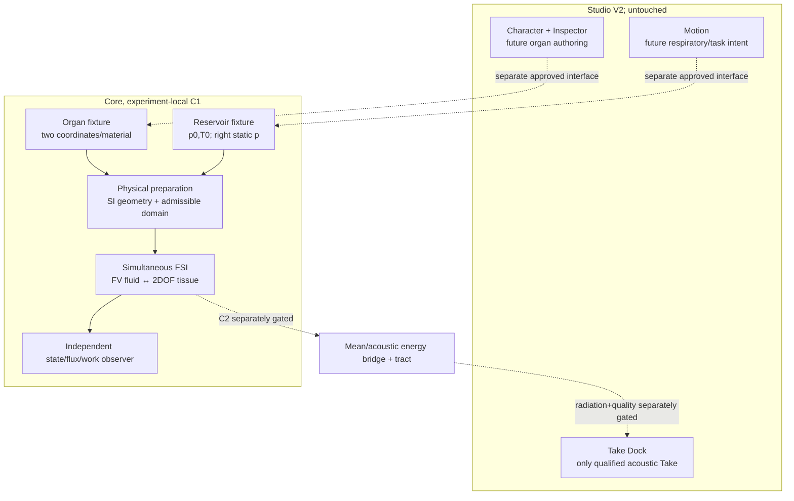

# VF-1B2 / C1-Open — SYSTEM v3, physical derivation

**DESIGN ONLY.** This describes the chosen candidate model, not verified implementation or a released organ/graph API.

## Source-to-result architecture


## Geometry, state, coordinates
z from lungs (0) to outlet (`L_g`), outward wall displacement x=(x_L,x_U), x>0 enlarges area, u>0 flows downstream.
`phi_L(z)=1-z/L_g`, `phi_U(z)=z/L_g`.
`h(z,t)=h0(z)+phi_L*x_L+phi_U*x_U` [m], `A=2 ell h` [m²].
For finite-volume cell j: `V_j(x)=integral_cell A dz=V_j0+sum_i g_ji x_i`; `g_ji=integral_cell 2 ell phi_i dz` [m²].
Hence `Delta V_j=sum_i g_ji Delta x_i` **exactly** for this linear shape basis; `sum_j dV_j/dt=ell L_g*(v_L+v_U)`. The same precomputed g_ji is the only wall-work/force projection, not a second valve correction.

Tissue: `M diag(m_L,m_U)>0`; `D diag(d_L,d_U)>=0`; `K=[[kL+kc,-kc],[-kc,kU+kc]]` positive definite in chosen domain. `dx/dt=v`, `M dv/dt=F_air-Kx-Dv`; `E_t=.5 v^T M v+.5 x^T K x`.

Fluid `rho>0`, velocity u, pressure p_abs>0, gas internal e, total energy density `calE=rho(e+u²/2)` [J/m³], `p_abs=(gamma-1)rho e`. Evolves conservative cell masses [kg], axial momenta [kg m/s], total energies [J], with moving V. No imposed periodic pressure/area.

## Continuum governing equations (smooth, inviscid moving-area quasi-1D)
```text
∂t(rho A) + ∂z(rho u A) = 0
∂t(rho u A)+∂z((rho u²+p_abs)A) = p_abs ∂z A
∂t(calE A)+∂z((calE+p_abs)u A) = -p_abs ∂t A
```
The pressure–geometry axial source must be discretized to maintain stationary p=constant, u=0 at nonuniform fixed A. The moving-wall lateral velocity energy is neglected by the quasi-1D approximation and labeled a *model discrepancy*, not an exact 3D FSI result. Fixed external tissue pressure `P_ext` is distinct from absolute gas p; tissue sees `p_g=p_abs-P_ext`.

`F_air,i=sum_j (p_abs,j-P_ext)g_ji` [N]. Tissue power `P_tissue_wall=sum_i F_air,i v_i=sum_j (p_abs,j-P_ext)dV_j/dt`; fluid wall power `P_fluid_wall=-sum_j p_abs,j dV_j/dt`. The external-pressure reference contributes `P_ext dV_total/dt` in the conserved **relative total** energy, avoiding a fake power surplus.

For fluid internal energy + kinetic energy, `E_f=sum_j calE_j V_j` [J]. Define `H=E_f+E_t+P_ext(V_total-V_total0)`. For adiabatic, inviscid, noncontact C1:
```text
dH/dt = Phi_E,left - Phi_E,right - sum_i d_i*v_i²
Phi_E = u*A*(calE+p_abs) = mdot*(e+p_abs/rho+u²/2) [W]
```
No extra scalar source/tract acoustic `p' U'` term. If later losses are added, state whether dissipation is converted to internal heat or genuinely leaves modeled control volume; a physically conservative total-energy EOS cannot simply delete frictional work as though it were thermodynamic loss.

## Chosen discrete conjugacy, to be proven before executable claims
For each cell and a single common midpoint/stage `*`:
```text
m_j^{n+1}-m_j^n = -dt*(Mflux_R - Mflux_L)
q_j^{n+1}-q_j^n = -dt*(Pflux_R - Pflux_L)+dt*(p*dA/dz)_j
E_j^{n+1}-E_j^n = -dt*(Eflux_R - Eflux_L) - p_j^* Delta V_j
M(v^{n+1}-v^n) = dt*(F_air^* - K x^* - D v^*)
x^{n+1}-x^n=dt*v^*
F_air,i^* = sum_j (p_j^*-P_ext)*g_ji
```
Summing the **identical** `p_j^* Delta V_j` across fluid/tissue yields `Delta H + dt*(Phi_E,right-Phi_E,left)+dt*v*^T D v*=0` up to the actually solved coupled numerical residual and flux quadrature. No independent source-shaped pressure applied to tissue. Midpoint preserves the quadratic tissue energy identity; nonlinear fluid geometry and boundary numerical flux need independent proof/test. Store both signed separate wall powers and antisymmetric force for auditing.

Choose a same-step nonlinear coupled residual, positivity and geometric conservation law; a tentative method is iterated implicit midpoint with bounded FV face flux. **Do not presume** implicit midpoint alone guarantees exact fluid entropy, shock handling, or tract power conservation. At A3 freeze flux formula, characteristic ghosts, iteration residual, tolerances and fallback refusal. No accepted one-tick pressure lag.

## Reference-limit nuance
A sealed (both `mdot=0`) spatial FV model can still support internal axial motion. It is **not** byte-identical to C1-R0. Test the uniform-pressure lumped reduction `u=0, rho=M/V, p=P0(V0/V)^gamma` and its analytical conserved H *as a declared reduction*. For genuine distributed sealed dynamics separately audit cell flux balance and compare only when time/space regime justifies it.

## Capability boundary
C1 output = physical pressure/velocity/density/geometry state and independent receipts, not emitted voice/WAV. C2 mean-flow/perturbation coupling is future and must re-derive energy; fixed downstream reservoir has no acoustic backreaction. BodyRevision/OD-3 and the passive `morphoacoustics_graph` p/U model remain separate.
