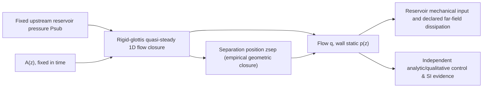

# VF-1B2a — rigid glottis flow reference (research only)
**Prerecorded before implementation 2026-10-27 JST.** [Issue #215](https://github.com/ryonakayama234/morphoacoustics/issues/215), dependency-independent continuation of source mechanism research. Base **Core main** `e05e3274ad69bfb9202816049f6661a18ba39ec0`, NOT a stacked branch. VF-1B1 [#214](https://github.com/ryonakayama234/morphoacoustics/pull/214) has dedicated green CI but independent Codex review is **BLOCKED by usage-limit response** on that PR; this module must not import #214, #209 or SFI-3.

## Narrow physical system

No tissue mass, no wall movement, no glottal self-oscillation, no tract acoustic pressure, no received audio. **No FSI or moving-wall power port is created here**. A rigid wall has zero wall mechanical work, even though nonzero pressure acts upon it.

## Frozen equations, assumptions and scope
Single symmetric 1D channel, air density `rho=1.21 kg/m^3`; axial length `L=0.006m`; cross-section area linearly interpolated between endpoint areas `A0>0`, `AL>0`. A geometry-independent fixed downstream reservoir reference `Pout=0 Pa` (gauge). `Psub >= Pout` only; reverse-flow is explicitly unsupported rather than silently reversing separation location. `Cd=0.7` default is an **assumed discharge factor**, NOT independently validated viscosity/calibration; separate `Cd=1` ideal reference.

**Separation closure (declared *ad hoc*, not predicted boundary layer):** convergent or parallel (AL<=A0) separation at outlet `zsep=L`; divergent (AL>A0) earliest `z` after entrance where `A(z)=1.2 * Amin`, if reached by outlet; otherwise at outlet. The `1.2` ratio is a source-described semiempirical illustrative criterion, not universal or fitted to this data. For linear divergence `A0=3e-5m², AL=6e-5m²`, `zsep=0.2L`, `Asep=3.6e-5m²`. At zero pressure gradient `q=0`; separation is geometric proxy even though physical separation is undefined: report `not_active`.

Flow law `q = Cd * Asep * sqrt(2*(Psub-Pout)/rho)` for nonnegative pressure difference. On the attached interval `z <= zsep`, `p(z) = Pout + 0.5*rho*q²*(1/Asep² - 1/A(z)²)`; on the separated interval `z>zsep`, `p(z)=Pout`. This is a **quasi-steady inviscid core and zero pressure recovery** assumption. It is NOT a solution of viscous Navier-Stokes, and it does not predict transglottal pressure in rigid replicas quantitatively. It deliberately allows local pressure below Pout at the narrow upstream throat in divergent geometry. Static pressure at the local glottal entrance need not equal distant upstream reservoir pressure; its difference represents missing entrance/acceleration/loss physics.

Effective far-field power loss (including untracked jet dissipation and entry losses) is **defined** as `(Psub-Pout)*q` [W] for reservoir-to-reservoir steady flow. This accounting is not an independently resolved dissipative model. Declare no fluid storage in this quasi-steady approximation and zero moving-wall work. The identity `reservoir_power - declared_far_field_loss == 0` is only bookkeeping, **NOT a real FSI energy-conservation oracle**. A true moving-wall FSI solver must derive its own non-double-counted fluid/solid work from conservation laws and add viscous/separation work.

## Constrained data routing
Standalone `experiments/038_vf1b2a_rigid_glottis/` code and tests, `docs/research/vf1b2a/{SYSTEM,DATA,EXPERIMENT}.md`, dedicated CI only. No changes to core `src/`, main production graph API, Studio, panel registry, Takes, waveguides, SMC or ASMR. No UI proposals. Original creator goal body+actuation → physical result is preserved only as *future* motivation, not a claim for the rigid reference.

## Literature (qualitative support only)
- [Deverge et al. 2003 JASA DOI 10.1121/1.1625933](https://pubmed.ncbi.nlm.nih.gov/14714815/) — measured rigid glottis; quasi-steady Bernoulli + viscosity + boundary layer separation predicts pressure globally under limitations.
- [Zhang 2008, Influence of flow separation location on phonation onset](https://pmc.ncbi.nlm.nih.gov/articles/PMC2646589/) — geometry-dependent separation and effects on mode synchronization.
- [Flow-induced oscillations of vocal-fold replicas (2023)](https://www.nature.com/articles/s41598-023-48080-x) — discusses semiempirical `Asep≈1.2*Amin` criterion (alternative to boundary-layer model).
- [Pressure distributions in a static physical model of the hemilarynx (2010)](https://pmc.ncbi.nlm.nih.gov/articles/PMC4804921/) — measured real flow is often asymmetrical/bistable, outside this 1D symmetric model.
- [Bernoulli versus Navier–Stokes comparison (2007)](https://pubmed.ncbi.nlm.nih.gov/16504473/) — separation closure accuracy is consequential.
