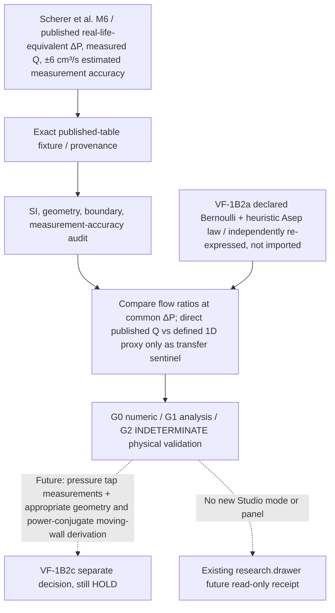

# VF-1B2b SYSTEM — measured rigid M6 glottal-flow transfer sentinel (research-only)

**Preregistered before source implementation, 2026-10-27 JST.** Core main parent `e05e3274ad69bfb9202816049f6661a18ba39ec0`. Tracking [#215](https://github.com/ryonakayama234/morphoacoustics/issues/215); frozen predecessor [Draft #216](https://github.com/ryonakayama234/morphoacoustics/pull/216) is not merged and is not imported. This independent pilot does **not** implement moving walls, FSI, phonation, or sound.

## System / physical and evidence path

**Reference facts (source)**: Scherer, Torkaman, Kucinschi & Afjeh (2010), *Intraglottal pressures in a three-dimensional model with a non-rectangular glottal shape*, JASA 128, 828–838, DOI [10.1121/1.3455838](https://doi.org/10.1121/1.3455838), [PMC2933258](https://pmc.ncbi.nlm.nih.gov/articles/PMC2933258/). M6 uses 7.5× enlarged static physical glottis, data expressed as real-life equivalents (model pressures 1/56.25 and model flows 7.5× those equivalents), sinusoidal nonrectangular 3D transverse shape, minimum projected real-life area 0.122 cm², 0.16 cm maximum gap and 1.2 cm A-P length, 10° convergent, 0° uniform, 10° divergent. Published experimental flow meter accuracy estimated approximately ±6 cm³/s **real-life equivalent**, not identified as one-standard-deviation uncertainty. Three sets of 14 wall taps are described, but full machine-readable numeric wall pressure traces and their uncertainties are not included in the four-pressure Table 2 used here.

**Strict domain mismatch:** #216's one-dimensional linear entry/exit-area model with `L=0.006 m`, zero pressure recovery and geometric Asep/Amin=1.2 does not geometrically represent M6's 3D sinusoidal flow, sidewalls or pressure taps. Even giving the toy the same minimum projected area does NOT produce a matched boundary-value problem. Comparison detects **non-transferability** of the simple parameterization; no quantitative M6 pressure-profile validation, calibrated Cd, CFD equivalence, or human biology claim.

**Existing Studio product contract:** [accepted V2 ADR](https://github.com/ryonakayama234/morphoacoustics-studio/blob/main/docs/product/STUDIO_WORKSPACE_V2_DECISION.md). `character.canvas` references physical anatomy (no new editing); `motion.canvas` owns motion/gestures; `scene.canvas` owns Speaker/Listener; `take.transport` reads only immutable audio Takes; `research.drawer` is the future owner of science receipts. **No Studio, Take, Core public API, organ graph, SMC, ASMR, or production files change.** Source is standalone under `experiments/047_vf1b2b_m6_flow_reference/` to avoid reuse of existing experiment number 038.

## Executed pilot / causal result — 2026-10-27 (append-only)
Research implementation head `d7213d70ceb49b66a12cf2be58a2c8761154fe1a`: [dedicated measured-flow CI #40432872175](https://github.com/ryonakayama234/morphoacoustics/actions/runs/40432872175) **SUCCESS**, 20/20 stdlib tests, SHA-pinned 12 experimental Table 2 observations, negative controls and science receipt. Input fixture SHA256 `febecab692b5eb78d2e73520d27556c368de5cff4691ff02c20baab64556b6d0`. Traces are 12 measured-vs-toy records with explicit unqualified geometry. The physical graph above is unchanged.

At four measured pressures (294,491,981,1472 Pa), published M6 divergent/uniform real-life equivalent Q ratios are `1.08685, 1.10021, 1.09293, 1.07539` versus **1.2** under the inherited toy ramp/Asep assumption. Each falls below the toy ratio even if both measured flows vary by the article's approximate ±6 cm³/s accuracy in the worst direction. This is **not** a randomized statistical confidence interval, a calibrated model-family rejection, or matched-shape pressure validation. It exposes a transfer limit in the current shape/ramp/separation parameterization.

VF-1B2c remains HOLD. No fluid-to-wall power transfer, pressure-wall tap mapping, tissue dynamics, phonation, radiation, receiver, or Studio runtime is implemented. Technical scope of a future experiment: numerical wall pressure measurements plus a defensible M5/M6 shape/boundary mapping, and separately derived moving-wall energy-conjugate ports.
