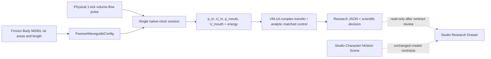

# VM-1A system — physical causal measurement, not a new sound engine

Research architecture (status: proposed until CI and review):

Source is prescribed flow; no glottal oscillator and no source-filter two-way coupling. Body is frozen 1D rest geometry, **not** an executable arbitrary organ-node graph. The WG1 solver, typed organ graph, old Takes and Studio adapter are untouched.

The fixed Studio [PR #33 PANEL_REGISTRY](https://github.com/ryonakayama234/morphoacoustics-studio/blob/design/workspace-v2-shell-20261025/docs/product/workspace-v2/PANEL_REGISTRY.json) is a **Draft UI contract**: Character canvas owns typed organ nodes/edges, Motion canvas owns script/gesture timing, Scene canvas owns Speaker/Listener staging; bottom dock owns audition/Takes; `research.drawer` alone may later own `ValidationReceipt`. This Core-side experiment does not add a panel or claim a Studio feature.

Dependence: source/mouth waveguide [CORE-WG-1], passive B0 termination, frozen Exp028 body areas, VM-0 diagnosis; downstream: segmented independent oracle → physical damping/source coupling/radiation → matched creator voice tests. The uniform matched reference checks only a special case and cannot validate B0 or natural speech.
