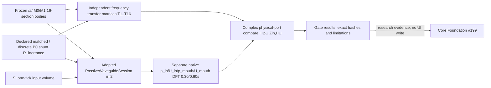
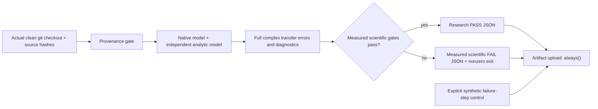

# VM-1B physical system and evidence ownership

**Research-only; no Core main, Studio UI, SMC, ASMR, held Voice/WG2 PR, or Take changes.** Proposed foundation programme [#199](https://github.com/ryonakayama234/morphoacoustics/issues/199).

**Two independent algorithm paths but shared physical assumptions:** frequency-domain 2×2 section transfer and exact phasor shunt-B0 derivation versus per-tick scattering/queue dynamics. The two paths share constants, geometry, *assumed* B0 R/m and ideal-flow source. Their agreement is a strong **software/numerical consistency** test, not independent evidence that the B0 circuit is a correct physical mouth radiation law.

Physical port `p_mouth,U_mouth` is the 1D mouth-boundary effort/flow pair, **not** a receiver pressure, sample-rate postprocessor, audience audio or listener sound. The source is a **prescribed physical flow**, not self-sustained vocal-fold oscillation. No gain/F0/formant quality inference.

Future extension principle: typed p/U ports and matched provenance are needed for an eventual swappable organ model, but no generic graph-to-WAV solver or universal model ABI is being introduced by this research. The accepted Studio Character/Motion/Scene canvas layout is protected; when UI expansion is necessary, **stop and submit an explicit proposal first**.

## Evidence durability / failure-path contract (2026-10-26)

The instrument computes exact executed-commit/tree identity and source-file SHA-256 **before physics execution**. Missing/dirty code provenance refuses evidence creation rather than mislabeling historical base SHA as the executed engine.

An **execution/system failure before report creation** cannot yield a truthful physical report and must fail visibly; the artifact upload cannot invent lost observations. The synthetic failure artifact is distinctly flagged and is never a real physical verdict. Normal workflow output artifacts remain subject to the 90-day GitHub retention; long-term permanence remains a separate task, [#197](https://github.com/ryonakayama234/morphoacoustics/issues/197).
