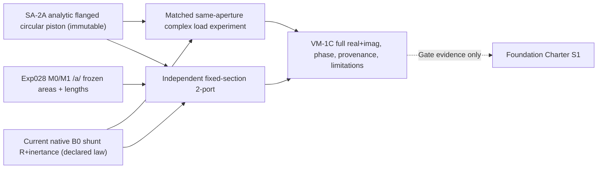

# VM-1C physical system / owner and dependency graph

Research branch is **stacked on exact SA-2A Draft #172**: it directly imports the previously validated analytical piston reference. It is NOT a new independent derivation of the reference, not a new production boundary, and not a PR to Core main.

A transmission-line analytic simulation is a steady-state *port-reaction calculation*, not a time-domain physically embodied source or receiver audio. Three terminations (piston, B0 continuum and B0 discrete) share the same anatomical tube geometry and prescribed `Uin`. The piston is a **flanged** idealization with an infinite rigid baffle. M0 and M1 differ in length only for /a/ frozen areas. The actual time-discrete B0 is derived from Core's native B0 update, and the continuous B0 load removes n=2 approximation. A distinct SA-2B task must still establish a causal passive time-domain boundary.

User-approved Studio Character/Motion/Scene UI, organ Inspector, Take flow and old character audio are protected and **not edited**. If UI change ever required, stop-and-propose.