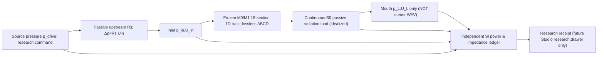

# VM-1D SYSTEM — internal source/duct/load research chain
This is a hypothetical passive acoustic source termination **inside the research runner**, not a new organ module, glottis model or Studio control.

With `[p_in,U_in]^T=M[p_L,U_L]^T`, `M=[A B; C D]`, `p_L=Z_L U_L`, and `p_drive=p_in+R_s U_in`,
`U_L=p_drive/[A Z_L+B+R_s(C Z_L+D)]`.
Ideal-flow comparator: `U_L=U_command/(C Z_L+D)`.
The passive duct has neither self-oscillation nor a physically realized gesture.

**UI ownership alignment** (Studio Draft #33 PANEL_REGISTRY, read only): `character.canvas` describes possible organ nodes / body refs; `motion.canvas` owns future Script, Direction and Gesture timing; `take.transport` owns verified creator audio (NOT generated in VM-1D); `research.drawer` may later own scientific receipts. No panel change and no new controls. Studio imports only vetted Core capability contracts later.
