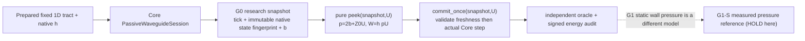

# VQ-1 G0-P SYSTEM — research-only same-tick inlet port

Status: PRE-IMPLEMENTATION PREREGISTRATION (2026-10-28 JST); no new solver run at registration. Source base: Core main `727b11ecf103f5c087cfcb820bdec11f883e7c03`. Creator delegated experimental implementation after design Draft #237. This child study has no production public API, Studio UI, glottal tissue, moving duct, or SFI branch import.

## Boundary & actual source semantics
Existing `PassiveWaveguideSession.step(U)` in `src/morphoacoustics_waveguide/passive_waveguide.py` implements a fixed static 1D serial FIFO acoustic waveguide. Each native tick: incident backward inlet pressure is the pre-shift first item `backward[0][0]` [Pa]. `Z0=rho*c/A0` [Pa*s/m3], `h=length/(c*cells_per_section)` [s]. Its source boundary is `a=b+Z0 U`; hence `p=a+b=2b+Z0 U` [Pa], `source_work=h*p*U` [J]. The port is oriented U>0 **into the tract**.

This is exactly a *discrete* boundary, not continuous-time midpoint acoustic impedance. This module MUST use the actually native h; it MUST NOT substitute the research SFI-2/3 midpoint backend at 48k. The only trusted Core step is `PassiveWaveguideSession.step()`; leave it unchanged.

## Research architecture

The adapter lives in `experiments/054_vq1_g0_port/port.py` and deliberately reads private FIFO state, marked **version-pinned experimental only**. Its snapshot fingerprints every wave FIFO, B0 q, complete immutable config representation, native tick and session ownership; later direct out-of-band mutation must cause a stale-state refusal. Snapshot/peek never calls `step`, advances FIFO, changes B0 q, or rewinds. `commit_once` validates the exact captured state and uses one existing `step()`; the Core step already precomputes candidates before committing live state. Research API explicitly single-threaded; a production concurrency-safe interface would need its own approval. No generic solver graph, moving duct, source-wall power, or Studio UI.

## Scientific separation
G0 tests **only** same-tick p/U port, failure atomicity, deterministic state and passive acoustic power. The port is not a tissue force. The subsequent G1-S static measured M5 pressure/geometry identification and G1-D moving-wall force/work remain separate conditional research gates. A G0 PASS gives no voice, self-oscillation or creator GO. Source and receiver are still absent.

## Executed implementation architecture (append-only, 2026-10-28 JST)
At exact tested source commit `ad967d5b978097a40ab8393704ae59e8ef5f96ae`, the research adapter implements `PortSnapshot` (owner/tick/digest/b/Z/h), pure `peek` and `commit_once` around the original unchanged Core native FIFO step. Full states include both pressure-wave queues, config and B0 q. No solver class, exported package API, Studio source, waveform or motion interface is altered. Scope is single-thread and one fixed serial duct only. The API is **NOT** a generalized FSI edge. G1-S and G1-D remain separate.

### Post-pilot adversarial audit (2026-10-28)
A snapshot state digest alone does not prove that its cached inlet `b_pa`, `z0_pa_s_m3` or `dt_s` fields are intact. The first numerical pilot checked live state only. This was independently spotted before final adoption; `_require_live` now compares the **entire immutable snapshot** to a newly captured live snapshot, rejecting a replaced payload even if state digest and tick match. Commit uses **the single validated candidate flow**, rather than coercing caller flow twice. This adds no backend or public API change; still single-thread research-only.

### External review remediation R1 (2026-10-28)
Original tested `ad967d5` received **four Codex P2** code-review findings: stale-payload snapshot, no Core-internal failure actually reached, STOP evidence erased, and receipt producer skipped after red tests. The adapter now binds all fields to a fresh live snapshot and commits the already validated flow. It still wraps `PassiveWaveguideSession.step()`, never rewrites its physics. Dedicated CI now creates evidence even when an earlier G0 pytest step fails.

### Exact-code checkout control
GitHub pull_request workflows default to an ephemeral **merge commit** unless `actions/checkout` pins the PR head. G0's dedicated workflow now checks out `github.event.pull_request.head.sha || github.sha` and forwards that expected SHA to the receipt producer; the producer refuses if `git rev-parse HEAD` differs. This is required for the exact-head Core port research gate and does not modify the solver.
