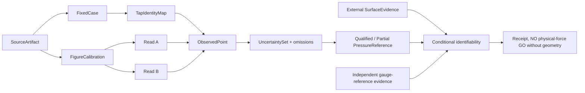

# VQ-1 G1-S D2 — DATA: what is observed, derived, and unknown

**Status:** documentation-only prospective research data contract (NOT public Core/Studio schema). Source: Original M5 (Fulcher, Scherer, Powell 2011 DOI 10.1121/1.3514424) and source prerequisite Draft #220. No measured pressure points, original figure binary hashes, qualifying geometry arrays or force claims are created in this design.

## Frozen case and reference plane

| Attribute | Frozen identity | Evidence class |
| --- | --- | --- |
| Case | `M5_UNIFORM_FIG2B_D002CM_DP10CMH2O` | paper/selection, preregistration |
| Hardware | rigid M5 uniform glottis | paper: **not a moving vocal fold** |
| Minimal gap | `d_life=0.02 cm = 0.0002 m` | published nominal geometry |
| Driving pressure | `10 cmH2O` (nominal life-size equivalent `980.665 Pa`) | published condition, **not** absolute local wall pressure |
| Measurand | `D_i=p_tap0-p_wall_i`, each real `tap_id,side` | plotted Figure 2B measured marker, pending independent reading |
| Axial anchors | tap 6 `z=.211 cm`; tap 11 `z=.413 cm`; tap 13 `z=.511 cm` | publication-based anchors |
| Side | `FW` (jet-attached) or `NFW` (jet-detached), not anatomical left/right | figure symbols; overlapping NFW often unresolvable |
| Same-case Q | `64.7 cm3/s = 6.47e-5 m3/s` | paper Table I contextual cross-check |
| Same-case entrance k | `1.447` | **author-derived scalar coefficient**, not observed local pressure |
| Apparatus factor | enlargement `7.5` | preserve original plotted unit, model-vs-life pressure/flow scale before conversion |

**Important:** measured `D_i` cannot be silently converted to `p_i` without qualifying `p_tap0` in a shared reference frame. Source and M5 fixture coordinates must be distinguished from prospective body/organ geometry. No evenly spaced missing taps.

## Evidence class and provenance

Data processing must keep the original independently acquired source **immutable** and keep `measured_marker`, `textual_figure_anchor`, `derived_unit_conversion`, `calculated_model_curve`, `synthetic_control`, `proposed_wall_quadrature` and `unresolved` as different fields/classes. A published fitted Figure 4 curve, paper's reconstructed equations, scalar flow/coefficient, synthetic controls or AI-inferred pixels are **never** eligible as Figure 2B observed measured markers.

## Research-local prospective records

1. **SourceArtifact**: DOI, citation, original figure `Fig1B/Fig2B`, immutable archive URI and bytes hash if legally acquirable, acquisition provenance/time, original image dimensions, crop/transform history, media rights, measured-vs-model-layer classification. A missing binary source/hash must be recorded as such, never fabricated.
2. **CaseIdentity**: apparatus identity, case ID, gap, pressure and flow in native source units and SI with explicit conversion steps, scale convention, downstream and tracheal reference planes. All case qualifiers must match source.
3. **TapMap**: exact `tap_id`, side `FW/NFW/UNRESOLVED`, physical source-reported `z` and coordinate uncertainty; source citation for each. Figures can support only what is actually identifiable.
4. **FigureCalibration**: original source hash and crop, >=2 independently recognizable nondegenerate tick anchors on BOTH x/y axes, chosen linear transform/validity domain, pixel scale, tick/line thickness, full original axis unit/sign, apparatus scaling assumption and its source. No pressure values consumed by a force model before calibration freezes.
5. **IndependentRead**: raw marker centroid pixel x/y, bounding box, symbol and wall attribution, plot id, tap id, read A/B identity and independence statement, read date, uncertainty from visual marker localization, ambiguity reason; not a point taken from a drawn line or calculated curve. Two reads of **one** figure do NOT constitute independent biological experiments.
6. **ObservedPressurePoint**: frozen and reconciled source-kind, case/tap/side, raw plotted `D` in original units, `D_pa` and interval, `z_m` and interval, calibrated marker lineage, status `VALID/AMBIGUOUS/MISSING/REJECTED`. No replacement of an occluded side by the other side.
7. **UncertaintySet**: multiple identifiable sources kept separate: publication instrumental bounds (upper limit is **not** standard deviation), calibrated tick/axis/pixel/marker bias, co-transformed common plot axis, scale conversion, coordinate uncertainty, wall/jet attribution, read disagreement, unresolved systemic bias. Store shared nuisance dimensions where possible rather than pretend all observations independent.
8. **SurfaceEvidence (separate prerequisite, not generated here)**: fixture-specific wetted surface patches, unit areas, local normals, tap-to-patch reconstruction rule, support region and pressure spatial resolution, evidence of pressure variability within each patch, separate outside pressure-reference plane, optional **explicitly model-defined** tissue/mode projection. Reject unrelated anatomical mesh or mere 1D area profile as a genuine 3D wetted surface.
9. **IdentifiabilityReceipt**: target observable `pressure_feature / differential_force_component / conditional_generalized_force`, required observation set, missing coverage, measurement operator/version, force-weight provenance, common-gauge cancellation or independent gauge source, uncertainty bound if finite, structural rank/nullspace test, rejected inferences and result status.
10. **ScienceReceipt**: immutable exact head SHA, source hashes, test and external audit outcome, stated claims, each independently adjudicated gate, explicit absence of real force/FSI/voice certification. On computation errors retain STOP/UNRESOLVED evidence; do not overwrite older artifacts.

## Mathematical decision rule: distinguish algebraic identifiability from experiment

Let `d` denote true static wall pressure-drop samples in a *declared finite discretization*, `y=H d + epsilon` observations, and `w` the pressure-to-generalized-force weights defined by separately evidenced geometry and mode. The target is

`F=(p0-p_ext)sum(w)-w^T d` **only for a separately justified paired-surface reduction**. The general mechanical force is the sum of gas-pressure traction integrals over all relevant fluid-facing tissue surfaces, with `n` oriented from each fluid region into the tissue. No exterior pressure may be subtracted from medial patches unless equivalent opposing-surface weights have independent support.

- **Structural identifiability** of `w^T d` in a noiseless linear design requires `w^T v=0` for every `v` in the nullspace of `H`. Equivalently the force functional must lie in the row-space of the observation operator. Otherwise two pressure fields can match all measured taps while yielding different force: report `NOT_IDENTIFIABLE`.
- **Absolute gauge condition (conditional paired-surface formula only):** if `sum(w) != 0`, a qualified observation of `p0-p_ext` is also necessary. A whole-tissue interface instead requires all relevant pressure fields and appropriate surface traction orientations. If `sum(w)=0` the shared additive pressure reference cancels **for this specific target** only; do not infer tissue traction fields from that cancellation.
- **Bounded interval result:** with a declared source-supported feasible set `U` of pressure, geometry, common-reference and uncertainties, publish `F_min = inf_{u in U} F(u)`, `F_max = sup_{u in U} F(u)` only if both finite and all constraints trace to sources. Missing pressure coverage with no valid bounds means `UNBOUNDED_OR_NOT_IDENTIFIABLE`, **not** a zero or interpolated value.
- **If a fixed already-qualified patch geometry is hypothetically given**, the earlier G1-S Draft #239 pressure-only conditional bound is `|sum(w)| (u_p0+u_ext) + sum(|w_j| u_Dj)` for independent per-tap worst-case interval magnitudes. Real marker/axis errors are correlated; use the source-calibration feasible set rather than applying this simplified bound blindly. Material, mode and surface mapping uncertainty must be separately included before any *physical* force claim.

At the level of raw Figure 2B tap points, `H` alone does **not** establish any particular 3D pressure-to-surface reconstruction. The nullspace test cannot be claimed to PASS until the discretization and mapping are independently specified and frozen. A `source-qualified pressure profile` may still be a useful scientific success even if `F` is not identifiable.

## Status vocabulary (not a production schema)

- `SOURCE_ONLY`: original figure has not been calibrated/dual-read.
- `PARTIAL_PRESSURE_REFERENCE`: some true pressure markers are recovered; coverage/axis/side gaps remain.
- `SOURCE_QUALIFIED_FOR_PROFILE_COMPARISON`: complete original predeclared tap 6..13 FW case with independent readings, tap mapping, source/uncertainty audit; **not force**.
- `PRESSURE_FEATURE_SUPPORTED`, `PRESSURE_FEATURE_CONTRADICTED`, `PRESSURE_FEATURE_INDETERMINATE`: interval-based static comparisons.
- `STATIC_FORCE_CONDITIONAL_ONLY`: geometry/gauge proven for a **declared** fixture/quadrature; not biological tissue.
- `STATIC_FORCE_NOT_IDENTIFIABLE`: missing evidence or nontrivial nullspace affects target.
- `G1_D_HOLD`, `G4_VOICE_NO_GO`: always in this D2 slice.

No new Studio panel or Take fields. If a future separately approved UI capability reads these receipts, they belong exclusively in `research.drawer` with immutable links, never in `character.canvas` editor state.
