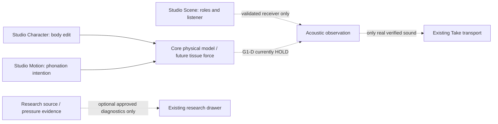

# VQ-1 G1-S D2 — DECISION: selected next scientific capability

**Design date 2026-10-29 JST.** **This is a technically finalized proposal for creator decision**, not creator consent, execution approval, source-data adoption or physics validation. **Primary owner:** Core / research-local G1-S observed intraglottal pressure reference and force identifiability. **Next bounded work package:** source-qualified M5 Figure 2B measured pressure profile, then a no-forgery identifiability assessment. Keep main, existing source/graph/Studio contracts and Draft #239 implementation untouched.

## Creator-facing motivation

A compelling Character is a body that responds to physical parameters. The long-term value of this study is lawful source-specific aerodynamic forces, so a tissue/material edit may eventually change phonation and sonic identity for a physically intelligible reason. This study produces **no immediate improved timbre or new Character**; forcing it to would incentivize invented pressure and noncausal audio. The result must make the next actual physical capability *easier to judge*, not grow a Studio diagnostics panel.

## Competing directions and decision

| Alternative | Benefit | Key scientific/product failure | Decision |
| --- | --- | --- | --- |
| A. Treat current G0-P inlet pressure as glottal wall force | simplest integration | acoustic boundary is not a spatial intraglottal measured field; false tissue work | REJECT |
| B. Derive wall pressure from M5 scalar Q and k coefficients | numeric convenience | underdetermined spatial inverse problem, paper's coefficients are derived from measurements | REJECT |
| C. **Independent M5 pressure-source qualification -> force identifiability** | measured physical anchor, useful even if partial/HOLD, no code branch stack | may fail if original markers, geometry or gauge cannot be qualified; acceptable negative result | **SELECT** |
| D. Implement moving two-mass fluid-structure self-oscillator now | fastest route to sound samples | neither force law nor moving-wall work validated, historic VF-1A/1B1 decay | HOLD |
| E. Improve timbre via EQ, hand-drawn excitation or neural repair now | may sound attractive quickly | breaks causal explanation and confounds source-quality diagnosis | REJECT as substitute; separate validated neural closures later allowed |

## D2 scientific conclusion: pressure samples are not full force

M5 Figure 2B measures `D_i=p0-p_i` at discrete taps on a **rigid** surface, and the paper reports side-dependent and partially overlapping FW/NFW figures. The source does not deliver actual time-dependent tissue force. A general continuum force requires **pressures on the actual wetted tissue boundary**, orientations, areas, external faces and motion coordinate.

**NEW explicit geometry/sign qualification:** Let `n_f` be the normal from a fluid domain *into the solid tissue* at its fluid-facing boundary. The pressure traction **on the tissue** is `+p_f n_f` at that fluid-facing surface (or `-p_f n_s` when `n_s=-n_f` is tissue-outward). Real generalized pressure force sums pressure traction over all relevant gas-contact surfaces, including separate exterior/subglottal surfaces where present. A naive `(p_wall-p_ext)*area` term on only the measured medial patches is **NOT** a general physical statement. It is valid solely when a *separately qualified paired-surface geometry/reference construction* proves the same generalized weights and the difference legitimately represents opposing tractions. Otherwise retain the full signed two-/multi-surface traction formulation. The earlier #239 formula is a **synthetic algebraic conditional**, not automatically a measured tissue force.

```text
General: F_q = sum_{s in independently mapped fluid/solid interfaces}
               integral_{S_s} p_s (n_{fluid->solid,s} · phi_{q,s}) dS
Conditional paired-surface reduction (ONLY if independently justified):
         F_q = (p0-p_ext)*sum_j(w_j) - sum_j(w_j*D_j)
```

No sample can be assigned a nonzero wall weight solely from `tap_id`; a point-pressure tap does not specify representative surface area or a pressure interpolation error. Unknown exterior pressure is a separate gate. A source profile may legitimately be complete while total tissue force remains NOT_IDENTIFIABLE.

## Fixed implementation slice / no accidental scope creep

**IF creator agrees with D2**, execute only:
1. Archive / audit original Figure 1B, Figure 2B and exact M5 condition, including symbol attribution and axis units; preserve original hash/source.
2. Calibrate source axes, true taps and uncertainty, independently digitize observed FW measured markers with two independent passes; keep NFW ambiguities explicit. Qualify or reject each marker, preserve raw sessions.
3. Produce the source-qualified pressure reference (or partial/HOLD), test preregistered `D11-D6` and `D11-D13` with conservative intervals.
4. Perform an **identifiability audit** for a prospective explicit force target with actual independently available surface/pressure information. If not available, output no-force `NOT_IDENTIFIABLE` and the exact missing prerequisites. Do NOT fabricate a geometric mesh or extrapolated pressures merely to finish a force computation.
5. Commit source/data/test provenance and synchronously update SYSTEM/DATA/EXPERIMENT, run exact-head CI, require independent source-science/code review. Keep as research Draft and make adoption a separate explicit decision.

**Do not:** create a new compiler, new ASMR feature, pressure solver, tissue ODE, neural timbre processor, waveform, Character presets, interface panel, public data schema or `main` merge.

## Gate-by-gate deliverables and acceptance

| Gate | Deliverable | Allowed GO | Mandatory STOP/HOLD |
| --- | --- | --- | --- |
| A source | exact paper/case/fig/pixel provenance | SOURCE_ARCHIVED | wrong case, no attributable measured symbols |
| B calibration | original axis-to-SI map and tap locations | CALIBRATED | unknown sign/units/model-vs-life scaling |
| C readings | two frozen independent marker readings and side identity | INDIVIDUAL_POINTS_RECONCILED | conflicting reads, hidden NFW treated as copied value |
| D uncertainty | joint conservative observation intervals + missing coverage | SOURCE_QUALIFIED_FOR_PROFILE_COMPARISON **only for all taps 6..13 FW** | no bounded uncertainty or tap map => PARTIAL/HOLD |
| E observed features | signed interval contrasts and interpretation | SUPPORT/CONTRADICT/INDETERMINATE with original intervals | no pressure law fitting or force GO |
| F force identifiability | geometry/gauge evidence, pressure coverage, nullspace/finite interval analysis | STATIC_FORCE_CONDITIONAL_ONLY under **separate review**, if all inputs exist | no independent surface/gauge/coverage => NOT_IDENTIFIABLE |
| G independent review | exact-head tests, negative cases, same-source audit, SHA/provenance | GO_SOURCE_RESEARCH_ONLY | failed review/CI/source uncertainty => HOLD |
| H downstream | G1-D dynamic and G4 listening | **NONE IN D2** | G1_D_HOLD, G4_VOICE_NO_GO |

**No arbitrary numeric tolerance** is imposed until original image pixel/axis metrology establishes a defensible unit-based bound. Scientific results are graded on the **predeclared** rule; never retroactively pick the d/pressure case or narrow a confidence interval to make a preferred conclusion.

## Explicit product mapping



Studio's accepted V2 panel set is CLOSED. There is **no UI implementation** in this D2 deliverable. `src/morphoacoustics_graph/` remains independently capability-limited and is not claimed to be an FSI engine. SMC under `packages/speech-motor-compiler/` and `asmr/` are imported only when their own verified contracts/physical features become relevant; neither belongs in this static pressure study.

## Strongest anticipated objection and falsifier

*Objection:* even a perfect published 8-tap graph cannot determine the spatial traction over the remaining 3D walls. **Agreed.** We will explicitly test for pressure-to-force non-identifiability. If the only scientific outcome is a source-qualified static pressure reference together with a **proved missing-force nullspace**, this study has done useful work and is not a failure. It **prevents** future arbitrary self-excitation and identifies which new measurements/geometry a genuine physical phonator needs.

## Status of predecessor and no migration promise

As of this design: G0-P #238 remains a research Draft; G1-S algebra #239 on `11dd289e` has completed exact-head CI and Codex re-review without major findings. Its synthetic 13+failure-injection tests do NOT certify biological forces. PR #220 retains its own frozen acquisition plan and is unmerged. This D2 document does not rewrite old evidence, rebase/stack any of those branches, or authorize future source compilation; a separate task may reuse qualified data *as inputs* after approval.

**Creator decision sought:** approve the narrow scientific D2 source-first scope, refusal semantics and no-Studio-change ownership; afterwards permit an independent experiment-local implementation with its own science-review/receipt gate. Until then: DESIGN_FINAL_PROPOSAL / IMPLEMENTATION_HOLD.

Sources: https://pmc.ncbi.nlm.nih.gov/articles/PMC3078031/ ; https://github.com/ryonakayama234/morphoacoustics/pull/220 ; https://github.com/ryonakayama234/morphoacoustics/pull/239 ; https://github.com/ryonakayama234/morphoacoustics-studio/blob/main/docs/product/STUDIO_WORKSPACE_V2_DECISION.md .
