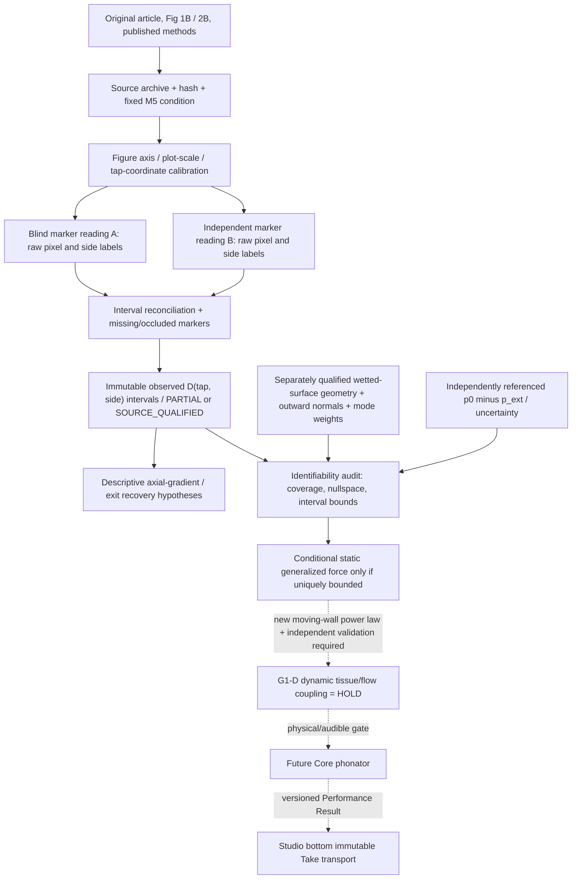

# VQ-1 / G1-S D2 — SYSTEM: source-to-force identifiability decision

**Date:** 2026-10-29 JST | **Status:** DESIGN DECISION DRAFT / implementation NOT authorized by this document | **Primary module:** Core scientific measurement qualification `G1-S`. **No physical-code changes in this PR.**

## Decision in one sentence

The next execution slice is **M5 Figure 2B measured spatial pressure-drop source qualification plus a source-independent force-identifiability audit**, **not** an immediately computed vocal-fold force, moving-wall solver, acoustic makeover, or Studio feature. The primary scientific output is a traceable **observed pressure reference** or an explicit PARTIAL/HOLD record; a force is admissible only with separately evidenced surface geometry, quadrature, external pressure reference, and enough spatial coverage.

### Existing gates and exact dependencies

- Core `main` base SHA `727b11ecf103f5c087cfcb820bdec11f883e7c03`; this design branch is independent of unmerged PRs.
- G0-P [Draft #238](https://github.com/ryonakayama234/morphoacoustics/pull/238) exact source/head `8ea3f1fe`: same-native-tick supraglottal `p,U`, **not** intraglottal `p_wall(z)`. No imported code.
- G1-S [Draft #239](https://github.com/ryonakayama234/morphoacoustics/pull/239) `11dd289e`: **synthetic conditional static-force algebra** only; exact-head science/tests and code-review success do not qualify observed physical force. No imported code.
- Source inventory [Draft #218](https://github.com/ryonakayama234/morphoacoustics/pull/218), full pressure-profile prospective protocol [Draft #220](https://github.com/ryonakayama234/morphoacoustics/pull/220), 35 scalar matched Q/exit-coefficient pairs [Draft #222](https://github.com/ryonakayama234/morphoacoustics/pull/222) are **independent, unmerged** evidence sources. D2 refines #220's next empirical gate without superseding its original frozen condition.
- Studio [approved V2 ADR](https://github.com/ryonakayama234/morphoacoustics-studio/blob/main/docs/product/STUDIO_WORKSPACE_V2_DECISION.md) is frozen. Character/Motion/Scene, permanent Take dock, optional research drawer; no UI changes until separate specific creator approval.

## Explicit physical planes: three non-substitutable quantities

1. `p_in(t),U_in(t)`: supraglottal acoustic port with native clock (G0-P). **Not** a measured local glottal wall traction.
2. `D_i=p_{tap0}-p_{wall,i}`: **static M5 measured pressure drop** at a real pressure tap/side under a fixed apparatus and drive, with source figure/point uncertainty. This is measured relative to tap 0; **not** absolute tissue pressure, continuous wall field, or moving-fold force.
3. `F_q = integral_S (p_wall-p_ext)(n·phi_q) dS`: a **model-defined generalized static pressure force** requiring independently defined wetted surface S, sign of normal, mode shape phi, outside pressure p_ext, and point-to-surface quadrature/coverage. No actual vocal tissue in the rigid M5 rig. A force output based on hypothetical geometry is always conditional, not physiologically validated.

For a frozen discrete representation `w_j=A_j(n_j·phi_q,j)`, `F_q=(p0-p_ext)sum_j w_j - sum_j w_j D_j`. This equation is **not** permission to infer missing values. If all required `w_j` and `D_j` are known, the algebraic value is identifiable **conditional on geometry and gauge**. If `sum w_j=0`, the common reference term cancels for that generalized coordinate; otherwise `p0-p_ext` must be independently known. Any unknown patch coverage or pressure interpolation invalidates a full-force claim.

## Stage architecture / evidence DAG

No path in this graph jumps from source figure or algebraic CI to biological phonation, natural-sounding audio, waveforms, or Studio adoption.

## Ownership, import and the fixed Studio panel contract

| Owner | Owns / may consume | Must not own |
| --- | --- | --- |
| External peer-reviewed M5 source | original plotted measured markers, condition, rig geometry described by authors | numerical solver predictions, in-vivo anatomy |
| Core `experiments/` candidate (after separate authorization) | source audit, two figure reads, conditional identifiability/uncertainty evidence | creator Character/Take data or public solver ABI |
| `src/morphoacoustics/` | canonical future body preparation, physical realization and acoustics **only if separately validated/adopted** | publication PDF or UI state |
| `src/morphoacoustics_graph/` | present supported passive graph topology under capability gates | presumed moving vocal folds or universal 3D contact |
| Studio `character.canvas` + `selection.inspector` | eventual versioned body modules, materials and accepted controls | source calibration, solver pressure maps |
| Studio `motion.canvas` | Script/Direction/task-level motion plans; SMC proposals only when separately compatible | new duplicated script compiler / dynamic solver |
| Studio `scene.canvas` | Speaker/Listener scene references; gated ASMR imports | fabricated microphone/ear physics |
| Studio `take.transport` | immutable **real** accepted acoustic Take audition | synthetic M5 data as sound |
| Studio `research.drawer` (hidden) | only future version-pinned scientific receipts, subject to explicit UI permission | new research panels |

SMC's `packages/speech-motor-compiler/` and ASMR `asmr/` remain separately maintained, not prerequisites for static source qualification. Neural approximation is admissible only in a later physically validated, separately authorized residual/closure role; it cannot create missing measured markers or repair scientific provenance.

## Product effect and exact STOP line

This task establishes whether future bodies may have **causally justified aerodynamic force differences**. It does **not** increase current available Characters, audible naturalness, or Studio controls today. A source-qualification result alone can never prove the voice is pleasant, language is intelligible or Character identities distinguishable.

**No new panel, no UI edits, no Core API, no G0-P merge, no force-law patch, no G1-D dynamic solver, no pressure imputation, no waveform, no neuro-acoustic beautifier, no `main` merge** in this design PR. A separately accepted empirical work package may later modify experiment-local source/data tooling only.

## Provenance

Original measured M5 paper: Fulcher, Scherer & Powell (2011), *JASA* 129:1548-1553, DOI 10.1121/1.3514424, https://pmc.ncbi.nlm.nih.gov/articles/PMC3078031/ ; Figure 2B is **uniform d=0.02 cm**, Figure 1B shows named pressure taps and one medial plastic insert. Strong risk: original plotted FW/NFW symbols overlap, and pressure-tap values are observations of a **rigid model**. No dynamic tissue stress/force is reported by the source. See sibling DATA, EXPERIMENT and DECISION for auditable gates.
