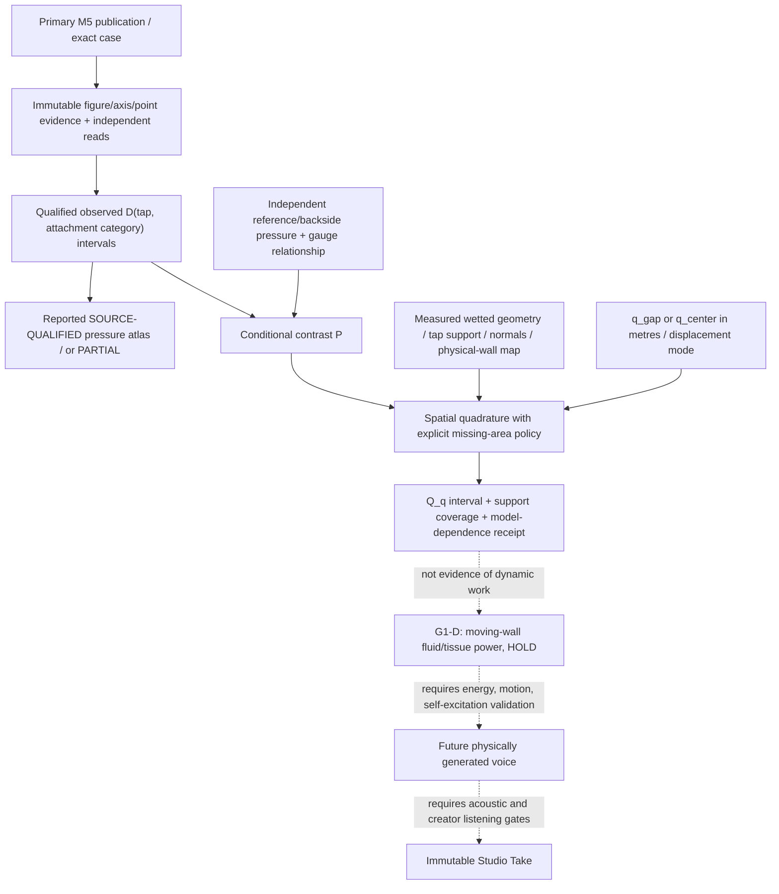

# VQ-1 / G1-S — Measurement and architecture FINAL DECISION (SYSTEM)

**Decision version:** 2026-10-29 / v1.0 design freeze for the next research work package. **DESIGN ONLY.** Independent Core-main base `727b11ecf103f5c087cfcb820bdec11f883e7c03`. This is not an authorization to change Core runtime or Studio UI. Scientific acceptance and merge remain separate.

## 1. Precise goal and non-goals

Goal: determine exactly which **static, spatially localized pressure observables** are identifiable from the published rigid M5 model, and the extra boundary/geometry/kinematic evidence needed to turn them into a signed **generalized pressure load for a declared virtual displacement coordinate**. We study the evidence boundary, not build a self-oscillating phonator.

NOT goals: assigning an oscillation frequency, fitting a convenient force curve, claiming physiological vocal-fold loading, sonic quality, new Studio panels, invented anatomy, or substituting G0-P acoustic inlet pressure for intraglottal wall pressure.

The scientifically defensible early product of the next work package is a **source-qualified wall pressure-drop atlas or an explicit PARTIAL/HOLD**. A physically calibrated total force is not promised in advance.

## 2. Three separate quantities (do not conflate)

1. **Observed spatial pressure drop** from original M5 figure: `D(c,t,s) = p_tracheal,tap0(c) - p_wall(c,t,s)` [Pa]. `c` is an immutable geometry/drive case; `t` a physical tap; `s` the source's flow-attachment category. This observation does **not** require guessed tissue area. Source Figure 2B displays plotted samples, not continuous pressure or full wetted surface.
2. **Conditional trans-wall pressure contrast**: `P(c,t,s) = DeltaP_0,back(c,t,s) - D(c,t,s)` [Pa], where `DeltaP_0,back = p_tracheal,tap0 - p_back`. The tissue backside pressure/reference and equivalence of pressure datum must be separately justified. Published `transglottal DeltaP` may refer to a downstream tap, **not automatically** to `p_back`. If this reference is absent, `P` remains unidentifiable even when `D` is source-qualified.
3. **Coordinate-specific static generalized load**: for a modelled wetted surface `Gamma`, generalized coordinate `q` with dimension **metres**, surface outward-from-fluid unit normal `n_f`, and displacement sensitivity `phi_q(x)=partial x/partial q` (dimensionless), `Q_q = integral_Gamma P(x) (n_f . phi_q(x)) dA` [N]. This is an assumed pressure-contrast boundary model: it is NOT total tissue force; it excludes unmeasured backside/other boundaries, shear, collision and viscoelastic load.

A mathematically executable quadrature `Q_q^h = sum_j P_j A_j (n_f,j . phi_q,j)` has no observed-force status unless pressure-to-area interpolation, wetted geometry, normals, backside/reference and coordinate displacement are all independently qualified.

## 3. The critical mode distinction

Select a physical lateral axis `x`; left and right are **physical wall identities**, not M5 labels FW and NFW. With two symmetric facing walls of equal surface area and uniform `P`:

- **Gap-width coordinate** `q_gap = x_right - x_left` [m], fixed midpoint: left displacement `-dq_gap/2`, right `+dq_gap/2`. Each inward-to-wall (fluid-outward) projection is `+1/2`; thus `Q_gap = (P_left A_left + P_right A_right)/2` [N]. Equal positive contrasts ADD to opening load.
- **Center-translation coordinate** `q_center = (x_right+x_left)/2` [m], fixed gap: both walls move right by `dq_center`. Left projection `-1`, right `+1`; equal pressure/area CANCEL: `Q_center = -P_left A_left + P_right A_right` [N].

These represent **different virtual-work questions**. The previously green #239 opposing-projection cancellation test is a valid synthetic **translation-like** oracle, not evidence that equal pressure on both walls produces no opening force. A bare `projection` scalar with no declared coordinate and physical-wall map cannot be interpreted as a phonatory opening force.

M5 FW/NFW are **flow wall (jet adhered)** and **nonflow wall (jet separated)**, not permanent left/right identities. A physically signed left/right result requires an independent case-by-case mapping. Do not treat the small/overlapping FW/NFW markers in Figure 2B as two individually located numerical points if they are not distinguishable.

## 4. Proposed scientific architecture

**Authority boundary:** publication and extraction tools own observation provenance; geometric/kinematic evidence owns map and mode; experiment-only integration owns conditional Q, with no Core production solver edits. Separate G0-P `p,U` is a native supraglottal **acoustic boundary port**, not a source of measured M5 `p_wall`. A pressure model must predict held-out `D` before it may feed force calculation. A dynamical FSI model must independently validate power exchange `P_aero = Q_q * dq/dt` with consistent sign, time synchronization and dissipative/passive tissue bookkeeping. Static M5 alone cannot validate such power.

## 5. Studio V2 non-negotiable contract

The accepted [Studio V2 ADR](https://github.com/ryonakayama234/morphoacoustics-studio/blob/main/docs/product/STUDIO_WORKSPACE_V2_DECISION.md) owns exactly Character, Motion, Scene and the frozen eight slots. Character owns morphology/material; Motion owns motor gestures; Scene owns spatial relationships; Core enforces feasible physics; a versioned immutable Take stores produced observations and source/solver receipts; any research detail is at most a future hidden research drawer. **No new panel/mode or UI code, no direct waveform painting, no status promotion or take mutation.** Any Studio change requires a distinct explicit creator approval.

## 6. Evidence and caveat ledger

- Source: [Fulcher, Scherer & Powell 2011 / M5](https://pmc.ncbi.nlm.nih.gov/articles/PMC3078031/) reports rigid static spatial pressure, tap0, glottal entrance tap6 and exit tap13; its FW/NFW are flow-attachment classifications. Its entrance/exit coefficients and Q are not raw wall-pressure observations.
- Source metrology preregistration: [Core Draft #220](https://github.com/ryonakayama234/morphoacoustics/pull/220), qualification [#218](https://github.com/ryonakayama234/morphoacoustics/pull/218), scalar-only [#222](https://github.com/ryonakayama234/morphoacoustics/pull/222).
- Existing synthetic algebra: [Core Draft #239](https://github.com/ryonakayama234/morphoacoustics/pull/239), exact-head Actions [#40710433629](https://github.com/ryonakayama234/morphoacoustics/actions/runs/40710433629) successful, Codex review final SHA `11dd289` no major findings. Does NOT certify correct anatomical coordinate, source coverage or physiological force.
- The [2024 review of synthetic self-oscillating vocal folds](https://pmc.ncbi.nlm.nih.gov/articles/PMC11348498/) illustrates how geometry, material and test conditions matter to actual vibration; [2025 JASA meeting abstract](https://doi.org/10.1121/10.0041540) describes dynamic angle-dependent pressure, but is not accepted here as numerical dynamic calibration data.

**Binding decision:** next executable task is SOURCE-ATLAS qualification (the #220 gate) plus explicit static-force identifiability audit. Do not extend #239 force arithmetic or begin G1-D phonator implementation until observed pressure and geometry/reference admissibility are decided.