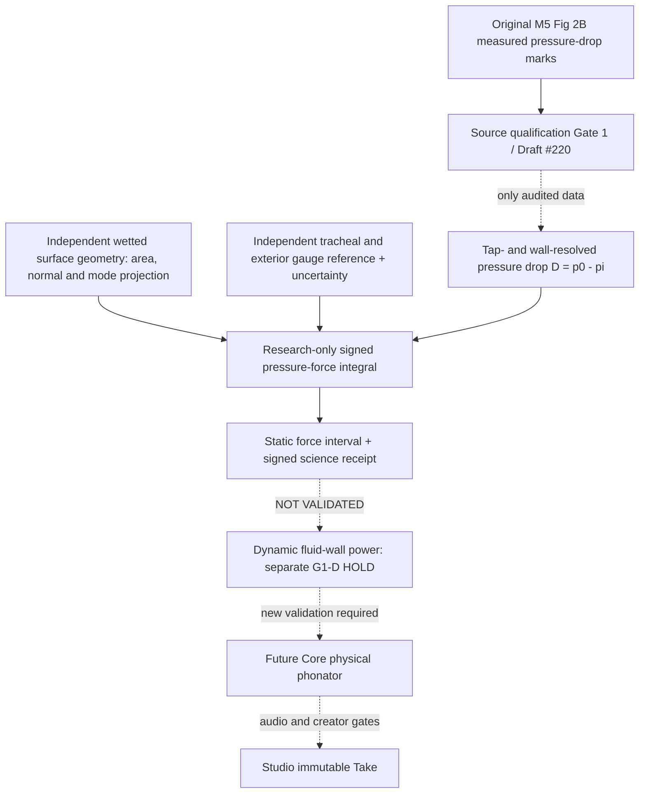

# VQ-1 G1-S — static wall-pressure force identifiability / SYSTEM

Date: 2026-10-28. Status: RESEARCH-ONLY / pre-implementation preregistration. Core main base `727b11ecf103f5c087cfcb820bdec11f883e7c03`. G0-P Draft #238 is independently verified research but NOT merged and is NOT imported here.

**Selected capability**: identify the minimum measured pressure and wetted-surface information needed to compute a signed static generalized pressure force. Not a phonator, pressure model or fabricated anatomy. Explicitly separate the native supraglottal acoustic port (G0-P: `p,U`) from the **spatial** intraglottal wall pressure needed at G1-S.

For a static surface discretization with area A_j and signed mode projection s_j, the generalized force is **F = sum_j (p0 - D_j - p_ext) A_j s_j**. All pressure values are in the same gauge; all coordinates refer to a **declared** wall and unique pressure tap. No pressure profile, area, normal, mode, or reference pressure is inferred from scalar flow Q, exit coefficient k_ex, or G0 inlet pressure. A single global pressure reference has **correlated** uncertainty across all patches.

This is algebraic identifiability, not force validation: real M5 Figure 2B pressure samples, exact tap-to-wetted-surface mappings and independently measured tracheal-to-exterior gauge remain unqualified in this experiment. Synthetic controls must never be relabeled as observed anatomy. Dynamic movement, wall power, self-excitation, frequency, sound and naturalness are deliberately absent.

**Studio V2 fixed panel ownership** (approved ADR): Character/organ material in `character.canvas` + `selection.inspector`; phonation intention in `motion.canvas`; Speaker/Listener in `scene.canvas`; eventual immutable audio in `take.transport`; experimental force/uncertainty receipts *only* in hidden `research.drawer`. **No new slot, panel, UI change or Performance Contract extension.** SMC is separately imported only after its contracts pass; ASMR remains independent.

No modifications to `src/morphoacoustics/`, `src/morphoacoustics_graph/`, `src/morphoacoustics_waveguide/`, Studio, SMC or ASMR. No production/API promotion without new evidence and explicit acceptance. Sources: Core Draft #237, #238; M5 source-qualification #218, preregistration #220, scalar-only #222; Studio approved Workspace V2 ADR; Fulcher/Scherer/Powell (2011), DOI 10.1121/1.3514424.

## Execution update — 2026-10-28 (research branch, after prospective protocol)

The preregistered experiment-only static algebra is implemented under `experiments/055_vq1_g1s_force_guard/`. Dedicated same-head [CI #40709820069](https://github.com/ryonakayama234/morphoacoustics/actions/runs/40709820069) on tested source SHA `fe50d3e2de29884970c9b5ccab7f4d8f1ba12db9` PASSED 13 synthetic/negative-control unittest methods, wrote and archived an explicit HOLD receipt. This is not M5 Figure 2B metrology. G1-S observed pressure, qualified force, moving-wall source and Studio voice remain absent. Research code review is independently requested; this documentation appendix does not mean adoption. Original preregistration above remains retained.

## Independent review correction (after first exact-head scientific tests)

Codex on Draft #239 identified a P2 **evidence atomicity** failure: if synthetic algebra threw before JSON creation, the failure receipt itself was lost. The experiment runner now creates an unresolved STOP receipt **before** analytic operations, traps calculation and runner exceptions, records them, and writes JSON before returning failure. This changes no physical equation, Core API, Studio slot, or claim. New SHA / exact-head CI and independent re-review are required to confirm the repair.
