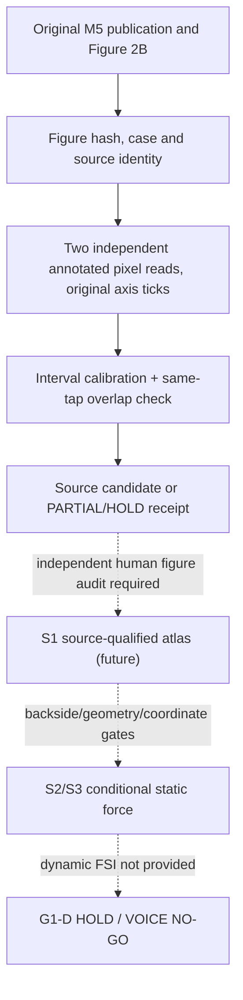

# VQ-1 / M5 Gate1 static pressure atlas — SYSTEM

**2026-10-30 preregistration BEFORE experiment code.** Independent Core main parent `727b11ecf103f5c087cfcb820bdec11f883e7c03`. Based on design-only [#241](https://github.com/ryonakayama234/morphoacoustics/pull/241) and source protocol [#220](https://github.com/ryonakayama234/morphoacoustics/pull/220), which are unmerged and NOT imported. This work is independent experiment-only source metrology; no Core production, no Studio, no voice.

## Scientific target
Source: Fulcher, Scherer & Powell (JASA, 2011), DOI 10.1121/1.3514424, original Figure 2B: static rigid M5 uniform, d=0.02cm life-size, transglottal pressure=10cmH2O life-size, tracheal tap0 reference, taps6..13 primary. Measured variable `D_i=p0-p_i` [Pa]; FW jet-attached, NFW jet-separated, **not anatomical left/right**. Paper reports near-uniform intraglottal decrease and exit pressure recovery, possible graphical FW/NFW overlap; neither is a numeric digitization.

**Input chain:** exact original figure bytes + cryptographic hash; source identity/case/scale/axis ticks; raw marker pixel coordinates and width; two independent reader ID sets and source-visible side labels; tap geometrical positions with separate evidence; bounded instrument/calibration/pixel errors -> research-only, raw-first qualified candidate or partial/hold receipt. No figure bytes or image-axis annotations are available in the checked-in repo: **zero observed point values at preregistration**. If original image is inaccessible, report SOURCE_IMAGE_NOT_ACQUIRED, no fake figure hash. Report pressure **digitization-only** intervals separately from the still-unqualified measurement-instrument uncertainty; a graphical decrease is not accepted as physical H-AXIAL until the actual instrument bound is qualified. The original physical tap z uncertainty must not be narrowed by measured pixel x.

**Image source is NOT automatic proof of scientific origin.** User-defined SHA merely fixes supplied bytes. A separate human source audit is needed to confirm the figure genuinely came from the cited paper and labels/ticks match. The program must NEVER auto-emit `S1_PRESSURE_ATLAS_QUALIFIED` based on self-entered JSON or two copies of the same synthetic notes. It may emit `CANDIDATE_FOR_INDEPENDENT_SOURCE_AUDIT`.

Research-local experiment `experiments/056_vq1_m5_gate1_atlas/` and dedicated workflow. Preserve a status JSON even for RED tests. No import of #218 or #239, no `src/*`, no Studio V2 UI edit or public API promotion. A source-qualified p(tap) is NOT a surface integral, actual force, oscillator, singing, speech or creator-approved voice.