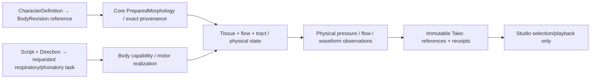
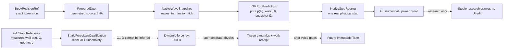

# VQ-1 DATA — Candidate source/body/observation ownership (DESIGN / NO ABI)

Date: 2026-10-28 JST. This is an experiment-local **candidate** data map, not a newly adopted `CreatureSpec`, `OrganGraph`, Performance Contract, Studio component or serialized public API. Do not migrate legacy immutable Takes.

## Distinct authoring, physical and observation objects



| Concept | Candidate data and unit | Authority | Provenance / no-leak rule |
|---|---|---|---|
| Character body reference | immutable body id, revision, preparation digest | Studio reference → Core validated binding | Not a UI-supplied geometry-to-sound shortcut |
| Tissue/material fixture | geometry, mass kg, stiffness N/m, damping N·s/m, tissue response law version, contact capability | Core physics fixture; future Character domain only after separate contract | Same body/gesture must give deterministic comparable state under fixed solver |
| Respiratory/task command | pressure Pa, time s, phonatory mode/task, optional nonperiodic initial perturbation | Motion intent → Core motor authority | **No imposed F0, periodic aperture, target waveform or post-EQ** in self-excitation proof |
| Flow and wall coupling | volume flow m³/s, pressure Pa, wall load N, velocity m/s, aperture m², work J; signed port conventions | Core source/flow mechanics | Applied force must be derived from declared spatial-pressure law, not guessed from scalar exit recovery |
| Tract and graph | validated physical/acoustic port p [Pa], U [m³/s], topology & rest geometry digest, solver time step | Core, currently model/backend-specific | Preserve time state; exact common-clock and passivity/energy ledger |
| Observer and playback | named mouth-port p/U or independently modeled radiated receiver; sample rate Hz, scale Pa/PCM full-scale, anti-alias law | Core physical observation → backend adapter | Mouth-port pressure is **not** ear pressure or calibrated SPL; no per-Take gain to suggest vocal effort |
| Physics receipt | solver/experiment source commit, body/material/source IDs, energy/work residuals, tests and uncertainty/status | Core experiment archive | Hashes establish reproducibility, not scientific validity |
| Creator Take (future) | immutable sound bytes and exact physical receipt refs | Studio Take store after validation | `FEASIBLE` numeric result alone does not mean voice-like sound |

## Proposed research-local case identity (not a public JSON contract)

```text
VQ1Case
  case_id, hypothesis_id
  body_id@revision, body_preparation_digest
  tissue_fixture_id + parameter units + material-law revision
  nonperiodic_drive_id / respiratory pressure_pa
  source_flow_wall_model_id, tract_model_id, outlet_model_id
  numerical_dt_s, duration_s, numerical_proof_revision
  observation_port_id + units + monitor_conversion_version
  exact_source_sha + tests_sha + frozen_input_digest
  outcome: INVALID | UNSUPPORTED | NUMERICALLY_UNRESOLVED
         | NO_SUSTAINED_PHONATION | SUSTAINED_MODEL_OSCILLATION
  evidence_artifacts: raw_tissue_trace / pU / work_ledger / (WAV only if separately authorized)
```

`SUSTAINED_MODEL_OSCILLATION` is a **research finding** within one approximate physical model; it is not Core's current `FEASIBLE` semantic outcome, nor a speech identity/quality certification. `NO_SUSTAINED_PHONATION` preserves a real negative physical result, not a fallback synthesizer. These candidate labels do not alter existing published domain contracts.

## Immutable comparisons and identifiable interventions

- **Source mechanism comparison:** same exact body + outlet + respiratory drive conditions where meaningful, compare frozen externally prescribed LF as a **control** against self-driven model output; do not claim acoustically source-matched if one drive is imposed periodically and the other emerges.
- **Material identity comparison:** same prepared tract geometry, pressure drive, observer and motor task, vary only one justified tissue parameter; separate material effect from rendering.
- **Body acoustic comparison:** keep one source/drive model, tissue fixture and physical observer fixed while varying one validated tract property. Full source–filter coupling may legitimately change source state; measure that mediation rather than forcibly equalizing the final WAV.
- **Sound/creator comparison:** a separate controlled audition asks whether this candidate is less signal-like and more useful than the pinned old Take **for the stated single vowel/task**. A/A and A/B; all conditions stored with provenance. No inferred speaker identity and no broad phonetic claims.

Proposed public body/material and Performance Contract changes are explicitly **NOT authorized** by this document. Studio fixed V2 slots and existing v0/v1 historical Take meaning stay unchanged.

## G0 data refinement — two incompatible solver-state families (read-only audit)

Current main `PassiveWaveguideSession`: per-section forward/backward discrete pressure FIFO [Pa], optional B0 radiation `q` [m³/s], fixed `Zc=ρc/A` [Pa·s/m³], native `dt=length/(c*cells)` [s]. Its `WaveguideStep.source_pressure_pa` is the *actual inlet pressure* [Pa] in the prescribed-flow boundary update; `inlet_flow_m3_s` is the input at that same tick. A research-only prospective port-predictor could expose `(b_pa, Zc_pa_s_m3, tick_index, state_digest)` with `p(U)=2 b+Zc U` and a controlled once-only `commit(U)`, but **this is not an existing API**.

VF-1A's different Draft `PassiveTract`: cell pressure array and face-flow array, implicit-midpoint solver state, independently set `dt_s`; `StepObservation.inlet_pressure_pa` is computed from midpoint coupling and face inertance. Passing this state to the main FIFO solver would discard its physical integration scheme and evidence trail. Never claim matching `PreparedMorphology` implies identical numerical state/clock, nor directly port VF-1A energy proofs.

Candidate G0 comparison record should preserve `source_commit, backend_id, state_representation, p/U orientation, time_staggering, native_clock_hz, outlet_law, predictor_version, expected_tick, actual_tick, energy_residual_j`, with an explicit `UNSUPPORTED_INCOMPATIBLE_BACKEND` refusal. No public schema is amended here.


---

## D1 research data contract refinement (2026-10-28 JST)

**Status: design candidate, not a new public Core/Studio ABI.** Keep G0 port, G1 static measurements, G1 dynamic wall forces and output audio as **four distinct record types**.

### Minimal evidence graph



| Record | Frozen inputs | Calculated observables | Invalid/missing branch |
|---|---|---|---|
| `G0PreparedDuct` | Core source SHA, geometry blob/digest, \(\rho\,[kg/m^3]\), \(c\,[m/s]\), each section \(L\,[m],A\,[m^2]\), \(n_{cells}\), \(\Delta t\,[s]\), outlet law | \(Z_c\,[Pa\,s/m^3]\), physical clock Hz | Unsupported geometry/time/ref |
| `G0PortSnapshot` | native tick, immutable state digest, reflection sample \(b_n\,[Pa]\) with declared pre-shift time | Candidate \(p_n\,[Pa]\), \(U_n\,[m^3/s]\), \(W_n\,[J]\) | stale/mutated state; duplicate commit |
| `G0WaveStep` | exact snapshot and chosen \(U_n\) | true Core `WaveguideStep`: inlet p, source work, mouth p/U, stored energy, outlet loss and signed residual | Core `ValueError`/`FloatingPointError`, no pretend audio |
| `G1StaticReference` | DOI, figure/table, data-access origin, digitization revision, physical z[m] and uncertainty, actual measured pressure drops Pa, Q [m³/s], shape/conditions | spatial pressure residuals [Pa], comparison with independent paper equations / control | `REFERENCE_UNQUALIFIED` |
| `G1StaticForceCandidate` | physical wet surface / effective normal/weights \(J_i(z)\,[m]\) and pressure field [Pa] | \(F_i\,[N]\), integral numerical uncertainty [N] | `UNIDENTIFIABLE_FORCE` if surface map missing |
| `G1DynamicResearch` | physically valid moving-wall model/force law & independent dynamic reference (not yet available) | \(x,\dot x,p_{\rm wall},q,U_{\rm in},F_i\), power ledger | `HOLD_DYNAMIC_REFERENCE` |
| Future Take | resolved source/body/motor/scene/observer + solver and artifact receipts | physical sound and immutable bytes | No Take prior to actual approved renderer and creator-quality gate |

**Distinguish three pressures:** \(P_{\rm sub}\) reservoir/gauge [Pa]; \(p_{\rm in}\) tract acoustic pressure [Pa]; \(p_{\rm wall}(z)\) local intraglottal surface pressure [Pa]. These are not aliases. Define \(q\) from reservoir into glottis [m³/s] and \(U_{\rm in}\) from glottis into supraglottal tract [m³/s]. \(p_{\rm wall}\) may have distinct flow-wall/nonflow-wall values in the static M5 data; no symmetry assumption without a source.

### Proposed `G0PortProbe/v0` private research-only wire (illustrative)

```json
{
  "schema_version": "vq1-g0-port-probe/v0-research",
  "model_scope": "one-fixed-passive-1d-tract",
  "source_commit": "PIN_EXACT_MAIN_SHA",
  "backend": "morphoacoustics_waveguide/PassiveWaveguideSession",
  "prepared_body_digest": "SOURCE_AUTHORED_DIGEST",
  "state": {"tick": 0, "snapshot_digest": "HASH_OF_NATIVE_SESSION"},
  "port": {
    "flow_positive_direction": "into_supraglottal_tract",
    "pressure_unit": "Pa",
    "flow_unit": "m3/s",
    "impedance_unit": "Pa*s/m3",
    "work_unit": "J",
    "native_time_reference": "step_n_pre_shift"
  },
  "candidate_flow_m3_s": 0.0,
  "status": "UNTESTED_EXAMPLE_NOT_EXECUTED"
}
```

Values shown here are **placeholders**, not accepted fixture values or real digests. Real results must preserve exact Core SHA and state/fixture byte identity; do not mint versioned public `PerformanceRequest` from this draft.

**G0 API invariants:** all `peek` calls return consistent values without mutating the real session; the same exact snapshot can be queried at `U=0`, `+U` and `-U`; only one `commit` is legal for that tick; `commit` result must be a true `WaveguideStep` with identical stored acoustic state to an independent direct session step for the same input. A fresh snapshot is required after advancing the tick. The method cannot change solver physics or silently convert the per-body native clock to 48k.

### G1 force/work record: which data actually identify the mechanism?

```text
G1WallStressCase
  provenance: DOI + figure/table + image/data SHA + qualification version
  geometry: surface / orientation / z-axis / life-size-equivalent scale
  pressure: p_trachea, tap_pressure_drop_i, p_flow_wall_i, p_nonflow_wall_i
  flow: measured_Q_m3_s + uncertainty + matched deltaP_Pa
  model: pressure law ID / coefficients / static or dynamic
  residuals: pressure_Pa, flow_m3_s, integral_force_N [only if surface map known]
  uncertainty: measurement / extraction / geometry / truncation / model separate
  outcome: QUALIFIED_STATIC_ONLY | REFERENCE_UNQUALIFIED
           | INDETERMINATE_FORCE | STOP_INCONSISTENT_WORK
```

**Static and moving tissue are not equivalent.** For the candidate M5 fixture \(d=0.02\,cm\), \(\Delta P=10\,cmH_2O\), Core Draft #220 specifies tap 6 \(0.211\,cm\), tap 11 \(0.413\,cm\), tap 13 \(0.511\,cm\) and Q \(64.7\,cm^3/s\), all as **life-size equivalents** requiring source recheck. Do not treat the entire paper's 35 Q/\(k_{\rm ex}\) pairs as measured pressure profiles, nor infer a numerical surface force from only three tap coordinates.

For dynamic force acceptance define tissue/flow/tract powers \(\mathbf F_{\rm aero}\cdot\dot{\mathbf x}\), \(P_{\rm sub}q\), \(p_{\rm in}U_{\rm in}\); and the signed energy statement:

\[
\Delta(E_{\rm tissue}+E_{\rm fluid}+E_{\rm acoustic})
-\int P_{\rm sub}q\,dt+\int (D_{\rm tissue}+D_{\rm flow}+D_{\rm outlet})\,dt=R_{\rm all}.
\]

This equality is a **required bookkeeping hypothesis**, not a current validated discretization or a guarantee of actual biological dynamics. A moving control volume must also account for volume-change terms and any other modeled work sources; unmodeled sources prohibit a PASS. Near-zero energy denominators and numerical cancellation are reported separately, not obscured by a small normalized residual.

### Explicit uncertainty and evidence meaning

| Uncertainty class | Example | What it can establish |
|---|---|---|
| Numerical | floating-point and nonlinear residual, dt refinement | equation implementation consistency |
| Discretization/model | 1D scattering and boundary modeling; static pressure interpolation | sensitivity to approximate physics |
| Experimental reference | M5 pressure taps/coordinate/digitization, static flow | static aerodynamic agreement only |
| Anatomy/material | effective masses, surface maps, human/animal calibration | physiological interpretation **not** established by M5 |
| Perceptual | human voice-likeness and creative utility | only after independently authenticated same-task Takes |

A universal naturalness score, inferred F0 from a tone, or measured listener SPL cannot be generated from these records. During this task Studio domains are *read-only conceptual mappings*. The exact UI ownership remains that of Studio V2: Character stores references, Motion stores intent, Scene stores instances, Take dock stores playback of genuinely immutable physical output, Research Drawer owns raw proof. Neither `src/App.tsx` nor the panel registry may change.
