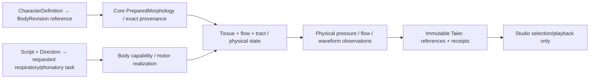

# VQ-1 DATA — Candidate source/body/observation ownership (DESIGN / NO ABI)

Date: 2026-10-28 JST. This is an experiment-local **candidate** data map, not a newly adopted `CreatureSpec`, `OrganGraph`, Performance Contract, Studio component or serialized public API. Do not migrate legacy immutable Takes.

## Distinct authoring, physical and observation objects



| Concept | Candidate data and unit | Authority | Provenance / no-leak rule |
|---|---|---|---|
| Character body reference | immutable body id, revision, preparation digest | Studio reference → Core validated binding | Not a UI-supplied geometry-to-sound shortcut |
| Tissue/material fixture | geometry, mass kg, stiffness N/m, damping N·s/m, tissue response law version, contact capability | Core physics fixture; future Character domain only after separate contract | Same body/gesture must give deterministic comparable state under fixed solver |
| Respiratory/task command | pressure Pa, time s, phonatory mode/task, optional nonperiodic initial perturbation | Motion intent → Core motor authority | **No imposed F0, periodic aperture, target waveform or post-EQ** in self-excitation proof |
| Flow and wall coupling | volume flow m³/s, pressure Pa, wall load N, velocity m/s, aperture m², work J; signed port conventions | Core source/flow mechanics | Applied force must be derived from declared spatial-pressure law, not guessed from scalar exit recovery |
| Tract and graph | validated physical/acoustic port p [Pa], U [m³/s], topology & rest geometry digest, solver time step | Core, currently model/backend-specific | Preserve time state; exact common-clock and passivity/energy ledger |
| Observer and playback | named mouth-port p/U or independently modeled radiated receiver; sample rate Hz, scale Pa/PCM full-scale, anti-alias law | Core physical observation → backend adapter | Mouth-port pressure is **not** ear pressure or calibrated SPL; no per-Take gain to suggest vocal effort |
| Physics receipt | solver/experiment source commit, body/material/source IDs, energy/work residuals, tests and uncertainty/status | Core experiment archive | Hashes establish reproducibility, not scientific validity |
| Creator Take (future) | immutable sound bytes and exact physical receipt refs | Studio Take store after validation | `FEASIBLE` numeric result alone does not mean voice-like sound |

## Proposed research-local case identity (not a public JSON contract)

```text
VQ1Case
  case_id, hypothesis_id
  body_id@revision, body_preparation_digest
  tissue_fixture_id + parameter units + material-law revision
  nonperiodic_drive_id / respiratory pressure_pa
  source_flow_wall_model_id, tract_model_id, outlet_model_id
  numerical_dt_s, duration_s, numerical_proof_revision
  observation_port_id + units + monitor_conversion_version
  exact_source_sha + tests_sha + frozen_input_digest
  outcome: INVALID | UNSUPPORTED | NUMERICALLY_UNRESOLVED
         | NO_SUSTAINED_PHONATION | SUSTAINED_MODEL_OSCILLATION
  evidence_artifacts: raw_tissue_trace / pU / work_ledger / (WAV only if separately authorized)
```

`SUSTAINED_MODEL_OSCILLATION` is a **research finding** within one approximate physical model; it is not Core's current `FEASIBLE` semantic outcome, nor a speech identity/quality certification. `NO_SUSTAINED_PHONATION` preserves a real negative physical result, not a fallback synthesizer. These candidate labels do not alter existing published domain contracts.

## Immutable comparisons and identifiable interventions

- **Source mechanism comparison:** same exact body + outlet + respiratory drive conditions where meaningful, compare frozen externally prescribed LF as a **control** against self-driven model output; do not claim acoustically source-matched if one drive is imposed periodically and the other emerges.
- **Material identity comparison:** same prepared tract geometry, pressure drive, observer and motor task, vary only one justified tissue parameter; separate material effect from rendering.
- **Body acoustic comparison:** keep one source/drive model, tissue fixture and physical observer fixed while varying one validated tract property. Full source–filter coupling may legitimately change source state; measure that mediation rather than forcibly equalizing the final WAV.
- **Sound/creator comparison:** a separate controlled audition asks whether this candidate is less signal-like and more useful than the pinned old Take **for the stated single vowel/task**. A/A and A/B; all conditions stored with provenance. No inferred speaker identity and no broad phonetic claims.

Proposed public body/material and Performance Contract changes are explicitly **NOT authorized** by this document. Studio fixed V2 slots and existing v0/v1 historical Take meaning stay unchanged.

## G0 data refinement — two incompatible solver-state families (read-only audit)

Current main `PassiveWaveguideSession`: per-section forward/backward discrete pressure FIFO [Pa], optional B0 radiation `q` [m³/s], fixed `Zc=ρc/A` [Pa·s/m³], native `dt=length/(c*cells)` [s]. Its `WaveguideStep.source_pressure_pa` is the *actual inlet pressure* [Pa] in the prescribed-flow boundary update; `inlet_flow_m3_s` is the input at that same tick. A research-only prospective port-predictor could expose `(b_pa, Zc_pa_s_m3, tick_index, state_digest)` with `p(U)=2 b+Zc U` and a controlled once-only `commit(U)`, but **this is not an existing API**.

VF-1A's different Draft `PassiveTract`: cell pressure array and face-flow array, implicit-midpoint solver state, independently set `dt_s`; `StepObservation.inlet_pressure_pa` is computed from midpoint coupling and face inertance. Passing this state to the main FIFO solver would discard its physical integration scheme and evidence trail. Never claim matching `PreparedMorphology` implies identical numerical state/clock, nor directly port VF-1A energy proofs.

Candidate G0 comparison record should preserve `source_commit, backend_id, state_representation, p/U orientation, time_staggering, native_clock_hz, outlet_law, predictor_version, expected_tick, actual_tick, energy_residual_j`, with an explicit `UNSUPPORTED_INCOMPATIBLE_BACKEND` refusal. No public schema is amended here.
