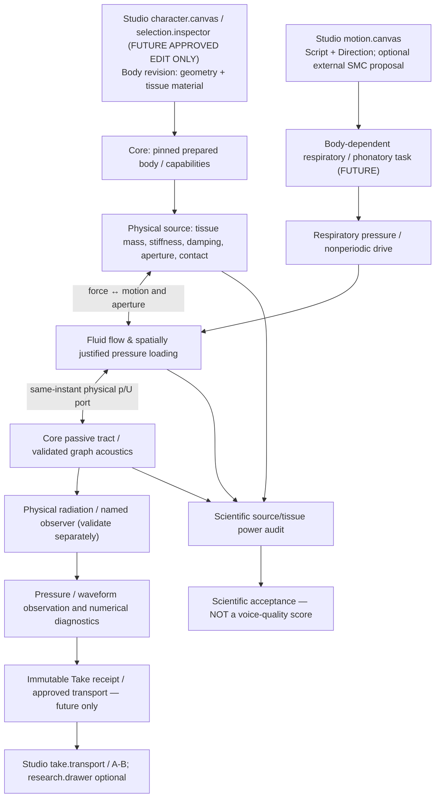

# VQ-1 SYSTEM — Physical phonation to creator voice (DESIGN / NOT IMPLEMENTED)

Date: 2026-10-28 JST. Owner: **Core physical voice source / VF lineage**. No Studio source, UI panel, Core production API, SMC, ASMR, or waveform generator is modified by this design. Based on Core `main@727b11ecf103f5c087cfcb820bdec11f883e7c03`.

## Why this capability, rather than another feature panel

The creator reported a WG2 signal/tone and an approximately /a/-like Take, **without authenticated UUID-to-body attribution** (Studio #32). VM-0 measured that one archived M1 mouth-port monitor has 96.871% of its first 80 harmonic energy at 600 Hz (Core voice-metrology/CASE_001), but that is a diagnostic for this fixture, not proof of a bad resonance or why either local Take sounded that way. The accepted SV-1 uses a **prescribed LF glottal flow**; graph acoustics and WG2 passive waves do not yet make the character's tissue sustain phonation.

VF-1A Draft #209 demonstrates an energy-audited **reduced two-mass/tract system** on an unmerged SFI-3 stack; VF-1B1 Draft #214 finds strongly decaying transient motion and an antisymmetric mode with zero direct pressure work under the symmetric setup. Neither proves self-excited phonation or improves creator audio. VF-1B2 pressure/flow reference Drafts #216, #217, #218, #220, #222 distinguish partial experimental sources from missing local wall-pressure fields; **do not promote an invented distributed pressure law**.

## Causal boundary and dependencies

The acoustic graph's **node/edge** contracts remain typed physical ports, not arbitrary visual links. Current `src/morphoacoustics_graph` is a limited fixed passive acoustic graph, not a general force/flow/contact solver. Cross-domain pressure-to-tissue force requires its own measured physical law. Do not imply source coupling is already a production graph edge.

Dependencies in order:
1. Verify current Core main `morphoacoustics_waveguide` capabilities vs research-only SFI-3 #84 and VF-1A #209 exact heads. Explicitly determine whether a compatible common-tick port can be implemented independently on main, without copying a research stack or silently importing its API.
2. Preserve VF-1B1 #214 negative modal-work evidence; test candidate nonuniform pressure distribution only after independent pressure/flow constraints are qualified. No assumption that the 35 scalar M5 values in #222 specify local tissue force.
3. A positive numerical oscillation result permits **research-only** source→tract audition *after* outlet/observer meaning is fixed. It does not authorize a new Studio UI control, a "human voice" claim, or import of SMC/ASMR.

## Approved Studio V2 slot mapping (read-only)

| Data / action | Existing slot | Constraint |
|---|---|---|
| Body/material revision, someday selectable | `character.canvas` + `selection.inspector` | UI code requires separate creator STOP-AND-PROPOSE authorization (Studio `STUDIO_WORKSPACE_V2_DECISION.md`) |
| Respiratory/phonatory intent | `motion.canvas` | No second Script compiler; SMC remains independent/unmerged |
| Speaker/Listener placement and receiver | `scene.canvas` | No fake radiation/ASMR capability |
| Immutable acoustic Take playback/A-B | `take.transport` | Only after physical and creator-quality gates |
| Exact port work, errors, hashes, raw traces | `research.drawer` | Hidden by default; no new default panel |
| References and revision selection | `project.library` | No duplicated physics ownership |

This project task intentionally has **zero current Studio UI change**. Draft Studio #33 is the accepted visual reference but not a merged implementation. Held Studio #31 / Core #193 remain NO-GO. The only possible neural follow-up is physically constrained closure with ablation and causal intervention tests; no post-hoc waveform beautification.
