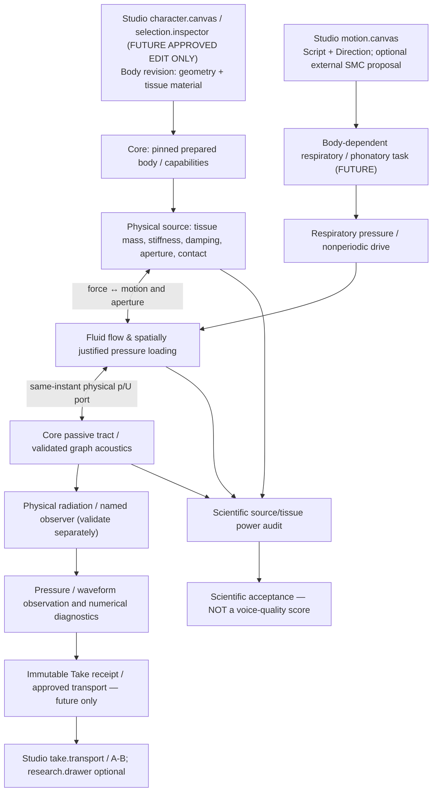
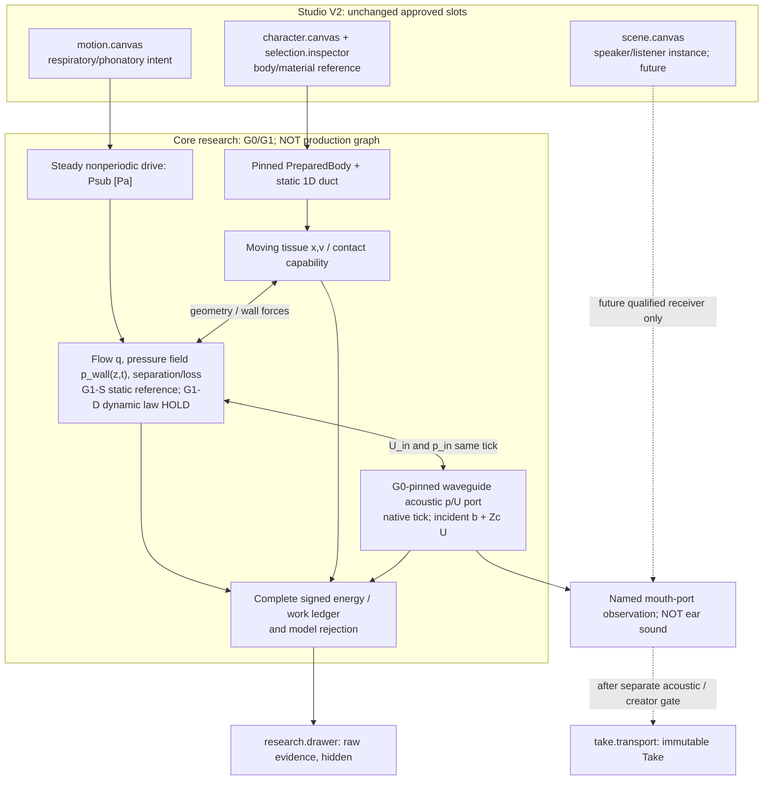

# VQ-1 SYSTEM — Physical phonation to creator voice (DESIGN / NOT IMPLEMENTED)

Date: 2026-10-28 JST. Owner: **Core physical voice source / VF lineage**. No Studio source, UI panel, Core production API, SMC, ASMR, or waveform generator is modified by this design. Based on Core `main@727b11ecf103f5c087cfcb820bdec11f883e7c03`.

## Why this capability, rather than another feature panel

The creator reported a WG2 signal/tone and an approximately /a/-like Take, **without authenticated UUID-to-body attribution** (Studio #32). VM-0 measured that one archived M1 mouth-port monitor has 96.871% of its first 80 harmonic energy at 600 Hz (Core voice-metrology/CASE_001), but that is a diagnostic for this fixture, not proof of a bad resonance or why either local Take sounded that way. The accepted SV-1 uses a **prescribed LF glottal flow**; graph acoustics and WG2 passive waves do not yet make the character's tissue sustain phonation.

VF-1A Draft #209 demonstrates an energy-audited **reduced two-mass/tract system** on an unmerged SFI-3 stack; VF-1B1 Draft #214 finds strongly decaying transient motion and an antisymmetric mode with zero direct pressure work under the symmetric setup. Neither proves self-excited phonation or improves creator audio. VF-1B2 pressure/flow reference Drafts #216, #217, #218, #220, #222 distinguish partial experimental sources from missing local wall-pressure fields; **do not promote an invented distributed pressure law**.

## Causal boundary and dependencies

The acoustic graph's **node/edge** contracts remain typed physical ports, not arbitrary visual links. Current `src/morphoacoustics_graph` is a limited fixed passive acoustic graph, not a general force/flow/contact solver. Cross-domain pressure-to-tissue force requires its own measured physical law. Do not imply source coupling is already a production graph edge.

Dependencies in order:
1. Verify current Core main `morphoacoustics_waveguide` capabilities vs research-only SFI-3 #84 and VF-1A #209 exact heads. Explicitly determine whether a compatible common-tick port can be implemented independently on main, without copying a research stack or silently importing its API.
2. Preserve VF-1B1 #214 negative modal-work evidence; test candidate nonuniform pressure distribution only after independent pressure/flow constraints are qualified. No assumption that the 35 scalar M5 values in #222 specify local tissue force.
3. A positive numerical oscillation result permits **research-only** source→tract audition *after* outlet/observer meaning is fixed. It does not authorize a new Studio UI control, a "human voice" claim, or import of SMC/ASMR.

## Approved Studio V2 slot mapping (read-only)

| Data / action | Existing slot | Constraint |
|---|---|---|
| Body/material revision, someday selectable | `character.canvas` + `selection.inspector` | UI code requires separate creator STOP-AND-PROPOSE authorization (Studio `STUDIO_WORKSPACE_V2_DECISION.md`) |
| Respiratory/phonatory intent | `motion.canvas` | No second Script compiler; SMC remains independent/unmerged |
| Speaker/Listener placement and receiver | `scene.canvas` | No fake radiation/ASMR capability |
| Immutable acoustic Take playback/A-B | `take.transport` | Only after physical and creator-quality gates |
| Exact port work, errors, hashes, raw traces | `research.drawer` | Hidden by default; no new default panel |
| References and revision selection | `project.library` | No duplicated physics ownership |

This project task intentionally has **zero current Studio UI change**. Draft Studio #33 is the accepted visual reference but not a merged implementation. Held Studio #31 / Core #193 remain NO-GO. The only possible neural follow-up is physically constrained closure with ablation and causal intervention tests; no post-hoc waveform beautification.

## G0 read-only code audit — 2026-10-28 (no solver run)

Compared **actual** current-main `src/morphoacoustics_waveguide/passive_waveguide.py` to SFI-2 Draft #81 `experiments/032_passive_time_domain_tract/waveguide.py` and VF-1A Draft #209 `experiments/036_vf1a_two_mass/two_mass.py`. Main uses `PassiveWaveguideSession` traveling-wave FIFOs with per-body `dt=section_length/(c*cells_per_section)`; VF-1A expects SFI-2 `PassiveTract` implicit-midpoint pressure/face-flow state at independently specified `dt` (VF pilot 1/48k). **They are not interchangeable solver types or clock conventions.**

However, in the current-main waveguide source, within one uncommitted step, the first-cell incoming reflected pressure `b` and characteristic impedance `Zc=rho*c/A0` imply the **exact discrete inlet relation** `p_in = 2*b + Zc*U_in`. The actual `step(U_in)` computes this pressure and source work `dt*p_in*U_in` and updates FIFOs/B0 once after validation. This is a **code algebra observation**, not an independently tested safe new strong-coupling interface; `b` resides in private per-session FIFO state. Any new solver must have a reviewed read-only per-tick port prediction and exactly-one atomic commit; never mutate/advance a session during nonlinear iterations or directly access private FIFOs in production. Sign, clock and moving-volume work need separate audited conventions. The SFI-2 `PassiveTract` equation and the current-main FIFO waveguide law must not be conflated.

A small **new research adapter built against current main** is a possible route around stacked SFI dependencies, conditional on pinned port-law tests and exact source audits. Until then, G0 is `PARTIAL_CODE_AUDIT_ONLY`, **not** G0 PASS or an implemented coupled source.

---

## D1 design refinement — proposed final G0/G1 boundary (2026-10-28 JST)

**Status:** source-reviewed *architecture decision proposal*, pending creator agreement; **not** a working solver or physiological finding. D1 refines the earlier high-level G0/G1 framing, without retroactively changing its historical observations.

### Precisely selected feature

**Primary module: Core / physical phonation source, VF lineage.** The deliverable immediately following approval is *one bounded scientific interface and force-law qualification path*, not a new audible synthesizer or Studio feature.

- **G0-P (port evidence):** Can the already adopted Core-main *fixed passive* FIFO waveguide be coupled in a single physical tick through a well-defined inlet acoustic power port, without changing its existing solver law, replaying a frame, or relying on one-tick delayed pressure? This establishes an **acoustic coupling capability**, not a vocal fold.
- **G1-S (static aerodynamics):** Can one spatial intraglottal pressure field be defined in **SI units** and independently checked against a *qualified actual static wall-pressure reference* with matched geometry, pressure and flow? It establishes a **static force-map candidate**, not a moving-fold force law.
- **G1-D (dynamic work transfer):** Only if G1-S is qualified, can a moving-wall extension provide a defensible time-dependent wall-load and **fluid/solid/acoustic work balance**? This is the minimum mechanism-level prerequisite for VF-1B dynamic experiments. It is NOT passed by static fitting or a numerically conserved surrogate alone.

**Key category error prohibited:** `p_in(t)` at the *supraglottal acoustic port* is not `p_wall(z,t)` over the interior glottal tissue. `Psub * q` is reservoir input power; `p_in * U_in` is acoustic power entering the tract; `F_i * v_i` is wall work. They cannot be equated or counted twice by convenience. M5 scalar flow / exit coefficient measurements cannot uniquely identify spatial `p_wall`.

### Separation of responsibilities and causality

The current `src/morphoacoustics_graph/` owns **limited passive acoustic topology/typed ports**; a `force ↔ velocity` mechanical port or full glottal FSI edge is **not** present, and this proposal MUST NOT pretend one exists. An experiment-local coupling graph is separate from the producer-facing `OrganGraph` and `PreparedMorphology` ABIs. Its future promotion requires explicit capability/contract adoption.

### G0-P discrete physical port contract (research-only candidate)

Use the unmodified native session: pressure waves with \(+U\) **toward tract**, physical timestep \(\Delta t=L_{\rm section}/(c\,n_{\rm cells})\), \(Z_c=\rho c/A_{\rm inlet}\). At the start of tick \(n\), \(b_n\) denotes the **incoming pressure wave at the inlet**, before FIFO shift. For a candidate flow \(U_n\), the implemented boundary relation is

\[
a_n=b_n+Z_c U_n,\quad p_n=a_n+b_n=2b_n+Z_c U_n,\quad
W_{{\rm in},n}=\Delta t\,p_n U_n.
\]

All \(\rho,c,A,L,\Delta t\) and the B0/other terminal choice are *frozen prepared-body data*, not creator-adjustable port widgets. The relation is **discrete-time**; it must not be relabeled a continuously timed midpoint pressure law.

**Proposed narrow research API** (experiment-local adapter only, not public): `peek_inlet_response(snapshot, U_n) -> {tick, p_n, U_n, work_j, version}`; `commit_once(snapshot_id, U_n) -> real WaveguideStep`. A valid `peek` is pure/non-mutating, anchored to tick + state identity. `commit` advances exactly one native tick, and a stale or duplicate snapshot refuses. A solution may evaluate several candidates **without advancing live wave state**; only the chosen converged \(U_n\) commits. No fake "read-only preview" implemented by moving/restoring the production session after a failed nonlinear iteration. Existing `PassiveWaveguideSession.step()` is not to be changed in G0 unless an independent production ABI proposal is later approved. Research-only read access to current private FIFOs must be tightly version-pinned; a public wrapper cannot expose them.

Acceptance is limited to **one fixed passive serial tract** first (matched end, optional existing B0). A graph with a mechanical/airflow edge, branching tract, moving wall, or incompatible physical clocks must refuse `UNSUPPORTED`, not silently truncate. G0 does **not** import unmerged SFI-2/3 (#81/#84), VF-1A (#209), or create a general `morphoacoustics_graph` API.

### G1-S / G1-D physical-force contract (distinct from G0)

**Tissue coordinates:** \(\mathbf x\,[m]\), \(\dot{\mathbf x}\,[m/s]\), \(M\,[kg]\), \(C\,[N\,s/m]\), \(K\,[N/m]\). Research-only two-coordinate precedent: \(M\ddot{\mathbf x}+C\dot{\mathbf x}+K\mathbf x=\mathbf F_{\rm aero}+\mathbf F_{\rm other}\).

**Wall force must come from declared fluid pressure and geometry:** a candidate general form is

\[
F_{{\rm aero},i}(t)=\int_{S_{\rm wet}(t)}p_{\rm wall}(\mathbf r,t)\,
\mathbf n(\mathbf r,t)\cdot\frac{\partial\mathbf r}{\partial x_i}\,dS
\]

(with fluid stress terms and the sign of the surface normal declared; a pressure-only reduction is explicitly an approximation). For a two-mass reduced model, the surface-to-coordinate map must be specified in meters, not inferred from `p_in` or a generic constant `g_i` fitted to desired oscillations.

Fluid/acoustic volume balance, **only if the chosen control volume is geometrically defined**, is \(U_{\rm in}=q-\dot V_{\rm fluid\ boundary}\), and the reaction/loss work has to reconcile with \(P_{\rm sub}q\), \(p_{\rm in}U_{\rm in}\) and \(\sum F_i\dot x_i\). A wall pressure map that violates that accounting is physically rejected even if an oscillator appears stable.

**G1-S freeze candidate:** static M5 *uniform rigid glottis* from Fulcher, Scherer & Powell (2011), DOI 10.1121/1.3514424. The originally planned pre-registration case in Core Draft #220 is life-size-equivalent \(d=0.02\,cm\), transglottal pressure \(10\,cmH_2O\), axial entrance tap 6 \(z=0.211\,cm\), straight-run end tap 11 \(z=0.413\,cm\), exit tap 13 \(z=0.511\,cm\), with Q source qualified separately. Preserve measured \(\Delta p_i=p_{\rm trachea}-p_i\), physical tap coordinates, FW/NFW where observed, measured uncertainty and scaled-model conventions. This is a **candidate control**, not already digitized wall-pressure data in Core. Existing 35 Q/\(k_{\rm ex}\) pairs in Draft #222 are **not** per-tap pressure measurements. G1-S STOP if independent wall-field reference cannot be recovered and qualified.

G1-D needs **independent time-dependent moving-wall force or a separately justified conservative dynamic reference**; a static paper's Q-vs-pressure curve, peak-mode adjustment, arbitrary phase lag, negative damping, hidden F0 or hand-designed force schedule cannot be accepted as measured dynamic physiology. Even if a model is algebraically conservative, the physiological claim remains `INDETERMINATE_PHYSIOLOGY` until validated against dynamic evidence. A mathematical toy could be explored under an explicit `SYNTHETIC_ONLY` label but cannot be promoted to VF-1 physical self-phonation.

### Literature/independence anchors

- Titze (2008), *Nonlinear source–filter coupling in phonation: Theory*, DOI [10.1121/1.2832337](https://doi.org/10.1121/1.2832337): tract reactance can influence both flow and tissue motion. **A scientific rationale, not a validation of this project solver.**
- Fulcher, Scherer & Powell (2011), *Pressure distributions in a static physical model of the uniform glottis*, DOI [10.1121/1.3514424](https://doi.org/10.1121/1.3514424): measured static glottal wall-pressure profiles and pressure/flow coefficients. **Not time-dependent human vocal-fold force measurements.**
- Project evidence: Core `docs/research/voice-metrology/CASE_001.md`, `docs/research/vf1b/` Draft #214, Draft #220/#222 and adopted `src/morphoacoustics_waveguide/passive_waveguide.py` on `main@727b11e`.

### Final architecture choice

**Select Core-main-based, experiment-local G0 port evidence first.** It is objectively testable against an analytic passive 1D reference, has no speculative aerodynamic coefficients, avoids stacked research-branch ingestion and does not modify the application. **G1-S is a separate measured-static-law qualification, not concurrent dynamic-phonation construction. G1-D implementation remains a strict later HOLD** until a qualified physical force/work reference exists. This is a substantive reduction in speculative complexity, not a downgrade of the long-term creative objective.
