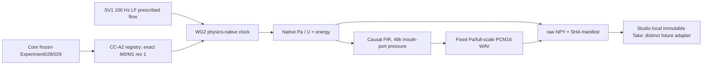

# WG2 Creator source — evidence ledger

Preimplementation Gate A: [GATE_A.md](GATE_A.md), frozen at `7951d17ff7b215338e9587bd1511240b1d0f08eb`.

## Source-to-observer chain

## Verification
- New script `tools/wg2_creator_take.py` sources the audited CC-A2 registry and SV1 waveform construction dynamically from the exact source checkout, passes prepared Tract1DGeometry to adopted WG2 observer. No static geometry copied into its own separate source.
- Durations exactly 0.25 or 0.50s, preset M0@1 or M1@1, string-safe character ID. Source LF F0 100 Hz, Rd1, *externally prescribed* flow. Fresh sound is **not** the old dynamic CC-A2 gesture, is not a calibrated mic, and is not proof of voice-likeness.
- File evidence exactly 5 payloads (source float64, native mouth pressure+flow, monitor pressure, PCM16 WAV), with exact hashes, source revision, prepared-body digest, energy trace/monitor parameters and final atomic manifest.
- `--verify` verifies all 5 hashes on re-read, with pinned exact Core SHA enforced by Studio receiver. Does not by itself attest hostile SHA-substituted archives.
- Dedicated [WG2 real CI](../../../../.github/workflows/wg2-creator-real.yml) runs both fresh authentic M0/M1 and uploads WAV/NPY; this evidence must be inspected before merging.
- **Evidence status at creation:** implementation+negative test candidate, real CI / Codex independent review pending, not Studio GUI integrated. Hold main merge until no unresolved independent P1/P2 and exact-sha CI pass.

## Known limitations
This bridge still uses static prescribed source and acoustic tract with physically derived native clock. The fixed 8 Pa preview full-scale can expose clipping refusal for large inputs; do not automatically normalize such a failure as a workaround. Perceptual quality and creator value require human listening (Studio #30), independent of numerically correct pressure.
