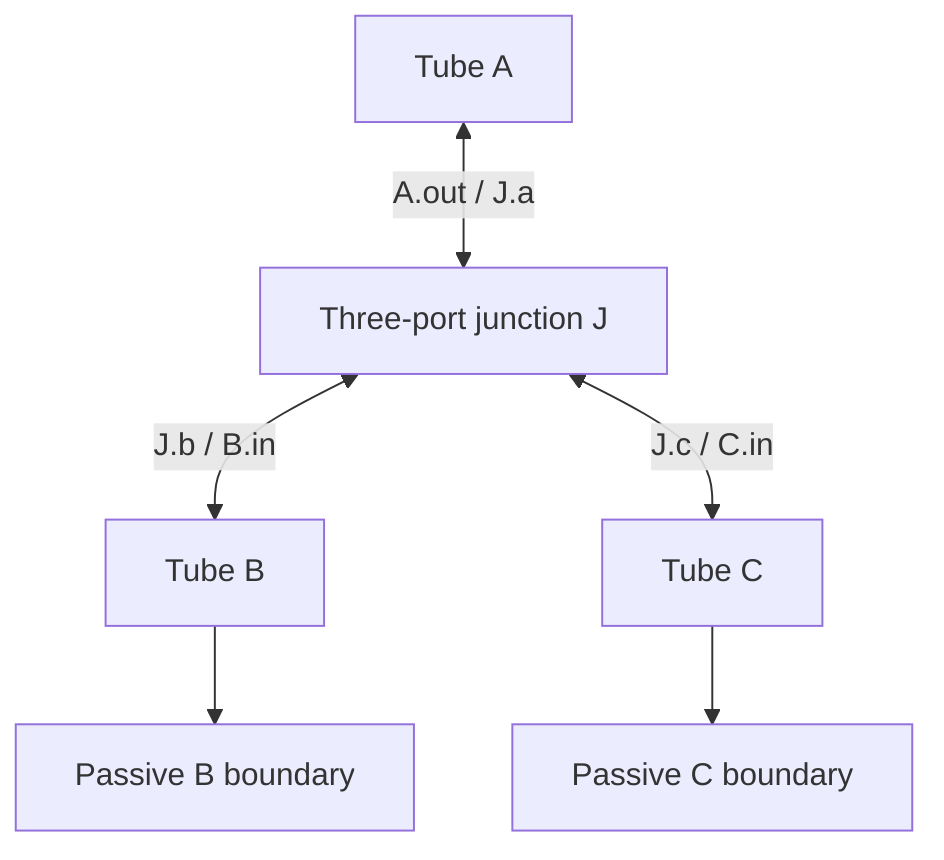

# OG-1 / Experiment 038 — one fixed passive three-port branch

Tracks [Core #94](https://github.com/ryonakayama234/morphoacoustics/issues/94).
**RESEARCH ONLY / NOT ADOPTED / Draft; no production or Studio integration.**

This implements one capability: a typed graph containing three fixed rigid tubes
and one zero-volume ideal acoustic junction. It resolves finite-length harmonic
pressure/volume-flow states, terminal reflections and a controlled branch-area
intervention. It does not generate a voice or integrate an acoustic time trajectory.

## Representation and equations



Tube port positions label the inlet-to-outlet coordinate, not one-way sound.
Each tube has two physical ports; each junction has three. Every port is claimed
exactly once by an edge or boundary. Nodes, ports, wire orientation and boundaries
are validated before backend capability checks. A fully valid larger graph or loop
is unsupported, whereas dangling/duplicate/unknown ports are invalid.

`network.py` reuses **adopted main `UniformTube`** for each tube's propagation.
It solves twelve normalized complex unknowns: p/U at six tube endpoints.
The constraints are six tube equations, two shared-junction-pressure equations,
one `UA.out=UB.in+UC.in` equation, two branch boundaries and one driven inlet flow.
Junction outward flows are `{-UA.out, UB.in, UC.in}`. Peak-phasor mean power is
`0.5*Re(p*conj(U))`; the convention is `exp(+i omega t)`.

Graph identity canonicalizes input ordering and undirected wire endpoints. Run
identity adds source, frequency grid, source/oracle digests, runtime and git revision.
All geometry, source, medium and boundary values are explicit.

## Independent gates

- `PROTOCOL.md` was remotely committed **first**, at `5a9e574`, before any solver code.
  Earlier theoretical planning fixtures are disclosed. This is an author-frozen
  pre-implementation protocol, not an independently approved preregistration.
- `reference.py` computes independent scalar tangent-load recursion and explicit
  phase propagation. It never calls the solver matrix or `UniformTube`.
- `wolfram/oracle.wl` was independently evaluated by the Wolfram service at 80-digit
  precision; `oracle.json` holds 24 full-port cases at 733/997 Hz, all three area ratios,
  and four C-load families. The tool truncates long displayed strings, so records were
  retrieved in four six-record JSON slices of the same evaluated source definitions.
  Its symbolic weighted-power identity is zero.
- Local scattering solves continuity equations for all three incident basis vectors
  and complex mixed incidence, compared with the separately written analytic matrix.
- Two deliberately wrong coupling rules are checked against the independent oracle.
- A singular lossless branch fixture is explicitly `NUMERICALLY_UNRESOLVED`, without
  regularization or invented finite output. All nominal samples remain in the test.

C matched loads are adjusted with C's characteristic impedance, an ideal no-return
fixture. **The separate fixed-impedance family keeps the actual terminal impedance
unchanged while C area changes**, isolating a geometry-only intervention.
Pressure-release and rigid-closed terminal mean power is zero; branch pressure/flow
need not vanish. Neither termination is realistic mouth radiation.

## Reproduce

From a full checkout, Python 3.11–3.13:

```bash
python -m pip install 'numpy==2.3.5' 'matplotlib==3.10.7'
python -m pip install -e '.[dev]'
python -m pytest tests/test_experiment_038_og1.py
python experiments/038_og1_passive_branch/run.py --output-dir /tmp/og1-new-a
python experiments/038_og1_passive_branch/run.py --output-dir /tmp/og1-new-b
diff -r /tmp/og1-new-a /tmp/og1-new-b
python experiments/038_og1_passive_branch/plot_results.py --output-dir /tmp/og1-new-a
python -m pytest
python -m mypy
```

Use new nonexistent output directories. The runner exclusively reserves one and
recomputes 288 nominal solves; the summary completion marker is written last.
Output includes full complex endpoint states CSV, immutable graph JSON, per-case
errors/gates/powers, local scattering and source/evidence fingerprints. Plots are
optional and produced from measured evidence only. Markers are fixed test frequencies;
connecting lines do not validate every intermediate frequency.

## Scientific decision and integration

A numerical pass is only `PROVISIONAL_NUMERICAL_PASS`. Independent code and numerical
physics reviews and explicit limited acceptance remain pending. OG-0 #90/#93 is still
unadopted; this standalone trial does not import its code or retroactively approve it.
Future graph/API adoption remains gated on OG-0 resolution and separate compatibility
review. `src/`, public domain/preparation contracts, existing experiments and Studio
are unchanged. No general graph solver, biological nasal claim, moving tissue, FSI,
source-load feedback, lip radiation or natural voice is demonstrated.

See [RESULTS.md](RESULTS.md) and [REVIEW_PACKET.md](REVIEW_PACKET.md).
