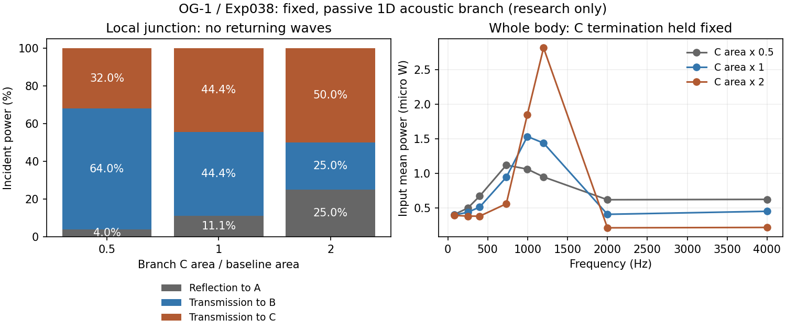

# Experiment038 pilot evidence — provisional

## Local measured outcome

Python 3.12.14, NumPy 2.3.5. All 288 fixed nominal cases passed without fixture
removal or tolerance changes. Twenty-four full-port Wolfram records also agreed.

| Quantity | Maximum measured | Frozen gate |
|---|---:|---:|
| Full-port normalized independent-reference error | 9.42571e-15 | 1e-10 |
| Full-port normalized Wolfram error | 2.73816e-15 | 1e-10 |
| Normalized mean-power imbalance | 9.87794e-15 | 1e-10 |
| Equation backward error | 1.55826e-16 | 1e-12 |
| Local scattering/weighted-power error | 2.22045e-16 | 1e-12 |
| Normalized system condition number | 139.025 | 1e8 |

Wrong signed coupling produced normalized independent-oracle discrepancy **2.29480**;
wrong particle-velocity continuity produced **0.495024**; both exceed the frozen 1e-3
rejection threshold. The all-equal-length pressure-release singular fixture had
condition approximately **1.32251e16** and was correctly `NUMERICALLY_UNRESOLVED`.

Two separately invoked runners produced byte-identical graphs, full-port states,
metrics, local scattering and completion manifests on the same runtime. The physical
response is recomputed each time; no existing evidence directory is overwritten.

Left: exact no-return local scatter, with C area ratios .5/1/2. Right: actual finite
body input mean power at the fixed test frequencies, prescribed input flow unchanged,
C terminal impedance kept at the baseline value. This is a geometry-only intervention.
It is neither voice loudness nor an energy-efficiency comparison of biological bodies.
Lines connect sparse measured samples; peaks between samples are not resolved here.

## Claim and provenance

Protocol commit **5a9e574** precedes implementation. It was author-defined after
theoretical planning, without independent approval. Numerically green software is not
a signature by an independent scientist. No threshold or fixture has been relaxed.

Status: **PROVISIONAL_NUMERICAL_PASS / INDEPENDENT_REVIEW_PENDING / NOT_ADOPTED**.
Remote CI and named revision-specific results are recorded in the Draft PR after
actual completion; this local report does not assert unobserved remote success.

Independent numerical/code audits, OG-0 adoption resolution and separate future API
integration remain outstanding. No waveform synthesis, biological nose or creator
editor has been introduced.
