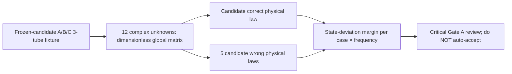

# Experiment 042 — NR-1a Gate A mutant-detectability preflight

**Status: EXPLORATORY / PRE-GATE-A / NOT CONFIRMATORY / NOT ADOPTED.**

This instrument prepares a reviewer-inspectable pre-registration for [NR-1a #118](https://github.com/ryonakayama234/morphoacoustics/issues/118). It is NOT the new, preregistered confirmation run (Gate B). Previous [Experiment 041](../041_nr1_static_oral_nasal_route/) N/O/M outputs remain exploratory and are not reused as confirmatory results.



## Instrument inventory
- [preflight.py](./preflight.py): stand-alone NumPy 12×12 linear-equation assembly, 3 cases × 8 frequency anchors × 5 **law-level** mutants. It does not import Core or the archived Wolfram goldens. Test-only diagnostics; it is *not* an independent golden oracle for the future Gate B.
- [wolfram_preflight.wl](./wolfram_preflight.wl): Wolfram Language 12-state assembly with exact rational geometry and 35-digit preparation. It was evaluated separately through the Wolfram connector on 2026-10-17, and the aggregate 24×5 candidate margins agreed with local Python. It is not run in hosted CI, nor is the tool-result output itself an immutable scientific receipt.
- [Python tests](../../tests/test_experiment_042_nr1a_preflight.py): 24-fixture structural checks, actual matrix law mutations (not only corrupting output), preserved reactive closed distal branch, 733 Hz historical powers and independently scoped M quarter-wave local-pole check.

## Running as a design preflight
```bash
python -m pytest tests/test_experiment_042_nr1a_preflight.py -q
python experiments/042_nr1a_gate_a_preflight/preflight.py --output /tmp/nr1a-gate-a-exploratory.json
wolframscript -file experiments/042_nr1a_gate_a_preflight/wolfram_preflight.wl
```

Do not label the generated JSON a prospective Gate B receipt. External Wolfram requires a locally accessible licensed Wolfram runtime; hosted CI does not silently supply one.

## Raw exploratory observations (not preregistered thresholds)
The two independently programmed linear systems agreed on 2026-10-17:
- Maximum 2-norm global matrix condition among all 24 correct fixtures: **~354.604480860**.
- Minimum (across 24) max-component dimensionless state deviation per mutant:
  - `tube_sign_A`: **~0.1692590094**, O at 80 Hz
  - `phasor_sign`: **~0.3008534468**, O at 80 Hz
  - `junction_particle_velocity`: **~0.04653672882**, N at 80 Hz
  - `wrong_B_terminal`: **~0.7881360092**, O at 400 Hz
  - `wrong_C_terminal`: **~0.3603832285**, N at 80 Hz
- Mouth-closed B quarter-wave local admittance pole (952.7777778 Hz) is **not** a singular global 12×12 system in this frozen fixture; independent Wolfram global condition ~**74.839905915**.
- Machine-precision local Python test run: **8 passed**. This is a local exploratory tool test, not the GitHub exact-HEAD CI verdict.

The scales are **p_ref=1.372 Pa** and **U_ref=1e-6 m³/s**; the recorded margin is the largest absolute difference among all twelve dimensionless complex state entries. This is *not* a relative error ratio and not a proof of mutant detectability for other geometries or frequencies. The `phasor_sign` mutant flips propagation phases but keeps the prescribed complex inlet U unchanged. A true test of the mean-power formula and mutation of stale provenance remain to be preregistered separately (the 041 tests currently contain exploratory examples).

## Reviewer decision still required
Before Gate B:
1. Freeze complete mutant inventory, exact matrix injection loci and expected case×frequency detection bounds; justify any insensitive points rather than exclude them.
2. Approve forward-error tolerances **independently** of exploratory observations, global-condition and fail-closed numeric rule.
3. Freeze raw exact-HEAD Wolfram reproduction receipt and two independent trial receipt formats.
4. Conduct distinct physics/numerical and code/API reviews. Only a written Gate A acceptance permits a new confirmatory Gate B execution.

No public OG-4 capability, real velopharyngeal port disconnection, voice, waveform or Studio API is created here.


## Exploratory audit hardening (stacked Draft; not a Gate A freeze)

This additional research-instrumentation slice strengthens engineering checks.
It does not change the physical model, promote Experiment 041/042 to prospective
evidence, or independently sign off the science.

- The tests now exercise **all 120 individual** N/O/M × eight-frequency ×
  five-equation-mutant cells. The test-only separation floor is 128 × float64
  epsilon × max(1, the largest dimensionless complex-state component of both
  solutions). This is a numerical **non-identity smoke check**, NOT a prospective
  per-cell mutation kill threshold or forward-state oracle acceptance criterion.
  Scientific tolerances and insensitive anchors must still be frozen at Gate A.
- The exploratory JSON now uses schema
  nr1a.gate-a.exploratory-mutation-preflight.v1. It records baseline and
  per-equation-mutant junction diagnostics: pressure equality (Pa), signed
  complex flow conservation magnitude (m³/s), real average-power imbalance
  (W), and complex-power imbalance magnitude (VA). These are independent
  *physical-law observations*, not merely linear-system solver residuals.
- Wrong particle velocity conservation at **N / 80 Hz** violates complex volume
  flow but can pass a **real mean-power** check, because the discrepancy is
  reactive. Thus average-power conservation is insufficient to validate the
  actual junction flow law.
- A separate output-formula negative control multiplies all peak-phasor
  powers by two (omitting 1/2): even the wrong output can pass a self-consistent
  terminal power balance. A separately derived **absolute-power oracle**
  is needed. This is *not* a sixth matrix-law mutant.
- A separate metadata negative control rejects absent, malformed and stale
  HEAD/source/fixture/oracle digest **claims**. The helper verifies header
  shapes and equality, NOT SHA-256 recalculation from bytes, signed provenance,
  immutable source binding or independently executed trial receipts. These
  remain future Gate A/B obligations.

Existing eight historic local tests and quoted Wolfram aggregate calculations
refer to the **previous exact HEAD**. Changing the HEAD requires new GitHub
CI evidence. Hosted CI still does not execute Wolfram, and this work does NOT
run a new confirmatory Gate B, freeze Gate A, or adopt Gate C.
