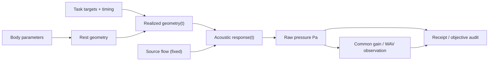

# Data / causal lineage — Experiment 043

| Record | Owner | Shape / unit | Revision semantics |
| --- | --- | --- | --- |
| Body condition | Core experiment | 16 TubeSections, `length_m`, `area_m2` (SI) | Exact M0/M1 research condition |
| Timing condition | Core experiment | 3 CandidateTasks; second onset 0.15 or 0.19 s | Experiment-local, not a MotorPersona contract |
| Physical realized state | Core | 16-section time-dependent `Tract1DGeometry` | Derived; not persisted as Character anatomy |
| Source | Core | 48 kHz, fixed 0.5s LF flow array (m³/s) | Same float64 source for all four renders |
| Raw observation | Core experiment | 4 × float64 `*_pressure_pa.npy` | Derived acoustic pressure; not physical state |
| Audition | Core experiment | 4 × mono 16-bit PCM, 48 kHz | Shared multiplier from maximum across all pressure buffers |
| Receipt | Core experiment | `receipt.json`, schema `exp043-research-only/v0` | Source/pressure/PCM SHA256, intervention settings, limits |
| Immutable Take | Studio | **None in this experiment** | Future adapter must preserve all previous Take revisions |

Do not identify `M0` or `M1` as a real species or voice actor. The profile
`late_constriction` is a schedule intervention, not an independent speaker
identity. The current audio render is an experiment-local observation bundle
and **must not be presented as a validated creator Take**.
