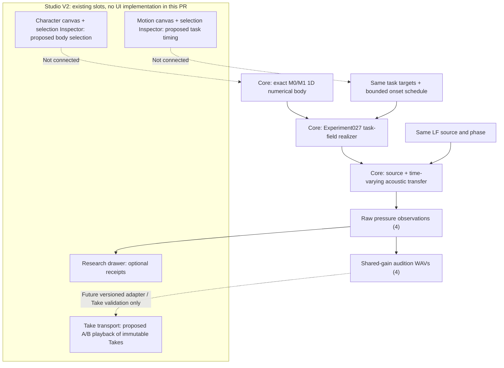

# System / product ownership — Experiment 043

**Existing UI contract authority:** Studio
[`STUDIO_WORKSPACE_V2_DECISION.md`](https://github.com/ryonakayama234/morphoacoustics-studio/blob/main/docs/product/STUDIO_WORKSPACE_V2_DECISION.md).
The closed slots are unchanged: `character.canvas`, `motion.canvas`,
`selection.inspector`, `take.transport`, `research.drawer`.
This Core research PR does not edit Studio. Future UI binding requires a
separate creator-approved proposal (action, slot, domain owner, exact contract,
real backend capability, immutable Take compatibility, and risks).

**Physical authority:** Existing Core Experiment027 task field computes
section-area state from task activation; Experiment023/012 computes pressure.
The experiment edits only the numerical rest-body section lengths and the
second task's onset time. A phonetic symbol does not specify a WAV.

**Not yet modeled:** self-excited larynx, dynamic tissue inertia, nonlinear
source-filter coupling, per-individual articulatory skill, full organ graph,
binaural listener or arbitrary script. A valid numeric observation is not a
claim of natural voice.
