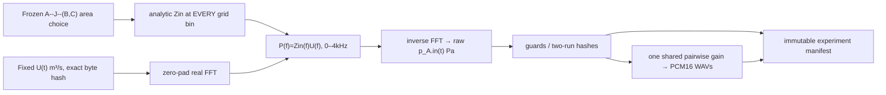

# Experiment 044 — audible three-organ pressure monitor prototype

**Status: EXECUTED EXPLORATORY ENGINEERING ONLY. NOT Gate A independently ratified, NOT confirmatory Gate B, NOT a Core public API, NOT Studio integration, NOT physical speech or mouth-radiated pressure.** Read [pre-implementation candidate protocol](./PROTOCOL_CANDIDATE.md), [physical SYSTEM](../../docs/research/og-aud1/SYSTEM.md), [DATA](../../docs/research/og-aud1/DATA.md), [EXPERIMENT ledger](../../docs/research/og-aud1/EXPERIMENT.md) and [results](./RESULTS.md).

## Why it is here

OG-4 provides only **8 isolated validated frequencies**, not a continuous spectrum. Experiment 043 confirmed the mathematical ideal-junction model at four anchors. This new isolated program `monitor.py` computes an **entire new explicit 0–4kHz FFT frequency-grid transfer** for two exactly fixed passive matched branch3 fixtures, then derives finite, pressure-monitored A/B audio from one identical prescribed *volume-flow* source. It does **not** call or extend OG-4's public API, and is not a universal graph/body adapter.

The exact causal branch model is `r=(Z_J-Z_A)/(Z_J+Z_A)`, `Z_J=(1/Z_B+1/Z_C)^-1`, `Z_in(f)=Z_A*(1+r*exp(-i 4π f L_A/c))/(1-r*exp(-i 4π f L_A/c))`, where `Z_i=ρc/area_i`. Both outgoing tubes are ideally matched, so distal **length** is physically unidentifiable at the source-port p monitor; changing **C area** is the tested intervention. Pressure (Pa) is derived from input volume-flow (m³/s); generated WAV is a *playback transform of the source-port monitor*, not external radiated sound, human voice, or calibrated SPL.

## Data flow



**Bandlimit caveat:** setting all f>4kHz bins to zero is a spectral projection, with potential noncausal pre-ringing. The pre-source guard, tail guard and energy residuals are measured and included in [RESULTS](./RESULTS.md); do not claim that an ideal brick-wall filter is causal, and do not silently replace it with a guessed model >4kHz. The 1D graph is passive linear small-signal acoustics, not self-oscillating folds or acoustic radiation.

## Reproduce (WSL2 bash, from repository root)

```bash
python3.11 -m venv .venv-og-aud1
source .venv-og-aud1/bin/activate
python -m pip install numpy==2.3.5
python -m unittest discover -s experiments/044_og_aud1_monitor -p 'test_*.py' -v
python experiments/044_og_aud1_monitor/monitor.py /tmp/og-aud1-first
python experiments/044_og_aud1_monitor/monitor.py /tmp/og-aud1-second
diff -r /tmp/og-aud1-first /tmp/og-aud1-second
```

The script refuses existing target directories and writes `manifest.json` only after validating staged files. New output folders contain two mono PCM16 48kHz WAVs, two raw pressure arrays [Pa], one identical raw source [m³/s] and artifact SHA-256. No external speech data or neural model is present. The [12-bin Wolfram global-system oracle](./oracle_fft_bins.wl) executes the independently assembled 12-state Experiment043 matrix at FFT bin frequencies (including previously unverified OG-4 frequencies), and the Python regression file contains its independently calculated values. Reproducing scalar/global agreement does not itself establish unrestricted bandwidth physics.

## Future Gate C and creator boundary

Do NOT wire this file directly into Studio as a trusted production backend: it lacks an adopted Core versioned body binding, signed code checkout and full reviewer-approved source/FFT contract. Once Gate A and confirmatory broadband Gate B are approved, implement a separate exact-pinned adapter that verifies raw Pa, identical physical source, common gain, WAV, immutable pair receipt, failed-input no-Take semantics, and creator reload/restart. Existing serial-tract CC-A2 Takes are immutable.
