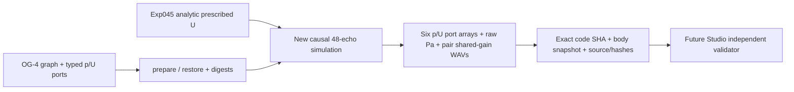

# Experiment 046 — typed-body fixed-pair preview (NOT ADOPTED)

Graph A → J → (B,C), matched B/C, two frozen C areas. See `GATE_A_FROZEN_CANDIDATE.json` committed before executing `wolfram_global_holdout.wl`. Eight new frequency points × two bodies gave max global 12-state vs analytic Zin error 4.609e-16, max flow residual 4.868e-22 m³/s, max power residual 5.509e-16. **Gate A has not been independently ratified; this is not a certified Gate B.**

Runner: `PYTHONPATH=src python tools/og_aud1_preview.py NEW_DIRECTORY`. It creates new 48kHz source-port non-radiated monitor sound for both bodies, all six-port SI p/U traces, graph preparation digest and SHA256 artifacts, in a single no-overwrite directory.

The adopted OG-4 blueprint carries a fixed phasor input for **graph validation only**; the analytic time U(t) is an explicit, separate research override at A.in. **This does not extend OG-4's fixed eight-frequency waveform-free API**, and future public admission requires a new source-program contract.

Physical claims excluded: radiation, listener SPL, speech, vocal folds, motor realization, graph drag editor. Studio will not accept this as adopted or modify existing v0/v1 CC-A2 Takes.
