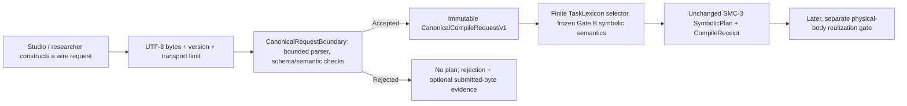

# SMC-4 Gate B-R: CanonicalRequestBoundary proposal (DESIGN_ONLY)

Date: 2026-10-25 JST. Owner issue: [#185](https://github.com/ryonakayama234/morphoacoustics/issues/185).
Review context: Gate A design [#175](https://github.com/ryonakayama234/morphoacoustics/pull/175),
unadopted Gate B [#180](https://github.com/ryonakayama234/morphoacoustics/pull/180)
and its [REVISE decision](https://github.com/ryonakayama234/morphoacoustics/blob/research/smc4-gate-b-bounded-tasklexicon-20261024/packages/speech-motor-compiler/docs/SMC4_GATE_B_DECISION_20261025.md).

**Status: PROPOSED / NOT APPROVED / NO_EXECUTABLE_CODE / SCIENCE_NOT_ADOPTED / NO_MAIN_MERGE.**
This is a *prospective design amendment*. Original Gate A frozen Protocol + Amendments 01–03,
Gate B frozen preregistration F01–F32, ten AI code-review rounds and 28 P2 findings remain
historically untouched. This branch is based on Gate A's exact design SHA `9f7a8d10ca7a524a1b47496a8c4807ce40a82165`
rather than the intentionally RED Gate B branch, so its design-only CI does not misrepresent
the rejected implementation as passing.

## 1. Design statement



A compiler may never accept arbitrary mutable Python graphs as direct executable requests.
A bounded syntactic and semantic ingress gate constructs immutable *trusted* values before
TaskDefinition/GoalSlot/SlotCandidate selection, source-span validation, sharing and rational
coordination. Bodies, organs, phonetic accuracy, perception, UI integration and WAV are excluded.

## 2. Distinct evidence domains (the core decision)

| Evidence | When available | Equal when? | Appropriate claim |
|---|---|---|---|
| `submission_sha256` | Received `bytes` of permitted size, valid or invalid | Byte-for-byte equal input | Provenance of submitted bytes |
| `canonical_request_sha256` | Fully schema-valid + structurally validated request, regardless of later mapping accept/refusal | Equivalent versioned typed semantics per explicitly declared ordering rules | Identity of the *validated experiment* |
| `plan_digest` | A fully valid symbolic plan was generated and checked | Equivalent output plan | Identity of generated task graph |
| `receipt_digest` | A structured receipt was produced | Versioned tuple of evidence + decision code + canonical diagnostics | Identity of compiler decision (not physical proof) |

Hash = SHA-256 with an explicit purpose/domain version tag; this does not prove truth or uniqueness
mathematically. Recording raw bytes and canonical semantics are deliberately **not the same hash**.

**Out of domain:** arbitrary Python objects (including dictionaries/dataclasses, cyclic/aliased
lists, and object-identity graphs) are **not admissible requests**. When a caller invokes
a future optional convenience entry with a non-`bytes` object, reject without walking
that object: `INVALID_INPUT / NON_WIRE_INPUT`, `submission_sha256=null`,
`canonical_request_sha256=null`. Do **not** pretend to distinguish arbitrary non-byte values.

For byte-backed malformed UTF-8/JSON/schema input **within** the byte ceiling, preserve
`submission_sha256`; `canonical_request_sha256=null`. For a schema-valid request
whose *task mapping* is `UNMAPPED`, `AMBIGUOUS`, `INSUFFICIENT_CONTEXT`,
`UNSUPPORTED_MAPPING_SCOPE`, etc., the canonical request hash **exists**
even if `SymbolicPlan` is absent. This prevents conflating ingress errors with scientific
or task-mapping failure. The body-owned outcome `INFEASIBLE` is never issued by this gate.

**Transport limit:** a future v0 proposal caps request payloads at 262,144 bytes. The transport
must enforce the limit before accepting material into the compiler. For a direct oversized
`bytes` call, return `INPUT_TOO_LARGE` and `submission_sha256=null` with
`hash_status=NOT_COMPUTED_OVER_LIMIT`; do not hash arbitrarily large data just to
satisfy an audit slogan. Other <= limit byte requests produce the exact raw digest.
This exception must be explicit in the receipt schema, not silently omitted.

## 3. Proposed wire grammar (JSON v1, type/size choices subject to design review)

One UTF-8 JSON document, root object with `schema_version="smc4-compile-request/v1"`.
Required distinct keys for `segment` (source_text, source_revision, segment_id, language),
`pronunciation` (complete alternative paths plus selected_path_id),
`motor_mapping` (profile, lexicon snapshot, context), and `coordination`
(shares, anchors, relations, coordination_kind). Keep every provenance source and
lexicon revision explicit. **No code reading or text-to-pronunciation inference.**

- **JSON types:** objects with string keys only; no duplicate object keys at any depth;
  arrays; strings; booleans; integers with explicit bounded ranges; null only where
  declared. Reject floats/exponents, NaN/Infinity, ambiguous rational coercions, unknown
  fields and unknown schema versions. Represent fractions as explicit
  `{"numerator":int,"denominator":positive_int}` in reduced form; `denominator!=0`.
- **Unicode:** strictly decoded UTF-8; reject unpaired surrogate escapes, Unicode
  noncharacters if required by explicit future policy (not assumed here).
  Do **not** silently NFC-normalize script, language, phonetic labels or IDs;
  preserve exact source code points and source spans. A later normalization layer
  requires its own provenance and version; no hidden reading corrections.
- **Acyclic representation:** JSON is a value tree. String IDs such as `definition_id`
  are typed *references*, not object pointers; no arbitrary `$ref`, `__dict__`,
  Python `repr`, graph serializer, or recursive dataclass expansion.
- **Proposed ceilings:** <=262,144 payload bytes; <=32 JSON nesting levels;
  <=4,096 total parsed JSON container/value nodes; <=16,384 Unicode code points
  for segment source_text; <=256 pronunciation units, <=256 definitions,
  <=512 bundles, <=1,024 GoalSlots/candidates in aggregate, <=1,024 anchors/relations
  in aggregate; all rational numerator/denominator magnitudes <=2^63-1.
  These are **design candidates**, not actual enforced software limits. Validation
  and parser resource behavior must be tested under each bound before a freeze.
- **Structural profile semantics:** exactly one explicitly selected complete
  `PronunciationPath` with complete source coverage, one-unit-only Bundle
  target scope, additive required GoalSlots and exclusive SlotCandidates,
  Kleene TRUE/FALSE/UNKNOWN predicates, exact rational timing, compatible
  explicitly chosen shared task episodes and full evidence provenance,
  consistent with the frozen Gate A and B semantic requirements.

## 4. Canonical equivalence — formal ordering policy

Only after a request is schema/structure-valid do we canonically encode it:
1. JSON *object* keys sorted by original UTF-8 string byte order (NOT Python `str(key)`
   coercion); JSON wire has no nonstring keys.
2. Explicit unordered semantic collections (versioned metadata): pronunciation
   *alternative paths* keyed by path ID; TaskDefinitions keyed by semantic ID/rev;
   bundle declarations keyed by bundle ID; required GoalSlots keyed by slot ID;
   exclusive candidate alternatives keyed by template ID; shares keyed by episode;
   anchor/relation declarations as multisets of canonical complete tuples. Duplicate
   IDs and illegal duplicate declarations cause a schema/contract rejection, not
   last-writer wins.
3. Semantically ordered data is preserved: selected path's pronunciation units
   and any source ordered spans, rational relation source/target direction,
   `NOT` unary operand, emitted task timing and source text's exact code points.
   `AND`/`OR` operand commutativity MAY be recognized, but must be explicitly
   frozen and tested; do not reorder `NOT` or directional coordinates.
4. Numeric canonicalization occurs only for schema-admitted exact integers and
   prevalidated reduced rationals; no floats or silent conversions.
5. F09 equivalence is defined for *schema-valid, semantically equivalent*
   requests (including mapping rejections). For **schema-invalid** wire documents
   we promise only exact submission-byte evidence and deterministic
   schema error classification for *those exact bytes*. We explicitly do not
   claim canonical equivalence of malformed cyclic Python object graphs.

A canonical semantic hash is not computed for an invalid input: no ambiguity over
whether `{1:[]}` and `{"1":[]}` are the same JSON value. Neither is a valid
JSON source object with an integer property name; arbitrary Python dictionaries
are outside the ingress domain.

## 5. Proposed observable receipts

```text
IngressReceipt {
  request_schema_version,
  boundary_version,
  ingress_status: ACCEPTED | REJECTED,
  code: INVALID_INPUT | INPUT_TOO_LARGE | ...,
  canonical_diagnostics: tuple[code, json_pointer, ...],
  submission_sha256: string | null,
  canonical_request_sha256: string | null,
  hash_status: COMPUTED | NON_WIRE | NOT_COMPUTED_OVER_LIMIT,
}
```

The mapping compiler receives only the accepted immutable
`CanonicalCompileRequest/v1`, returns the existing symbolic `CompileResult`
and its Task associations/timing evidence. Never fabricate `plan_digest` on
ingress refusal. Projected motor/task receipts keep provenance of source text,
explicitly selected pronunciation, lexicon rule, TaskDefinition revision,
coordination choices and timings; no human phonetic validation implied.

## 6. Prospective test-first fixtures — do NOT retrofit existing F01–F32

| Fixture | Test | Required behavior |
|---|---|---|
| BR01 | Two distinct accepted byte encodings with object-key permutation | Different byte hash, same canonical semantic hash |
| BR02 | Equivalent permutation of explicitly unordered definitions/bundles | Same semantic hash, graph and decision |
| BR03 | Reordered pronunciation units or reversed directed time relation | Do not silently equate; reject invalid order or distinguish meaning |
| BR04 | Wrong version, duplicate JSON object keys, unknown fields | Ingress rejection with raw digest and no graph |
| BR05 | Invalid UTF-8, lone surrogate escape, non-finite value | Ingress rejection with raw digest and no semantic hash |
| BR06 | Float where exact rational required; denominator 0 or nonreduced | Refuse or explicit contract-defined canonicalization, not guessing |
| BR07 | Bytes at ceiling and over ceiling, excessive depth/nodes | Safe deterministic bounded handling; no unbounded hash demand |
| BR08 | `dict`, dataclass, cyclic list as direct Python call | `NON_WIRE_INPUT` without traversal, no fingerprint or plan |
| BR09 | Same valid canonical request with explicit alternate pronunciation selected | Distinct semantic identity and source-linked receipt |
| BR10 | Schema-valid but unmapped / ambiguous / unknown context | Canonical hash exists; no partial plan; correct semantic refusal |
| BR11 | Exact valid F01 two-units/three-shared-tasks/four-links candidate | Preserve unchanged SMC-3 symbolic shape and provenance |
| BR12 | Frozen F01–F32 acceptance/refusal behavior lifted onto new ingress | Prospective equivalence report; report incompatibilities, do not overwrite |
| BR13 | F09 ordering over valid supported and rejected mappings | Same canonical experiment identity and canonical mapping decision |
| BR14 | Hash-version migration and domain labels | No cross-domain raw/semantic/plan hash confusion |

## 7. Gates, responsibilities, and explicit decision

**B-R Gate A (DESIGN_ONLY):** freeze this prospective interface contract after
third-party GitHub `@codex review`, decide
`GO_DESIGN_ONLY / REVISE / REJECT`. Codex is an AI software/architecture critic,
NOT human scientific peer review. The current document is an unapproved design
candidate, not a verified preregistration or permission to claim original Gate B passes.

**B-R Gate B (future, separately authorized):** commit immutable BR01–BR14
test protocol first; then RED tests; then bounded parser and validated immutable
request IR; then adapter to unchanged SMC-3 IR, exact-SHA Python 3.11–3.13 +
strict mypy/root regressions; finally a finite independent Codex exact-head review
and explicit `GO_LIMITED_SYMBOLIC / REVISE / REJECT` decision. Preserve legacy
[#180](https://github.com/ryonakayama234/morphoacoustics/pull/180)
as historical intentionally RED evidence; do not rewrite the frozen failures.

**Scientific boundary:** No anatomical model, neural gesture realization,
body transfer, audio WAV, Japanese reading inference, perceptual verification,
Studio integration, or merge to `main` is justified by either design gate.
