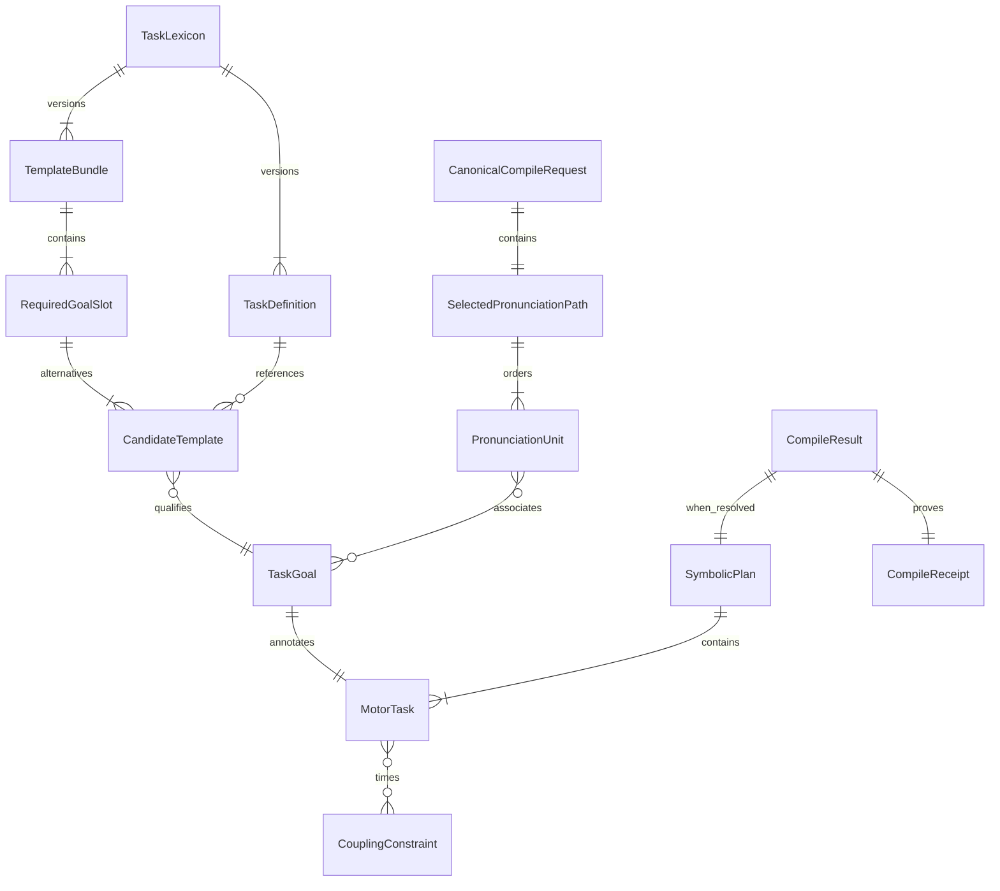

# SMC-5 DATA — typed research assets and identity

Status **PROVISIONAL / PRIVATE RESEARCH MODEL**. Do not promote as a public Performance or MotorScore schema.

## Inputs
- The already-reviewed SMC4-BR immutable `CanonicalCompileRequest(schema_version, canonical_bytes, canonical_sha256)`.
- Wire `segment`: exact UTF-8 source and source revision; `pronunciation`: complete selected path / source codepoint spans.
- `motor_mapping`: profile, context, versioned `TaskDefinition` (functional variable, goal kind, capability predicates) and selected `TaskTemplate` in required `TemplateBundle` slots; `coordination`: episode share members, ONSET/OFFSET anchors, directed lags.
- The input grammar and resource ceilings are owned by [SMC4_GATE_BR_PROTOCOL.md](SMC4_GATE_BR_PROTOCOL.md), not redefined here.

## Outputs
`CompileResult(plan: SymbolicPlan | None, goals: tuple[TaskGoal,...], timing: TimingReport | None, receipt: CompileReceipt)`.

`TaskGoal` retains task_id, definition ID/revision, functional goal kind, capability requirements, exact rational lower/upper target, source slot members, selected template IDs and evidence references. **Physical body feasibility is not inferred**. For a share episode, require strict same functional definition semantics; choose goal interval intersection only if nonempty.

`CompileReceipt` carries compiler_version, status RESOLVED|REJECTED, stage INGRESS|MAPPING|GRAPH|TIMING|SYMBOLIC, refusal code, submission SHA-256 if bounded raw bytes were admitted, schema-validated canonical request SHA-256, plan graph digest when validated, `candidate_digest` when fully resolved, versioned provenance and selection/share trace. No fake digest for missing candidate.



## Identity rules
- SMC3 `plan_digest`: Unicode source, units, Task IDs, associations, event constraints. **Does not include concrete goal intervals.**
- SMC5 `candidate_digest`: `SMC5-TASK-CANDIDATE/v0\0` domain-separated SHA-256 of `semantic_request_hash + plan_digest + selected typed TaskGoals`. Distinguishes goal intervals even if graph unchanged. A candidate digest is provenance, *not* speech correctness.
- Task occurrence IDs: SHA-256-derived synthetic IDs over explicitly chosen occurrence members, episode ID, selected templates, lexicon revision and rule revision; no deduplication solely by goal_kind. Hash collision is a refusal.
- Semantically unordered wire arrays and object keys are canonicalized at SMC4-BR. Phonetic unit order and timing direction remain significant. Rejections keep ingress semantic hash when and only when valid schema was received.
- `timeline_table` returns sorted triples `(task_id, onset: Fraction, offset: Fraction)` only for a fully resolved result; **not** a target actuator trajectory.

## Example timeline (synthetic mathematical fixture only)
```text
time (seconds)      0      0.4    0.6    0.8     1.0
P1 tract task       [============)
P1 source task      [====================)
P2 tract task              [===============)
```
These artificial periods are not measured natural coarticulation; no phoneme = physical organ assumption.
