# SMC-5 Gate A — bounded canonical-to-symbolic bridge, preregistered before tests/source

Date: 2026-10-26 JST. Owner approval in conversation; issue #210. Status: **PROTOCOL_FROZEN_BEFORE_TESTS / NOT IMPLEMENTED / SCIENCE_NOT_ADOPTED / NO_MAIN_MERGE**.
Base: SMC-4 Gate B-R ingress research Draft #189 at `1325f88793efdaa8fb2f5457455e8d77311a2325`, stacked on design Draft #186, SMC-4 Gate A #175, SMC-3 #164. Parent design code-reviewed, prior historical Gate B #180 is REVISE/RED and **must not be copied**.

## Intent and architecture

```mermaid
flowchart LR
  A["versioned finite UTF-8 JSON"] --> B["SMC-4 BR bounded parser: frozen canonical bytes + raw/semantic receipt"]
  B --> C["SMC-5 synthetically bounded TaskLexicon selector"]
  C --> D["Task occurrences + explicit sharing + functional goal intervals"]
  D --> E["SMC-3 many-to-many SymbolicPlan + exact rational event constraints"]
  E --> F["validate_plan + resolve_timing"]
  F --> G["candidate graph + goal/receipt + source trace + synthetic timing table"]
  G -.later body adapter, new gate.-> H["Core physical execution"]
```

Success is *synthetic software construction*, never evidence for Japanese reading, task physiology, organ capability, voice quality, or actual physical execution. Pronunciation is explicitly caller supplied. No Studio/Core/production schema edits. The output is a **research-only in-process candidate**; not a new public `MotorScore` ABI. Canonical`SymbolicPlan` cannot itself encode Task goal intervals, so keep explicit typed `TaskGoal` records alongside graph; `candidate_digest` commits to input semantics + plan graph + goal records, while SMC-3 `plan_digest` covers symbolic graph only. Do not interpret either as acoustic quality evidence.

## Initial bounded selection sublanguage (all other constructs explicitly refused)
1. Exactly one complete selected pronunciation path, unchanged Unicode/codepoint offsets, from accepted immutable `CanonicalCompileRequest`; **never** accept direct mutable Python graph.
2. Selected path units must each have exactly one matching bundle for (profile, unit ID, candidate symbol). `EXACT_ONE_SELECTED_UNIT` scope and `target_unit_ids=[unit_id]`; multi-unit scope affecting selected units is `UNSUPPORTED_MAPPING_SCOPE`. Wrong/missing references are mapping refusal.
3. Each applicable bundle contains >=1 **required** GoalSlot with exactly **one selected candidate**. All priority fields must be null; non-null priority is `UNSUPPORTED_SELECTION_POLICY`. Candidate status must be `SYNTHETIC_ONLY`; other statuses are `UNSUPPORTED_EVIDENCE_STATUS`. TaskDefinition algebra must be `SCALAR_INTERVAL`; no default for others. Nonempty candidate/slot and unique semantic IDs are already guarded structurally by ingress. Missing bundle/slot is `UNMAPPED`; multiple valid bundles or eligible candidates `AMBIGUOUS`. No arbitrary tie breaking.
4. Context predicates: TRUE/FALSE/EQ/NOT/AND/OR using strong Kleene tri-valued `TRUE/FALSE/UNKNOWN`. A key missing from a caller-declared context is UNKNOWN, not FALSE. At any selectable level (bundle or candidate) unresolved UNKNOWN may change selection, hence `INSUFFICIENT_CONTEXT` unless all alternatives can be shown irrelevant. FALSE is deliberately inapplicable. Candidate EQ exact match against lexical context values; no language inference.
5. Definition identity = (definition_id, semantic_revision), referenced by selected candidate. Matching explicit sharing episode with >=2 **different unit IDs** and a unique member pair (unit_id,slot_id) maps multiple associations to one Task instance **only if** identity/goal kind/capabilities/value domain match and rational scalar intervals intersect. Otherwise `INCOMPATIBLE_SHARE`. Repeated goal_kind in independent occurrences never deduplicates. Goal interval intersection is stored in `TaskGoal` metadata (not silently discarded). Profile/revisions/evidence IDs are retained in compile receipt.
6. Event anchors and directed couplings refer by (unit_id,slot_id) and map through explicit sharing to SMC-3 task IDs. `EXACT_EVENTS` only; rational integers `Fraction`, not floats. Duplicate mapped anchor for task/event or equivalent coupling is `DUPLICATE_COORDINATION`. Run SMC-3 `validate_plan` and `resolve_timing`. Any invalid or unresolved time yields rejection with **no usable plan**, no partial timing, no candidate digest. Existing graph validation is a dependency not a physical feasibility oracle.
7. Deterministic task IDs derive from domain-versioned SHA-256 over canonical typed member tuple + lexicon/rule revision + chosen template IDs. Check for collisions explicitly. Canonical plan ordering, goal records and selection trace are stable under wire key/set permutation, never reorder pronunciation unit sequence, preserve exact UTF-8 source. Refusal receipt has stage-specific status/code, ingress canonical hash and null plan/candidate digests.

## Frozen falsifiers
S01 selected pronunciation and synthetic functional goals -> full resolved candidate with multiple tasks per unit.
S02 explicit cross-unit shared Task plus independent goals produces true many-to-many associations (not adjacent independent tasks).
S03 repeated goal_kind and different episode/occurrence do not collapse; no guessed similarity sharing.
S04 declared unordered JSON declarations and object order produce identical canonical ingress and candidate, ordered pronunciation changes identity or refusal.
S05 unselected pronunciation alternative has no impact on generated graph.
S06 missing bundle/slot, ambiguous bundles/candidates, UNKNOWN context, priority, multi-unit mapping scope -> explicit refusal, no plan.
S07 unknown definition/selected unit/slot, duplicate shares, incompatible definition or goal intervals -> explicit refusal; exact interval intersection preserved in candidate.
S08 contradictory rational timing, missing onset/offset reference, zero/nonpositive duration, unanchored timeline -> no candidate, no partial resolved events.
S09 exact source Unicode/spans; no morpho/organ/solver/F0/waveform or transcription claim.
S10 accepted ingress with mapping failure keeps ingress semantic hash in rejection receipt, no plan/candidate digest.
S11 candidate digest changes if candidate goal interval or chosen template changes even when SMC-3 plan graph digest would not.
S12 all CI successes are source-SHA-specific; physical/phonetic and general Gate B F01–F32 remain NOT_RUN/MORE_DATA.

## Freeze, implementation and evaluation
1. Commit this protocol **before** code/tests.
2. Commit preregistered tests importing missing `symbolic_bridge` module. Preserve RED CI/commit.
3. Implement independent `symbolic_bridge.py`, no old rejected #180 source. Test at exact SHA Python 3.11/3.12/3.13, strict mypy, Core root regressions. No dependency outside standalone SMC package.
4. Request **`@codex review` on Draft PR at code-bearing HEAD**. Reproduce reviewers' actionable findings in new failing tests *before* repair; repeat audit. Record all exact SHA, CI links and findings in append-only dated RESULTS/DECISIONS.
5. Only `GO_LIMITED_SYMBOLIC` for synthetic fixtures if all required evidence passes. Design/docs/AI checks alone never equal phonetic or physics acceptance. In absence of completed independent review: `MORE_DATA`. No main merge or Studio UI.

## Sources
- [M5 #11](https://github.com/ryonakayama234/morphoacoustics/issues/11), [M5b #20](https://github.com/ryonakayama234/morphoacoustics/issues/20)
- [SMC-3 Draft #164](https://github.com/ryonakayama234/morphoacoustics/pull/164)
- [SMC-4 Gate A #175](https://github.com/ryonakayama234/morphoacoustics/pull/175), [Gate B-R design #186](https://github.com/ryonakayama234/morphoacoustics/pull/186), [ingress #189](https://github.com/ryonakayama234/morphoacoustics/pull/189)
- Historical [Gate B RED #180](https://github.com/ryonakayama234/morphoacoustics/pull/180); unmodified and not an implementation dependency.
