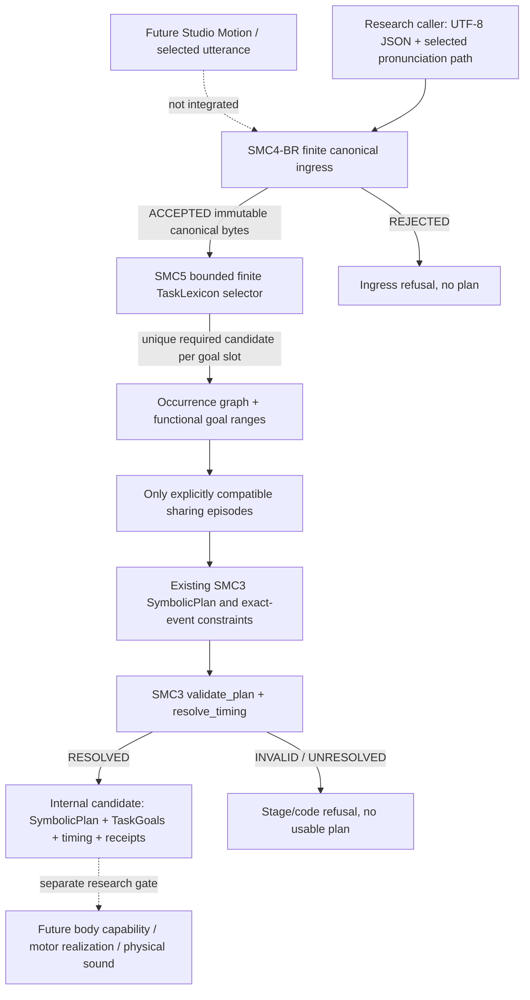

# SMC-5 SYSTEM — research-only compilation boundary

Status 2026-10-26: **SYNTHETIC_CANDIDATE / SCIENCE_NOT_ADOPTED / NO_MAIN_MERGE**. Owner issue #210, stacked Draft PR #211. Frozen protocol: [SMC5_GATE_A_PROTOCOL.md](SMC5_GATE_A_PROTOCOL.md).

## Purpose and boundary

The compiler constructs symbolic *functional* tasks from **caller-supplied** pronunciation hypotheses, not vowel WAVs and not body joint coordinates. All real-body binding remains a separate question. SMC-3 `SymbolicPlan` deliberately lacks concrete TaskGoal target intervals: SMC-5 holds ranges in research-local `TaskGoal` metadata and computes `candidate_digest` from canonical request identity, graph, and goals. The SMC-3 `plan_digest` alone cannot identify differing goal targets.

Only `CanonicalCompileRequest` or bytes admitted by `parse_canonical_request` can enter mapping. `compile_canonical` re-parses and checks the purported immutable snapshot to prevent a caller from hand-constructing a forged digest. `compile_wire` explicitly refuses arbitrary mutable Python graphs.

## Explicit limits

Synthetic `SCALAR_INTERVAL` goal algebra and `EXACT_EVENTS` coordination. Only `SYNTHETIC_ONLY` evidence and null priorities. Predicate `TRUE`/`FALSE`/`EQ`/`NOT`/`AND`/`OR` with Kleene UNKNOWN. No auto text-to-pronunciation, no full production motor score ABI, no data-driven phonetics, no phase oscillator. For each selected unit, one unique matching `EXACT_ONE_SELECTED_UNIT` bundle and >=1 required slot with one unique eligible candidate, or explicit refusal. Shared Task instances require explicit episode ID, distinct unit members, compatible TaskDefinition identities, and intersecting rational goal intervals. Missing timing anchors do not generate fake event times. Duplicate anchors after shares are rejected.

## Evidence classification

- `OBSERVED_IN_PROJECT`: SMC-3 synthetic many-to-many graph and exact rational time validation, SMC4-BR canonical input boundary (Draft #164 / #189).
- `SYNTHETIC_DEFINITION`: SMC-5 bounded TaskGoal selection, scalar goal intervals and explicit shares; not observed human phonetic gestures.
- `HYPOTHESIS_UNVERIFIED`: real linguistic motor task lexicon, cross-body binding, empirical coarticulation and subjective voice quality; not measured here.

Codex AI software review is not independent scientific peer review. Any physics, acoustic, or creator-facing claim requires its own gate.
