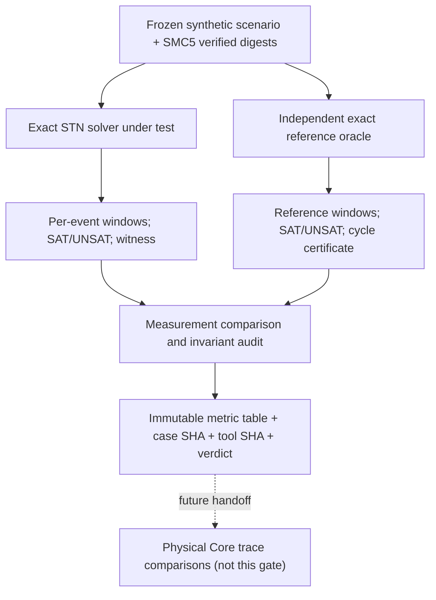

# SMC-6 A0 METROLOGY — scientific measurement specification (design only)

**Status:** PROPOSED_MEASURANDS / NO EXPERIMENT EXECUTED / NOT PHONETICALLY VALIDATED. Owner #219. SMC and Core measurement authorities remain separate.

## 0. Four layers of evidence must not be confused
| Layer | Object under measurement | Origin / reference | Gate now |
| --- | --- | --- | --- |
| L0 formal compiler | hard temporal constraints, graphs, rational outputs, identities | independently solved exact math | YES: plan and prereg only |
| L1 motor-planning empirical | onset coordination for externally documented human/animal speech | e.g. EMA/ultrasound, annotated external corpus with calibration | NO: later |
| L2 body execution | actual actuators, articulators, source and tract in Core | named physical ports, verified body, common clock, conservation | NO: later |
| L3 acoustics & perception | radiated/received signal and listener/creator evaluation | receiver and listening protocol | NO: later |

L0 can establish a *correct program* but cannot establish *naturalness of speech*. Do not make overlap a proxy target for naturalness or infer that a well-formed event is physically achievable.

## 1. L0 measurand catalog
Every numerical sample stores variable definition, unit, frozen case/reference, scenario and chosen schedule identity, exact rational numerator/denominator where applicable, instrument/software version, source SHA, and whether value is observed or predicted.

| ID | Measurand | Mathematical definition | Units | Reference and acceptance |
| --- | --- | --- | --- | --- |
| M01 | temporal feasibility | exact truth of all hard `L≤t_j-t_i≤U` and duration/horizon | Boolean, with UNSAT cycle | independent difference-constraints oracle; exact concordance |
| M02 | hard bound violation for a **witness** | `max(L-(t_j-t_i), 0, (t_j-t_i)-U)` | seconds (Fraction) | **exactly zero** for each hard relation; not merely a tiny floating tolerance |
| M03 | feasible windows | for each event `t_i`, `inf feasible(t_i), sup feasible(t_i)` | seconds (Fraction) | compare to independent all-pairs shortest-path or exhaustive small cases |
| M04 | underdetermination | `width_i=latest_i-earliest_i`; 0 means uniquely pinned event within bounded set | seconds | no "resolved" unique claim if any width nonzero |
| M05 | witness overlap | `O_ij=max(0,min(e_i,e_j)-max(s_i,s_j))` | seconds | independently compute from selected interval endpoints; i≠j task IDs |
| M06 | normalized witness overlap | `O_ij/min(d_i,d_j)` when both durations>0 | dimensionless [0,1] | record denominator and method, never evaluate as naturalness |
| M07 | achievable overlap extrema | `inf_{t in F} O_ij(t), sup_{t in F} O_ij(t)` | seconds | **NOT** derived by independently combining per-event bounds; requires joint optimization or case enumeration |
| M08 | intervention sensitivity | `Δ earliest_i, Δ latest_i, Δ O_ij` after **one specified constraint change** | seconds | compare same Task inventory, identical origin/horizon, pinned scenario revisions |
| M09 | identity and replay | canonical scenario/solution digest invariance under declared unordered-item permutations; changes when semantic constraint changes | digest equality/inequality | exact SHA/bytes, confirmed source and idempotent replay |
| M10 | contradiction certificate | graph negative-cycle edges or independently verified conflicting bound subset | references + Fraction weights | sum of cycle weights < 0, no witness and no false output digest |
| M11 | relative onset fraction (exploratory ONLY) | `r_ij=(s_j-s_i)/(e_i-s_i)` if `d_i>0`; preserve sign, don't mod 1 | dimensionless | diagnostic only; **NOT oscillator phase** |
| M12 | representation leakage | schema/typed-object inventory check for body, organ, actuator, acoustics, neural, waveform and unauthorized field | count | zero prohibited fields; not actual body portability proof |

Task-sharing: a shared SMC5 Task occurrence has a single timing identity. Only distinct `task_id` pairs enter overlap matrix; do not double count the same occurrence because two pronunciation units reference it.

## 2. Instrument, measurement error and uncertainty
- **Exact synthetic math:** Fraction arithmetic is deterministic; uncertainty is **model/constraint specification uncertainty**, not a numerical confidence interval. Do not print invented ±milliseconds or statistical significance. If a solver uses float internally, compare with exact independent oracle and record precision/rounding as numerical error separately.
- **Feasible-set range vs measurement uncertainty:** `[earliest, latest]` is a mathematical solution range, NOT an empirical confidence band.
- **Empirical task timing later:** declare instrument (EMA sample clock etc.), tracked landmark definition, latency/calibration, onset annotation rule, per-speaker/trial uncertainty and annotator agreement *before* measuring natural coarticulation.
- **Physical comparison later:** planned Task activation is NOT measured movement. In Core record desired task command, actual control inputs, actual physical state/contacts, acoustic source/receiver, clock alignment and per-port provenance separately.
- **Perception later:** naturalness, intelligibility, character identity, and artistic utility demand perceptual procedures; no single overlap threshold establishes them.

## 3. Explicit measurement process and traceability

Reference oracle must **not** call the implementation under test or reuse its graph-generation routine; tiny cases are enumerated exactly, and a separate difference-constraints implementation/checker handles larger cases. Dataset/oracle code only after separate test/prereg authorization.

## 4. Baseline reproducible hand-calculation (synthetic, not speech)
- `s1=0`, `e1=3/10s`.
- `9/50≤s2-s1≤11/50s`, `e2-s2=19/100s`.
- Then `O12=e1-s2` on the whole feasible set, so `O12∈[2/25,3/25]s` (80..120ms).
- Witness `s2=9/50s` yields `O12=3/25s`. Alternative permitted witness `s2=11/50s` yields `O12=2/25s`. Reporting 120ms as "the required" overlap is **wrong**.
- Sequential scenario `s2=3/10s` yields zero overlap (different explicit scenario).
- Adding the incompatible hard bound `s2≥7/20s` while preserving the original 9/50..11/50 bound yields UNSAT (negative cycle); reporting a clipped or partial schedule fails.

## 5. Outcome gates and stop rules
- **FORMAL_PASS** requires exact agreement on preregistered SAT, windows (where finite), witness residual=0, invariant digests, deliberate contradictory cases, and independent oracle. Any mismatch is REVISE, no post hoc threshold tuning.
- **INDETERMINATE** when reference/oracle is unavailable; no default successful status or silent fallback.
- **SYNTHETIC_RESEARCH_ONLY** even after FORMAL_PASS; actual phase dynamics, Japanese timing, body feasibility, acoustics and naturalness remain NOT_MEASURED.
- **Safety/epistemic stop:** any pressure/F0/waveform claims, invented naturalness improvement, any temporal override of SMC5 without provenance, or Studio UI/core-contract change requires separate approval.

## Literature / evidence lineage
Dechter, Meiri & Pearl (1991), DOI 10.1016/0004-3702(91)90006-6 (tractable temporal reasoning); Saltzman et al. (2008), ISCA (gestural planning vs execution); Krause & Kawamoto (2020), DOI 10.1111/lnc3.12373 (online feedback/adaptation complicates frozen feedforward gestures).
